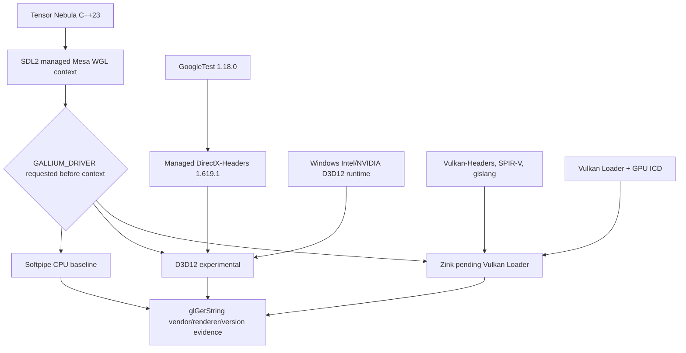

# Mesa 26.2.1: native Gallium backend expansion under BCC64X

**Date:** 22 November 2026. **Status:** source implementation on main, GPU paths [not verified].

## Purpose

Build and validate a single self-managed Mesa Windows WGL runtime which can select CPU Softpipe, GPU D3D12, and eventually GPU Zink/Vulkan. Keep native C++Builder 13 / BCC64X, full upstream test coverage, package ownership, and the known working Softpipe baseline. Tensor Nebula is the consumer-driven integration test; its backend selection is not itself proof of GPU support.

## Managed library inventory

| Library | Version | Existing evidence / role |
| --- | --- | --- |
| opengl | 26.2.1 | Existing Softpipe-only Windows Mesa WGL package; source now requests D3D12 as a second Gallium driver |
| directx-headers | 1.619.1 | Newly declared native BCC64X build and upstream test attempts, package-local pkg-config |
| googletest | 1.18.0 | Reused for the complete DirectX-Headers GoogleTest upstream suite |
| vulkan-headers | 1.4.368 | Existing Vulkan API headers, no Vulkan loader DLL |
| vulkan-memory-allocator | 3.4.0 | Existing Vulkan GPU allocation headers |
| spirv-headers | v1.202609.0 | Existing SPIR-V structures |
| spirv-tools | 2026.4 | Existing SPIR-V validation and tools |
| spirv-cross | vulkan-sdk-1.4.363.0 | Existing SPIR-V translation, used in Skia |
| glslang | 16.6.0 | Existing shader frontend |
| skia | 153 | Its source build already enables Direct3D and Vulkan, but does not prove Mesa D3D12 or Zink |

## The first native D3D12 gate

The modified Mesa declaration requests both `softpipe` and `d3d12` on the original managed Meson 1.12.0/BCC64X pipeline. It sets `PKG_CONFIG_PATH` to the installed, pinned DirectX-Headers 1.619.1 package, preserving the preexisting GLCPP, build, installation, upstream tests, import-library production and package consumer smoke. D3D12 video support is not part of this *OpenGL rendering* experiment. This is a source attempt and has not passed configure, compile, link or runtime acceptance.

The DirectX-Headers package uses the real upstream CMake project and its two testing branches, with a narrow source adapter replacing the original GoogleTest FetchContent live-main checkout by our existing pinned GTest 1.18.0 CMake target. Release and Debug are separate and package-local. The direct consumer compiles and links actual D3D12 structures and helper libraries.

## Zink / Vulkan readiness

Mesa Zink is implemented as a Windows Gallium WGL driver in upstream Mesa, but it cannot be claimed available in our runtime yet. The first missing managed package is **Vulkan Loader 1.4.368**. A Vulkan-Headers CMake adapter and BCC64X consumer smoke have been prepared under `admin/cmake/vulkan-loader` and `admin/smokes/vulkan-loader`. They are not yet wired to `admin/build-libraries.xml`.

The upstream Vulkan Loader test suite requires separate **GoogleTest source** and **Microsoft Detours source**, and the repository currently has no managed Detours library identity. Its native build also needs verification of x64 assembler semantics and generation tools. We must integrate these correctly rather than setting `BUILD_TESTS=OFF`, silently fetching unpinned source, or replacing BCC64X with MSVC.

Other dependencies that may surface during Mesa D3D12 or Zink build include shader compiler/CLC components and native Windows import libraries. These should be identified from the first actual Meson/BCC64X failure rather than guessed as completed dependencies.

## Consumer topology

## Evidence gates

1. DirectX-Headers Release/Debug CMake configure, compile, complete upstream tests, install, public consumer smoke.
2. Mesa Release/Debug Meson configure with `softpipe,d3d12`, compile, complete upstream tests, install both WGL DLLs and run the original OpenGL consumer.
3. Tensor Nebula Softpipe `--verify-gl`; D3D12 GPU `--verify-gl` with explicit adapter preference, actual renderer identification and known CPU fallback rejection. Do not infer GPU choice from a requested string.
4. Only after a fully native Vulkan Loader with its complete upstream tests and managed dependencies is available, enable Zink in Mesa and add separate native GPU verification.

**Current limits:** No local Windows build, GPU vendor/renderer transcript, Mesa Gallium D3D12 shader compilation, Vulkan Loader CTest result or Zink binary has been verified. The fact that a dropdown allows a backend selection is not equivalent to a successfully built driver.