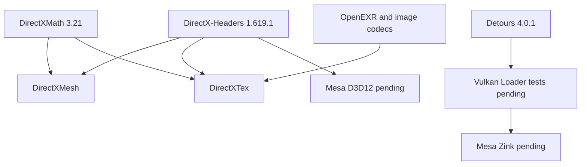

# Microsoft C++ and graphics integration stack — 22 November 2026

[TOC|Content]

**Status: [not verified]** for new package contracts; do not confuse XML registration with a passing BCC64X run.

## First declared source integration wave

| Library | Version | Scope |
| --- | --- | --- |
| Detours | 4.0.1 | Win32 interception DLL and original loader-test source |
| DirectXMath | 3.21 | SIMD and DirectXCollision, header-only |
| DirectXMesh | 1.7.2 | Dynamic mesh-processing library and tools |
| DirectXTex | 2.1.1 | Dynamic texture-processing library, original tools, samples and codec support |

All four use pinned Microsoft source tags, local C++Builder 13 BCC64X toolchains, independent native consumer smokes and versioned package roots. The Detours NMAKE source has a deliberately scoped native CMake DLL adapter; its entire original NMAKE sample suite is not yet ported. The pinned DirectXMath/DirectXMesh/DirectXTex tags have no upstream Tests directory. The independent smoke programs provide native evidence, but **not** upstream suite coverage.

## Additional Microsoft packages

DirectX Shader Compiler (DXC), DirectX Tool Kit 12, and C++/WinRT require separate native build gates. DXC ships a large LLVM-derived HLSL compiler. DirectXTK12 depends on DXC or FXC for generating shaders. C++/WinRT needs its generator, the Microsoft WinMD reader, and installed Windows SDK metadata. DirectStorage is distributed as a Microsoft SDK; the public repository contains sample applications and open GDeflate reference sources, **not** the entire DirectStorage runtime DLL. Declaring a sample checkout cannot establish a native, open-source DirectStorage SDK integration.

Never replace upstream compilation with a precompiled Microsoft binary while claiming BCC64X native success. Preserve test and build features, or explicitly document any remaining technical gate. Installed BCC64X packages are the only permissible build dependencies.

## Package dependency design

**Acceptance:** reproducible source, original CMake/Ninja where possible, BCC64X Release and Debug, native DLL runtime or true header-only ABI, all available upstream tests, package install, independent consumers, licensing, SBOM and final FSM state. Failure must not be hidden by disabling original features.

[Gallium D3D12 and Zink investigation](mesa-gallium-backends-2026-11-22.md).
