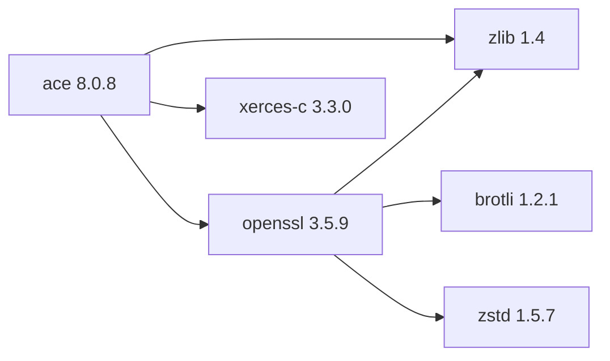

# ACE 8.0.8

[TOC|Content]

## Aktueller BuildEngine-Vertrag (10. November 2026)

**Vertragsdaten, keine bestätigte Build-Ausführung.** Ergebnisse aus früheren Tests sind versions- und buildgebunden; neue Ausführungen bleiben **[nicht verifiziert]**.

Adaptive Communication Environment providing portable networking, concurrency, IPC, and OS abstraction.

**Koordinate:** `ace@8.0.8` · **Kategorie:** `middleware` · **Lizenzampel:** `green`

### Deklarierte Abhängigkeiten (vollständig transitiv)

Die Diagrammkanten stammen aus den exakt gepinnten XML-Abhängigkeiten. Gestrichelte Kanten kennzeichnen Erweiterungen, durchgezogene Kanten Paketabhängigkeiten. Upstream-intern gebündelte Komponenten sind keine zusätzlichen BuildEngine-Koordinaten.

**Direkte Abhängigkeiten:** `openssl@3.5.9`, `xerces-c@3.3.0`, `zlib@1.4`

### Konfiguration und Besonderheiten

**CMake-Argumente:**

- `-D{BMakeConfiguration}`

**Build-Umgebung:**

- `ACE_ROOT={BuildRoot}\packages\{LibraryId}\{LibraryVersion}\{Configuration}\ACE_wrappers`
- `SSL_ROOT={DependencyRoot:openssl}`
- `SSL_INCDIR={DependencyRoot:openssl}\include`
- `SSL_LIBDIR={DependencyRoot:openssl}\lib\win64\{Configuration}`
- `XERCESC_INCDIR={DependencyRoot:xerces-c}\include`
- `XERCESC_LIBDIR={DependencyRoot:xerces-c}\lib\win64\{Configuration}`
- `XERCESLIB={XercesLibrary}`
- `ZLIB_ROOT={DependencyRoot:zlib}`
- `ZLIB_INCDIR={DependencyRoot:zlib}\include`
- `ZLIB_LIBDIR={DependencyRoot:zlib}\lib\win64\{Configuration}`
- `BCC32C=`
- `BCC64=`
- `BCC64X=1`
- `MPC_NUMBER_OF_PROCESSORS={BuildJobs}`
- `CODEGUARD=`
- `UNICODE=`
- `DEBUG={DebugFlag}`
- `RELEASE={ReleaseFlag}`
- `PATH={BuildRoot}\packages\{LibraryId}\{LibraryVersion}\{Configuration}\ACE_wrappers\lib;{BuildRoot}\packages\{LibraryId}\{LibraryVersion}\{Configuration}\ACE_wrappers\bin;{DependencyRoot:openssl}\bin\win64\{Configuration};{DependencyRoot:xerces-c}\bin\win64\{Configuration};{DependencyRoot:zlib}\bin\win64\{Configuration};{ToolDir:perl};{ToolDir:bcc64x};{ToolDir:embarcadero-make};{ENV:PATH}`

**Versionsgebundene Patches:**

- `{Workspace}\.buildengine\patches\{LibraryVersion}\bcc64x-xerces-modern-borland.patch`
- `{Workspace}\.buildengine\patches\{LibraryVersion}\bcc64x-zlib-library-names.patch`
- `{BuildFileDir}\patches\ace-tao\8.0.8\bcc64x-xerces-modern-borland.patch`
- `{BuildFileDir}\patches\ace-tao\8.0.8\bcc64x-zlib-library-names.patch`

**Source-Downloads:**

- `https://github.com/DOCGroup/ACE_TAO/releases/download/ACE%2BTAO-8_0_8/ACE%2BTAO-{LibraryVersion}.zip` (SHA-256: `de45b9e50c29b378d3074f4dc0a5d24e0eaa445b44f39461c447aa83f1cc833a`)

**Explizit geforderte Installationsartefakte:**

- `{InstallRoot}\packages\{LibraryId}\{LibraryVersion}\tools\bin\win64\{Configuration}\ace_gperf.exe`
- `{InstallRoot}\packages\{LibraryId}\{LibraryVersion}\include\ace`
- `{InstallRoot}\packages\{LibraryId}\{LibraryVersion}\include\ace\ACE.h`
- `{InstallRoot}\packages\{LibraryId}\{LibraryVersion}\COPYING`
- `{InstallRoot}\packages\{LibraryId}\{LibraryVersion}\ACE_VERSION.txt`

**Verbindliche Quellen:** `admin/build-libraries.xml` für Konfiguration und Pins; FSM/Buildlogs für tatsächliche Ausführung. [Bibliotheksverzeichnis](/manual/libraries.md).
