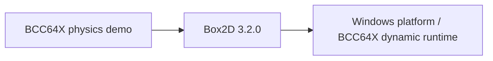

# Box2D 3.2.0: Native BCC64X integration

## 17 November 2026: BCC64X import-library install correction

Both Release and Debug native builds completed successfully. The install phase failed because the initial package gate requested `box2d.lib` / `box2dd.lib`. The target's existing BCC64X Windows-GNU import prefix is `lib` while the DLL name remains prefix-free. The package gate and the standalone `box2d::box2d` imported target now expect `libbox2d.lib` / `libbox2dd.lib` in their respective variant directories. No producer source, compiler rules, build timestamp or other package was modified. **[not verified]** Native installed file inventory and subsequent install/consumer smoke remain pending.

[TOC|Content]

## Purpose and architecture

Box2D provides deterministic 2D rigid-body physics, collision detection, constraints and simulations. Version 3.2.0 natively exposes a C interface; it is consumed unchanged from C++Builder code. No additional backup API or replacement wrapper is introduced.

**BuildEngine coordinate:** `box2d@3.2.0`  
**Source:** `erincatto/box2d`, pinned tag `v3.2.0`  
**License:** MIT (upstream LICENSE)  
**Toolchain:** Embarcadero C++Builder 13 / BCC64X, Win64x, dynamic runtime, Ninja/CMake.

## Build contract

The package uses upstream's own CMake `box2d` target through a small BuildEngine adapter. It selects a shared DLL and disables samples, benchmarks, profiling, and standalone upstream unit tests. The original `BOX2D_DLL` / `box2d_EXPORTS` Windows import/export contract is retained and propagated to consumers.

Debug and Release targets install to distinct directories. The declared library names are `box2d.dll`, `box2dd.dll`, and matching `.lib` imports. A BuildEngine-specific `box2dConfig.cmake` exports `box2d::box2d` with both configurations. The independent consumer smoke retrieves the library version and creates/destroys a simulation world.

## Dependency diagram

## Evidence

The upstream release, CMake shared target and exported DLL macros were inspected. **[not verified]** Native BCC64X Release/Debug compilation, DLL/import name, install gates, simulation smoke and runtime imports are pending. Existing build packages are not modified.
