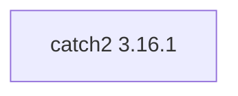

## Updated BuildEngine contract (10 November 2026)

**Declared configuration, not a new test PASS.**

### Complete transitive dependencies

Direct: none

### Current configuration

- `-DCMAKE_TOOLCHAIN_FILE:FILEPATH={BuildFileDir}\cmake\toolchains\bcc64x-buildengine-cxx.cmake`
- `-DCMAKE_MAKE_PROGRAM:FILEPATH={Tool:ninja}`
- `-DCMAKE_INSTALL_PREFIX:PATH={InstallRoot}\packages\{LibraryId}\{LibraryVersion}`
- `-DCMAKE_INSTALL_INCLUDEDIR:STRING=include`
- `-DBUILD_SHARED_LIBS:BOOL=OFF`
- `-DCMAKE_CXX_FLAGS:STRING=-DCATCH_CONFIG_NO_POLYFILL_ISNAN -fborland-exec-code-page=65001`
- `-DCATCH_DEVELOPMENT_BUILD:BOOL={TestsEnabled}`
- `-DCATCH_BUILD_TESTING:BOOL={TestsEnabled}`
- `-DBUILD_TESTING:BOOL={TestsEnabled}`
- `-DCATCH_ENABLE_WERROR:BOOL=OFF`
- `-DCATCH_BUILD_EXAMPLES:BOOL=OFF`
- `-DCATCH_BUILD_EXTRA_TESTS:BOOL=OFF`
- `-DCATCH_BUILD_FUZZERS:BOOL=OFF`
- `-DCATCH_BUILD_BENCHMARKS:BOOL=OFF`
- `-DCATCH_ENABLE_CONFIGURE_TESTS:BOOL=OFF`
- `-DCATCH_ENABLE_CMAKE_HELPER_TESTS:BOOL=OFF`
- `-DCATCH_ENABLE_REPRODUCIBLE_BUILD:BOOL=ON`
- `-DCATCH_INSTALL_DOCS:BOOL=OFF`
- `-DCATCH_INSTALL_EXTRAS:BOOL=ON`
- `-DPython3_EXECUTABLE:FILEPATH={Tool:python}`
- `-DCMAKE_CXX_STANDARD:STRING=23`
- `-DCMAKE_CXX_STANDARD_REQUIRED:BOOL=ON`
- `-DCMAKE_CXX_EXTENSIONS:BOOL=OFF`
- `-DCMAKE_BUILD_TYPE:STRING=Release`
- `-DCMAKE_CXX_FLAGS_RELEASE:STRING=-O2 -DNDEBUG`
- `-DCMAKE_INSTALL_LIBDIR:STRING=lib/win64/Release`
- `-DCMAKE_INSTALL_BINDIR:STRING=bin/win64/Release`
- `-DCMAKE_BUILD_TYPE:STRING=Debug`
- `-DCMAKE_CXX_FLAGS_DEBUG:STRING=-O0`
- `-DCMAKE_INSTALL_LIBDIR:STRING=lib/win64/Debug`
- `-DCMAKE_INSTALL_BINDIR:STRING=bin/win64/Debug`
- `-DCatch2_DIR:PATH={ConsumerRoot}\lib\win64\{Configuration}\cmake\Catch2`
- `-DCatch2_DIR:PATH={ConsumerRoot}\lib\win64\{Configuration}\cmake\Catch2`

---

## Historical integration notes

# Catch2 3.16.1

[TOC|Content]

## Current BuildEngine contract (10 November 2026)

**Declared contract data, not verified build execution.** Previous results belong to their exact versions and binaries; new runs remain **[not verified]**.

Modern C++ testing framework for unit tests, assertions, and test discovery.

**Coordinate:** `catch2@3.16.1` · **Category:** `testing` · **License indicator:** `green`

### Declared dependencies (complete transitive closure)

Graph edges are derived from exactly pinned XML dependencies. Dashed edges represent extensions; solid edges represent package dependencies. Internally bundled upstream components are not additional BuildEngine package coordinates.

**Direct dependencies:** None declared.

### Configuration and integration notes

**CMake arguments:**

- `-DCMAKE_TOOLCHAIN_FILE:FILEPATH={BuildFileDir}\cmake\toolchains\bcc64x-buildengine-cxx.cmake`
- `-DCMAKE_MAKE_PROGRAM:FILEPATH={Tool:ninja}`
- `-DCMAKE_INSTALL_PREFIX:PATH={InstallRoot}\packages\{LibraryId}\{LibraryVersion}`
- `-DCMAKE_INSTALL_INCLUDEDIR:STRING=include`
- `-DBUILD_SHARED_LIBS:BOOL=OFF`
- `-DCMAKE_CXX_FLAGS:STRING=-DCATCH_CONFIG_NO_POLYFILL_ISNAN -fborland-exec-code-page=65001`
- `-DCATCH_DEVELOPMENT_BUILD:BOOL={TestsEnabled}`
- `-DCATCH_BUILD_TESTING:BOOL={TestsEnabled}`
- `-DBUILD_TESTING:BOOL={TestsEnabled}`
- `-DCATCH_ENABLE_WERROR:BOOL=OFF`
- `-DCATCH_BUILD_EXAMPLES:BOOL=OFF`
- `-DCATCH_BUILD_EXTRA_TESTS:BOOL=OFF`
- `-DCATCH_BUILD_FUZZERS:BOOL=OFF`
- `-DCATCH_BUILD_BENCHMARKS:BOOL=OFF`
- `-DCATCH_ENABLE_CONFIGURE_TESTS:BOOL=OFF`
- `-DCATCH_ENABLE_CMAKE_HELPER_TESTS:BOOL=OFF`
- `-DCATCH_ENABLE_REPRODUCIBLE_BUILD:BOOL=ON`
- `-DCATCH_INSTALL_DOCS:BOOL=OFF`
- `-DCATCH_INSTALL_EXTRAS:BOOL=ON`
- `-DPython3_EXECUTABLE:FILEPATH={Tool:python}`
- `-DCMAKE_CXX_STANDARD:STRING=23`
- `-DCMAKE_CXX_STANDARD_REQUIRED:BOOL=ON`
- `-DCMAKE_CXX_EXTENSIONS:BOOL=OFF`
- `-DCMAKE_BUILD_TYPE:STRING=Release`
- `-DCMAKE_CXX_FLAGS_RELEASE:STRING=-O2 -DNDEBUG`
- `-DCMAKE_INSTALL_LIBDIR:STRING=lib/win64/Release`
- `-DCMAKE_INSTALL_BINDIR:STRING=bin/win64/Release`
- `-DCMAKE_BUILD_TYPE:STRING=Debug`
- `-DCMAKE_CXX_FLAGS_DEBUG:STRING=-O0`
- `-DCMAKE_INSTALL_LIBDIR:STRING=lib/win64/Debug`
- `-DCMAKE_INSTALL_BINDIR:STRING=bin/win64/Debug`

**Build-Umgebung:**

- `CB_BCC64X={Tool:bcc64x}`
- `CB_BDS={BDS}`
- `CTEST_PARALLEL_LEVEL={TestJobs}`
- `PATH={ToolDir:python};{ToolDir:ninja};{ENV:PATH}`

**Source-Downloads:**

- `https://github.com/catchorg/Catch2/archive/refs/tags/v3.16.1.zip`

**Deklarierte Smoke-Tests:**

- `consumer` / `Release` / `package` / `smokes\catch2\consumer`
- `consumer` / `Debug` / `package` / `smokes\catch2\consumer`

**Explizit geforderte Installationsartefakte:**

- `{InstallRoot}\packages\{LibraryId}\{LibraryVersion}\include\catch2\catch_all.hpp`
- `{InstallRoot}\packages\{LibraryId}\{LibraryVersion}\include\catch2\catch_test_macros.hpp`
- `{InstallRoot}\packages\{LibraryId}\{LibraryVersion}\include\catch2\catch_template_test_macros.hpp`
- `{InstallRoot}\packages\{LibraryId}\{LibraryVersion}\lib\win64\{Configuration}`
- `{InstallRoot}\packages\{LibraryId}\{LibraryVersion}\lib\win64\{Configuration}\cmake\Catch2\Catch2Config.cmake`
- `{InstallRoot}\packages\{LibraryId}\{LibraryVersion}\lib\win64\{Configuration}\cmake\Catch2\Catch2ConfigVersion.cmake`
- `{InstallRoot}\packages\{LibraryId}\{LibraryVersion}\lib\win64\{Configuration}\cmake\Catch2\Catch2Targets.cmake`
- `{InstallRoot}\packages\{LibraryId}\{LibraryVersion}\licenses\catch2\LICENSE.txt`

**Verbindliche Quellen:** `admin/build-libraries.xml` für Konfiguration und Pins; FSM/Buildlogs für tatsächliche Ausführung. [Bibliotheksverzeichnis](/manual/libraries.md).
