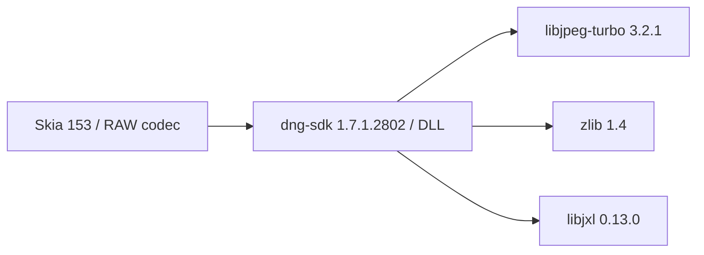

# Adobe DNG SDK 1.7.1 Build 2802: independent BuildEngine producer

## Metadata updater XMP-disabled build fix (16 November 2026)

The next BCC64X Debug/Release compile failed in `dng_update_meta.cpp:3028`, where `CleanUpMetadataForUpdate` calls `dng_metadata::GetXMP()`. A second unguarded XMP update branch appears later in the same translation unit at approximately line 3236. Both refer to functionality omitted by the explicitly configured `qDNGUseXMP=0`.

The version-pinned `xmp-disabled-update-meta.patch` now guards both XMP-only branches. Existing IPTC, EXIF, GPS, and big-table processing remains compiled. The source FSM checks, applies, and reverse-checks the patch, and the DNG logical timestamp is advanced to `2026-11-16T13:04:00Z`.

**Architecture qualification:** this patch is consistent with the current intentionally reduced producer, but repeated XMP guards indicate a broader source-level feature assumption. Restoring full XMP functionality instead requires a managed XMP Toolkit dependency and a distinct integration decision; no such work is claimed here.

**[not verified]** Native Debug and Release build, install, package consumer smoke, and Skia integration still require execution on the Windows host.

## BCC64X Clang / native timespec compatibility (16 November 2026)

The next native Debug and Release builds failed in `dng_pthread.cpp`, where BCC64X's Clang/MinGW-compatible `sys/timeb.h` redeclared `dng_timespec`. Adobe's Windows pthread compatibility header unconditionally creates its own `struct dng_timespec` and, for the historical `_MSC_VER < 1900` branch, globally defines `timespec` as `dng_timespec`. BCC64X is Clang, not an old MSVC compiler: the macro therefore rewrites unrelated `timespec` declarations later encountered in the compiler-provided C headers.

The versioned `clang-native-timespec.patch` explicitly includes `<time.h>` in Adobe's Windows pthread compatibility header, leaves the native `timespec` identifier intact when `__clang__` is defined, and uses Adobe's already-existing native-to-`dng_timespec` conversion paths in `dng_pthread.cpp` and `dng_mutex.cpp` for Clang. The separate `dng_timespec` interface is retained. This is a source compatibility correction, not a global compiler macro, alternate MinGW toolchain, modified vendor header, or new runtime dependency.

The source FSM performs the customary patch check, apply and reverse-check stages. The DNG logical timestamp was advanced to `2026-11-16T13:03:00Z`. **[not verified]** The Windows native Debug/Release builds, installation and consumer smoke need execution; success is not inferred from the committed patch.

## Semantic-mask preview RAII correction (16 November 2026)

The subsequent BCC64X Debug and Release builds reached `dng_preview.cpp` and failed inside the standard `unique_ptr` deleter because `tag_string` was incomplete. The upstream `dng_semantic_mask_preview` header owns `std::unique_ptr<tag_string>` and `std::unique_ptr<tag_uint32_ptr>` while declaring only forward references. Its constructor was inline and the destructor implicitly generated. Compiling the constructor's exception-cleanup and implicit destructor can instantiate the deleter at a location where these types are incomplete.

The pinned `semantic-mask-unique-ptr-lifetime.patch` moves the constructor implementation into `dng_preview.cpp` and explicitly declares/defines the destructor there; the implementation source has the complete tag definitions. No ownership semantics or standard-library implementation are changed. The source FSM now applies this patch using explicit precheck, application and reverse-check actions. The logical timestamp was advanced.

**XMP scope decision:** The separate XMP disablement is a deliberate integration policy, not a BCC64X type-system defect. The CMake adapter defines `qDNGUseXMP=0`, omits the separate Adobe XMP Toolkit integration, and leaves JPEG XL enabled. That reduced feature scope led to the earlier JXL XMP-only source guards. Full XMP support would require an explicit, licensed Adobe XMP Toolkit producer and additional dependency/ABI validation; it should not be restored with a standalone `-DqDNGUseXMP=1` flag.

**[not verified]** The updated Windows native build/install, consumer smoke, and Skia RAW decode have not been executed or observed.

## JXL decoder XMP-disabled correction (16 November 2026)

The subsequent native Debug and Release build both reported `dng_jxl.cpp:3880: variable has incomplete type 'dng_xmp'`. The pinned DNG SDK source's `ProcessXMPBox()` instantiates `dng_xmp` even though the native producer intentionally defines `qDNGUseXMP=0`. The versioned `xmp-disabled-jxl.patch` now also guards the decoder's XMP parsing block with `#if qDNGUseXMP`, in addition to the existing XMP encoder guard. EXIF, IPTC and the JPEG XL codec remain enabled, and XMP support remains explicitly disabled. The existing patch hunk header was corrected to match its actual line counts, and the logical DNG library timestamp was advanced to trigger source/build reevaluation.

The patch's source contexts have been checked against the exact pinned upstream `3a31897afe53aad5f15854eba0f04bab77cc4f82` revision. **[not verified]** Native `git apply`, BCC64X Debug/Release compilation, binary packaging, consumer smoke and Skia 153 integration must still be executed on the Windows build host. No successful build is claimed here.
## JXL / disabled XMP compile correction (16 November 2026)

The operator's subsequent native DNG compilation reached `dng_jxl.cpp:1540` and reported `no member named 'GetXMP' in 'dng_metadata'`. This is a source configuration mismatch: the producer deliberately defines `qDNGUseXMP=0`, but the pinned Adobe JXL encoder source refers to `dng_metadata::GetXMP()` twice without a preprocessing guard.

A version-pinned `xmp-disabled-jxl.patch` now wraps only the JXL XMP metadata encoding branch in `#if qDNGUseXMP` / `#endif`. EXIF, IPTC and general JPEG XL encode/decode remain enabled. The source workflow performs standard `git apply --check`, apply, and reverse-check, and the DNG logical source timestamp is advanced. No XMP Toolkit is added and no compiler or ABI setting is changed.

**[not verified]** The next native Release/Debug build and the installed DNG/JXL functional consumer have not yet been observed.

## CMake C++23 module-scanning failure (16 November 2026)

The native Release and Debug builds reached CMake's `dng_globals.cpp.o.ddi` dependency-scanning step, which failed while processing the BCC64X-provided compatibility header `_mingw.h` because it could not find `sdks/_mingw_ddk.h`. This is **not evidence that a different compiler was selected**: the established BCC64X toolchain includes MinGW-derived compatibility headers. The DNG producer consists of conventional C++ translation units and does not use C++ modules, so the target now explicitly sets `CXX_SCAN_FOR_MODULES OFF`. No MinGW compiler, alternate ABI, global toolchain flag or header-directory workaround was introduced. The logical library timestamp was updated to force reevaluation.

**[not verified]** The new BCC64X build has not been executed. If the missing header also appears during regular compilation, the missing header/include relationship must be investigated with the new command/log; module scanning is only one trigger.

## JPEG import-library configure repair (16 November 2026)

The first supplied native Debug configure log failed at `CMakeLists.txt:95 (find_library)` because the adapter searched `jpeg` and `libjpeg`, while BuildEngine's established libjpeg-turbo 3.2.1 package names the exact import libraries `libjpeg.lib` (Release) and `libjpegd.lib` (Debug). The corresponding zlib variant names are `libz.lib` and `libzd.lib`. The adapter now selects the exact installed variant paths and checks their existence before linking, without searching an unrelated system installation. The DNG source scope timestamp has been advanced to reprocess the corrected adapter.

**[not verified]** The next configure and build have not been observed; the first supplied configure failed before any compilation.

[TOC|Content]

## Integration and ownership

This is a new, **independent BuildEngine library** for the Adobe Digital Negative (DNG) SDK, identified by `dng-sdk@1.7.1.2802`. The intent is to replace Skia 153's old, embedded Android DNG SDK code with a managed native DLL and matching import library, while retaining Skia's RAW/DNG decoder.

**Status (16 November 2026): declared; native BCC64X build, installed outputs and Skia decode consumer are [not verified].** The prior Skia builds failed on `std::auto_ptr` in the older bundled `dng_pthread.cpp`. Do not interpret the new integration as a successful native port before matching execution evidence.

## Source provenance and license

- Adobe DNG SDK version: **1.7.1, Build 2802**, confirmed by the upstream `dng_flags.h` version macros in the selected source.
- Pinned revision-preserving source mirror: [hfiguiere/dng_sdk](https://github.com/hfiguiere/dng_sdk), commit `3a31897afe53aad5f15854eba0f04bab77cc4f82`.
- Source archive: `https://github.com/hfiguiere/dng_sdk/archive/3a31897afe53aad5f15854eba0f04bab77cc4f82.tar.gz`.
- Original Adobe license: `LICENSE.txt` in the source mirror, installed as `licenses/dng-sdk/LICENSE.txt`. The license is **not an OSI-approved open-source license**; it includes separate distribution and indemnification terms. The declarative license signal is yellow, not green.
- The source mirror's Meson build is Linux-oriented and produces a static library. BuildEngine supplies a version-specific Windows CMake adapter; the upstream Meson build is **not** treated as a proven BCC64X DLL build.

The GitHub mirror is not an Adobe-controlled repository. The revision is pinned to avoid moving-branch downloads; the license and vendor authenticity of a future release should be reviewed independently.

## Native producer contract

The BuildEngine CMake adapter is located at `admin/cmake/adapters/dng-sdk/CMakeLists.txt`. Its source list is curated from the pinned 1.7.1.2802 DNG Meson producer. It builds a **shared** `dng_sdk` library under the existing BCC64X CMake/Ninja rules, using the dynamic C++ runtime, with exact Release/Debug output destinations.

### Direct dependencies

- `zlib@1.4`
- `libjpeg-turbo@3.2.1`
- `libjxl@0.13.0`

These are declared through versioned BuildEngine coordinates. The adapter resolves installed variant-specific import libraries, rather than compiling privately bundled copies. XMP is deliberately disabled in this first RAW decoder producer; its separate XMP Toolkit subtree is not built. JPEG XL sources remain enabled and use the managed JPEG XL producer. The adapter explicitly excludes `dng_xmp_sdk.cpp` because that file unconditionally imports the XMP Toolkit even when XMP support is disabled.

Required per-variant artifacts:

```text
include/dng_sdk/source/dng_host.h
lib/win64/{Configuration}/dng_sdk.lib
bin/win64/{Configuration}/dng_sdk.dll
licenses/dng-sdk/LICENSE.txt
```

All paths are relative to the versioned package root. Output and import-library names are explicitly pinned to avoid the earlier Windows naming mismatch seen in other BCC64X packages.

## Skia 153 external consumer

The version-specific GN patch `bcc64x-system-dng-sdk.patch` changes `third_party/dng_sdk/BUILD.gn` to select a `system("dng_sdk")` group instead of a source-building `third_party("dng_sdk")` target when `skia_use_system_dng_sdk=true`.

BuildEngine passes the managed header root and import library through `CB_SKIA_DNG_SDK_INCLUDE` and `CB_SKIA_DNG_SDK_LIB`, and adds the package DLL directory to each applicable runtime `PATH`. `skia_use_dng_sdk=true` remains enabled. The public compile definitions align the SDK layout between DLL and consumer, and set `SK_DNG_VERSION=0x01070100` for Skia's version-dependent RAW code.

The old Skia-side DNG Gitiles archive, extraction and obsolete pthread patch are removed from its active source workflow. The GN upstream fallback remains inside the patch for reference, but is not selected by the declared configuration. Skia's SBOM manifest now reports DNG SDK as external.



## Installed DLL consumer smoke

The declarative package contract includes `smokes/dng-sdk/consumer` with `scope="package"`. This C++23 smoke uses the managed Release package, compiles against the installed `dng_host.h`, links to `dng_sdk.lib`, constructs a `dng_host` and executes `PerformAreaTaskThreads()` through the DLL. This tests the binary import boundary beyond the mere existence of the files. A separate RAW/DNG image decode consumer remains necessary for functional acceptance.

## Verification gate

The following checks must all pass before calling this migration complete: native Release and Debug configuration/build/install; exact DLL/import library and exported-symbol checks; GN generation proving the bundled `dng_pthread.cpp` is **not** in Skia's compilation graph; Skia Release and Debug link; PE DLL dependency closure; and a real RAW/DNG decode consumer test.

**[not verified]** None of those post-migration native Windows results has yet been supplied. Compiler, upstream-API, symbol-export and ABI issues uncovered during the first native attempt must be corrected at the producing layer, not hidden by re-enabling embedded DNG sources.

[Skia 153 integration](/package/skia/153/migration) · [Library catalog](/manual/libraries.md) · [Skia externalization](/manual/skia-externalization.md)
