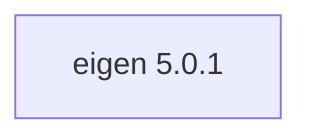

## Aktualisierter BuildEngine-Vertrag (10. November 2026)

**Deklarierte Konfiguration, nicht neuer Test-PASS.**

### Vollständige transitive Abhängigkeiten

Direkt: keine

### Aktuelle Konfiguration

- `-DEIGEN_PACKAGE_ROOT:PATH={InstallRoot}\packages\{LibraryId}\{LibraryVersion}`

---

## Historische Integrationsnotizen

# Eigen 5.0.1

[TOC|Content]

## Aufgabe und Integration

Header-only C++ matrix, geometry and sparse linear algebra templates. No DLL or import archive.

**Stand:** BuildEngine-XML-Vertrag vom 10. November 2026; native Builds und Smoke-Ergebnisse **[nicht verifiziert]**.

## Abhängigkeiten einschließlich transitiver Stufen

**Direkte Abhängigkeiten:** keine

## Konfiguration

### CMake

- `-DEIGEN_PACKAGE_ROOT:PATH={InstallRoot}\packages\{LibraryId}\{LibraryVersion}`

### Build-Umgebung

- `CB_BCC64X={Tool:bcc64x}`
- `CB_BDS={BDS}`

### Quellen

- `https://gitlab.com/libeigen/eigen/-/archive/5.0.1/eigen-5.0.1.tar.gz`

### Consumer-Smoke

- `consumer / Release / package`

## Besonderheiten

Versionierte Quell- und Build-Aktionen sowie eventuell erforderliche BCC64X-Patches sind im ausführbaren `admin/build-libraries.xml` dokumentiert. Eingetragene Fixes sind ohne FSM-Nachweis kein Test-PASS.

[Bibliotheksübersicht](/manual/libraries.md)
