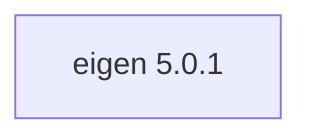

## Updated BuildEngine contract (10 November 2026)

**Declared configuration, not a new test PASS.**

### Complete transitive dependencies

Direct: none

### Current configuration

- `-DEIGEN_PACKAGE_ROOT:PATH={InstallRoot}\packages\{LibraryId}\{LibraryVersion}`

---

## Historical integration notes

# Eigen 5.0.1

[TOC|Content]

## Purpose and integration

Header-only C++ matrix, geometry and sparse linear algebra templates. No DLL or import archive.

**Status:** BuildEngine XML contract dated 10 November 2026; native builds and smoke results **[not verified]**.

## Dependencies including transitive levels

**Direct dependencies:** none

## Configuration

### CMake

- `-DEIGEN_PACKAGE_ROOT:PATH={InstallRoot}\packages\{LibraryId}\{LibraryVersion}`

### Build environment

- `CB_BCC64X={Tool:bcc64x}`
- `CB_BDS={BDS}`

### Sources

- `https://gitlab.com/libeigen/eigen/-/archive/5.0.1/eigen-5.0.1.tar.gz`

### Consumer-Smoke

- `consumer / Release / package`

## Special considerations

Versioned source/build actions and required BCC64X patches are defined in executable `admin/build-libraries.xml`. A registered fix is not a test PASS without matching FSM evidence.

[Library overview](/manual/libraries.md)
