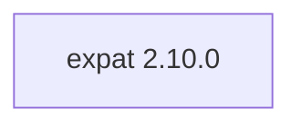

# Expat 2.10.0

[TOC|Content]

## Aufgabe und Integration

Streaming XML parser used as a native dependency by TECkit SFconv and other XML-consuming components.

**Stand:** BuildEngine-XML-Vertrag vom 10. November 2026; native Builds und Smoke-Ergebnisse **[nicht verifiziert]**.

## Abhängigkeiten einschließlich transitiver Stufen

**Direkte Abhängigkeiten:** keine

## Konfiguration

### CMake

- `-DCMAKE_TOOLCHAIN_FILE:FILEPATH={BuildFileDir}\cmake\toolchains\bcc64x-buildengine-cxx.cmake`
- `-DCMAKE_MAKE_PROGRAM:FILEPATH={Tool:ninja}`
- `-DCMAKE_INSTALL_PREFIX:PATH={InstallRoot}\packages\{LibraryId}\{LibraryVersion}`
- `-DCMAKE_INSTALL_INCLUDEDIR:STRING=include`
- `-DEXPAT_SHARED_LIBS:BOOL=ON`
- `-DEXPAT_BUILD_TESTS:BOOL={TestsEnabled}`
- `-DEXPAT_BUILD_TOOLS:BOOL=ON`
- `-DEXPAT_BUILD_EXAMPLES:BOOL=ON`
- `-DEXPAT_BUILD_DOCS:BOOL=OFF`
- `-DEXPAT_BUILD_PKGCONFIG:BOOL=ON`
- `-DEXPAT_BUILD_FUZZERS:BOOL=OFF`
- `-DEXPAT_ENABLE_INSTALL:BOOL=ON`
- `-DEXPAT_WARNINGS_AS_ERRORS:BOOL=OFF`
- `-DCMAKE_BUILD_TYPE:STRING=Release`
- `-DCMAKE_C_FLAGS_RELEASE:STRING=-O2 -DNDEBUG`
- `-DCMAKE_INSTALL_LIBDIR:STRING=lib/win64/Release`
- `-DCMAKE_INSTALL_BINDIR:STRING=bin/win64/Release`
- `-DCMAKE_BUILD_TYPE:STRING=Debug`
- `-DCMAKE_C_FLAGS_DEBUG:STRING=-O0`
- `-DCMAKE_INSTALL_LIBDIR:STRING=lib/win64/Debug`
- `-DCMAKE_INSTALL_BINDIR:STRING=bin/win64/Debug`

### Build-Umgebung

- `CB_BCC64X={Tool:bcc64x}`
- `CB_BDS={BDS}`
- `CTEST_PARALLEL_LEVEL={TestJobs}`
- `CB_BCC64X={Tool:bcc64x}`
- `CB_BDS={BDS}`

### Quellen

- `https://github.com/libexpat/libexpat/releases/download/R_2_10_0/expat-{LibraryVersion}.tar.xz`

### Consumer-Smoke

- `consumer / Release / published`

## Besonderheiten

Versionierte Quell- und Build-Aktionen sowie eventuell erforderliche BCC64X-Patches sind im ausführbaren `admin/build-libraries.xml` dokumentiert. Eingetragene Fixes sind ohne FSM-Nachweis kein Test-PASS.

[Bibliotheksübersicht](/manual/libraries.md)
