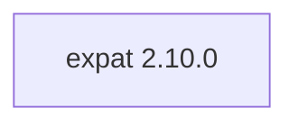

## Updated BuildEngine contract (10 November 2026)

**Declared configuration, not a new test PASS.**

### Complete transitive dependencies

Direct: none

### Current configuration

- `-DCMAKE_TOOLCHAIN_FILE:FILEPATH={BuildFileDir}\cmake\toolchains\bcc64x-buildengine-cxx.cmake`
- `-DCMAKE_MAKE_PROGRAM:FILEPATH={Tool:ninja}`
- `-DCMAKE_INSTALL_PREFIX:PATH={InstallRoot}\packages\{LibraryId}\{LibraryVersion}`
- `-DCMAKE_INSTALL_INCLUDEDIR:STRING=include`
- `-DEXPAT_SHARED_LIBS:BOOL=ON`
- `-DEXPAT_BUILD_TESTS:BOOL={TestsEnabled}`
- `-DEXPAT_BUILD_TOOLS:BOOL=ON`
- `-DEXPAT_BUILD_EXAMPLES:BOOL=ON`
- `-DEXPAT_BUILD_DOCS:BOOL=OFF`
- `-DEXPAT_BUILD_PKGCONFIG:BOOL=ON`
- `-DEXPAT_BUILD_FUZZERS:BOOL=OFF`
- `-DEXPAT_ENABLE_INSTALL:BOOL=ON`
- `-DEXPAT_WARNINGS_AS_ERRORS:BOOL=OFF`
- `-DCMAKE_BUILD_TYPE:STRING=Release`
- `-DCMAKE_C_FLAGS_RELEASE:STRING=-O2 -DNDEBUG`
- `-DCMAKE_INSTALL_LIBDIR:STRING=lib/win64/Release`
- `-DCMAKE_INSTALL_BINDIR:STRING=bin/win64/Release`
- `-DCMAKE_BUILD_TYPE:STRING=Debug`
- `-DCMAKE_C_FLAGS_DEBUG:STRING=-O0`
- `-DCMAKE_INSTALL_LIBDIR:STRING=lib/win64/Debug`
- `-DCMAKE_INSTALL_BINDIR:STRING=bin/win64/Debug`

---

## Historical integration notes

# Expat 2.10.0

[TOC|Content]

## Purpose and integration

Streaming XML parser used as a native dependency by TECkit SFconv and other XML-consuming components.

**Status:** BuildEngine XML contract dated 10 November 2026; native builds and smoke results **[not verified]**.

## Dependencies including transitive levels

**Direct dependencies:** none

## Configuration

### CMake

- `-DCMAKE_TOOLCHAIN_FILE:FILEPATH={BuildFileDir}\cmake\toolchains\bcc64x-buildengine-cxx.cmake`
- `-DCMAKE_MAKE_PROGRAM:FILEPATH={Tool:ninja}`
- `-DCMAKE_INSTALL_PREFIX:PATH={InstallRoot}\packages\{LibraryId}\{LibraryVersion}`
- `-DCMAKE_INSTALL_INCLUDEDIR:STRING=include`
- `-DEXPAT_SHARED_LIBS:BOOL=ON`
- `-DEXPAT_BUILD_TESTS:BOOL={TestsEnabled}`
- `-DEXPAT_BUILD_TOOLS:BOOL=ON`
- `-DEXPAT_BUILD_EXAMPLES:BOOL=ON`
- `-DEXPAT_BUILD_DOCS:BOOL=OFF`
- `-DEXPAT_BUILD_PKGCONFIG:BOOL=ON`
- `-DEXPAT_BUILD_FUZZERS:BOOL=OFF`
- `-DEXPAT_ENABLE_INSTALL:BOOL=ON`
- `-DEXPAT_WARNINGS_AS_ERRORS:BOOL=OFF`
- `-DCMAKE_BUILD_TYPE:STRING=Release`
- `-DCMAKE_C_FLAGS_RELEASE:STRING=-O2 -DNDEBUG`
- `-DCMAKE_INSTALL_LIBDIR:STRING=lib/win64/Release`
- `-DCMAKE_INSTALL_BINDIR:STRING=bin/win64/Release`
- `-DCMAKE_BUILD_TYPE:STRING=Debug`
- `-DCMAKE_C_FLAGS_DEBUG:STRING=-O0`
- `-DCMAKE_INSTALL_LIBDIR:STRING=lib/win64/Debug`
- `-DCMAKE_INSTALL_BINDIR:STRING=bin/win64/Debug`

### Build environment

- `CB_BCC64X={Tool:bcc64x}`
- `CB_BDS={BDS}`
- `CTEST_PARALLEL_LEVEL={TestJobs}`
- `CB_BCC64X={Tool:bcc64x}`
- `CB_BDS={BDS}`

### Sources

- `https://github.com/libexpat/libexpat/releases/download/R_2_10_0/expat-{LibraryVersion}.tar.xz`

### Consumer-Smoke

- `consumer / Release / published`

## Special considerations

Versioned source/build actions and required BCC64X patches are defined in executable `admin/build-libraries.xml`. A registered fix is not a test PASS without matching FSM evidence.

[Library overview](/manual/libraries.md)
