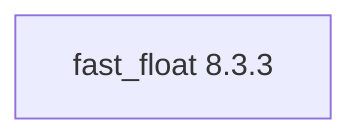

# fast_float 8.3.3

[TOC|Content]

## Aufgabe und Integration

High-performance C++ floating-point parser

**Stand:** BuildEngine-XML-Vertrag vom 10. November 2026; native Builds und Smoke-Ergebnisse **[nicht verifiziert]**.

## Abhängigkeiten einschließlich transitiver Stufen

**Direkte Abhängigkeiten:** keine

## Konfiguration

### CMake

- `-DCMAKE_TOOLCHAIN_FILE:FILEPATH={BuildFileDir}\cmake\toolchains\bcc64x-buildengine-cxx.cmake`
- `-DCMAKE_MAKE_PROGRAM:FILEPATH={Tool:ninja}`
- `-DCMAKE_INSTALL_PREFIX:PATH={InstallRoot}\packages\{LibraryId}\{LibraryVersion}`
- `-DCMAKE_INSTALL_INCLUDEDIR:STRING=include`
- `-DFASTFLOAT_TEST:BOOL=OFF`
- `-DFASTFLOAT_BENCHMARKS:BOOL=OFF`
- `-DFASTFLOAT_INSTALL:BOOL=ON`
- `-DFASTFLOAT_SANITIZE:BOOL=OFF`
- `-DCMAKE_BUILD_TYPE:STRING=Release`
- `-DCMAKE_INSTALL_LIBDIR:STRING=lib/win64/Release`
- `-DCMAKE_INSTALL_BINDIR:STRING=bin/win64/Release`
- `-DCMAKE_INSTALL_DATAROOTDIR:STRING=lib/win64/Release`
- `-DCMAKE_BUILD_TYPE:STRING=Debug`
- `-DCMAKE_INSTALL_LIBDIR:STRING=lib/win64/Debug`
- `-DCMAKE_INSTALL_BINDIR:STRING=bin/win64/Debug`
- `-DCMAKE_INSTALL_DATAROOTDIR:STRING=lib/win64/Debug`
- `-DFastFloat_DIR:PATH={InstallRoot}\packages\{LibraryId}\{LibraryVersion}\lib\win64\Release\cmake\FastFloat`

### Build-Umgebung

- `CB_BCC64X={Tool:bcc64x}`
- `CB_BDS={BDS}`
- `CB_LLVM_AR={Tool:llvm-ar}`
- `CB_BCC64X={Tool:bcc64x}`
- `CB_BDS={BDS}`

### Quellen

- `https://github.com/fastfloat/fast_float/archive/refs/tags/v8.3.3.tar.gz`

### Consumer-Smoke

- `consumer / Release / package`

## Besonderheiten

Versionierte Quell- und Build-Aktionen sowie eventuell erforderliche BCC64X-Patches sind im ausführbaren `admin/build-libraries.xml` dokumentiert. Eingetragene Fixes sind ohne FSM-Nachweis kein Test-PASS.

[Bibliotheksübersicht](/manual/libraries.md)
