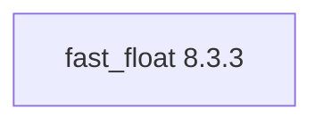

## Updated BuildEngine contract (10 November 2026)

**Declared configuration; no new test PASS.**

### Complete transitive dependencies

Direct: none

### Current configuration

- `-DCMAKE_TOOLCHAIN_FILE:FILEPATH={BuildFileDir}\cmake\toolchains\bcc64x-buildengine-cxx.cmake`
- `-DCMAKE_MAKE_PROGRAM:FILEPATH={Tool:ninja}`
- `-DCMAKE_INSTALL_PREFIX:PATH={InstallRoot}\packages\{LibraryId}\{LibraryVersion}`
- `-DCMAKE_INSTALL_INCLUDEDIR:STRING=include`
- `-DFASTFLOAT_TEST:BOOL=OFF`
- `-DFASTFLOAT_BENCHMARKS:BOOL=OFF`
- `-DFASTFLOAT_INSTALL:BOOL=ON`
- `-DFASTFLOAT_SANITIZE:BOOL=OFF`
- `-DCMAKE_BUILD_TYPE:STRING=Release`
- `-DCMAKE_INSTALL_LIBDIR:STRING=lib/win64/Release`
- `-DCMAKE_INSTALL_BINDIR:STRING=bin/win64/Release`
- `-DCMAKE_INSTALL_DATAROOTDIR:STRING=lib/win64/Release`
- `-DCMAKE_BUILD_TYPE:STRING=Debug`
- `-DCMAKE_INSTALL_LIBDIR:STRING=lib/win64/Debug`
- `-DCMAKE_INSTALL_BINDIR:STRING=bin/win64/Debug`
- `-DCMAKE_INSTALL_DATAROOTDIR:STRING=lib/win64/Debug`
- `-DFastFloat_DIR:PATH={InstallRoot}\packages\{LibraryId}\{LibraryVersion}\lib\win64\Release\cmake\FastFloat`

---

## Historical integration notes

# fast_float 8.3.3

[TOC|Content]

## Purpose and integration

High-performance C++ floating-point parser

**Status:** BuildEngine XML contract as of 10 November 2026; native builds and smoke tests **[not verified]**.

## Dependencies including transitive levels

**Direct dependencies:** none

## Configuration

### CMake

- `-DCMAKE_TOOLCHAIN_FILE:FILEPATH={BuildFileDir}\cmake\toolchains\bcc64x-buildengine-cxx.cmake`
- `-DCMAKE_MAKE_PROGRAM:FILEPATH={Tool:ninja}`
- `-DCMAKE_INSTALL_PREFIX:PATH={InstallRoot}\packages\{LibraryId}\{LibraryVersion}`
- `-DCMAKE_INSTALL_INCLUDEDIR:STRING=include`
- `-DFASTFLOAT_TEST:BOOL=OFF`
- `-DFASTFLOAT_BENCHMARKS:BOOL=OFF`
- `-DFASTFLOAT_INSTALL:BOOL=ON`
- `-DFASTFLOAT_SANITIZE:BOOL=OFF`
- `-DCMAKE_BUILD_TYPE:STRING=Release`
- `-DCMAKE_INSTALL_LIBDIR:STRING=lib/win64/Release`
- `-DCMAKE_INSTALL_BINDIR:STRING=bin/win64/Release`
- `-DCMAKE_INSTALL_DATAROOTDIR:STRING=lib/win64/Release`
- `-DCMAKE_BUILD_TYPE:STRING=Debug`
- `-DCMAKE_INSTALL_LIBDIR:STRING=lib/win64/Debug`
- `-DCMAKE_INSTALL_BINDIR:STRING=bin/win64/Debug`
- `-DCMAKE_INSTALL_DATAROOTDIR:STRING=lib/win64/Debug`
- `-DFastFloat_DIR:PATH={InstallRoot}\packages\{LibraryId}\{LibraryVersion}\lib\win64\Release\cmake\FastFloat`

### Build environment

- `CB_BCC64X={Tool:bcc64x}`
- `CB_BDS={BDS}`
- `CB_LLVM_AR={Tool:llvm-ar}`
- `CB_BCC64X={Tool:bcc64x}`
- `CB_BDS={BDS}`

### Sources

- `https://github.com/fastfloat/fast_float/archive/refs/tags/v8.3.3.tar.gz`

### Consumer-Smoke

- `consumer / Release / package`

## Special considerations

Versioned source and build actions and any necessary BCC64X patches are defined in `admin/build-libraries.xml`. Recorded fixes are not test PASS without matching FSM evidence.

[Library overview](/manual/libraries.md)
