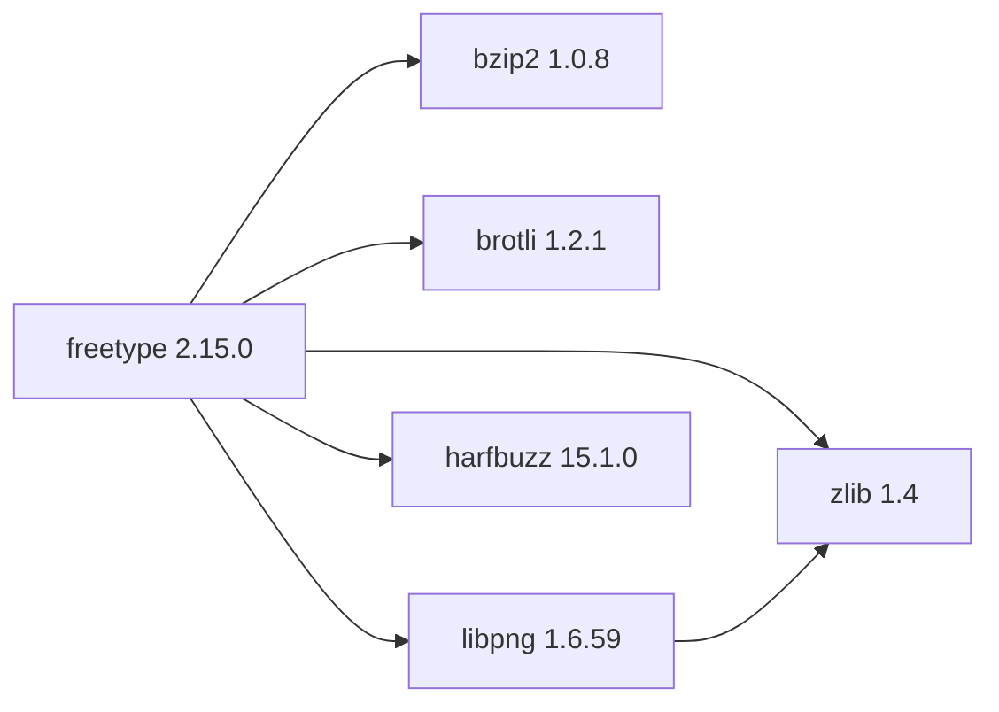

## Updated BuildEngine contract (10 November 2026)

**Declared configuration; no new test PASS.**

### Complete transitive dependencies

Direkt: `zlib@1.4`, `bzip2@1.0.8`, `brotli@1.2.1`, `libpng@1.6.59`, `harfbuzz@15.1.0`

### Current configuration

- `-DCMAKE_TOOLCHAIN_FILE:FILEPATH={BuildFileDir}\cmake\toolchains\bcc64x-buildengine-cxx.cmake`
- `-DCMAKE_MAKE_PROGRAM:FILEPATH={Tool:ninja}`
- `-DCMAKE_INSTALL_PREFIX:PATH={InstallRoot}\packages\{LibraryId}\{LibraryVersion}`
- `-DCMAKE_INSTALL_INCLUDEDIR:STRING=include`
- `-DBUILD_SHARED_LIBS:BOOL=ON`
- `-DFT_DISABLE_ZLIB:BOOL=OFF`
- `-DFT_REQUIRE_ZLIB:BOOL=ON`
- `-DFT_DISABLE_BZIP2:BOOL=OFF`
- `-DFT_REQUIRE_BZIP2:BOOL=ON`
- `-DFT_DISABLE_PNG:BOOL=OFF`
- `-DFT_REQUIRE_PNG:BOOL=ON`
- `-DFT_DISABLE_BROTLI:BOOL=OFF`
- `-DFT_REQUIRE_BROTLI:BOOL=ON`
- `-DFT_DISABLE_HARFBUZZ:BOOL=OFF`
- `-DFT_DYNAMIC_HARFBUZZ:BOOL=OFF`
- `-DFT_REQUIRE_HARFBUZZ:BOOL=ON`
- `-DCMAKE_PREFIX_PATH:PATH={DependencyRoot:zlib};{DependencyRoot:bzip2};{DependencyRoot:brotli};{DependencyRoot:libpng};{DependencyRoot:harfbuzz}`
- `-DHarfBuzz_LIBRARY:FILEPATH={DependencyRoot:harfbuzz}\lib\win64\{Configuration}\libharfbuzz{DebugPostfix}.lib`
- `-DHarfBuzz_INCLUDE_DIR:PATH={DependencyRoot:harfbuzz}\include\harfbuzz`
- `-DBZIP2_LIBRARY_RELEASE:FILEPATH={DependencyRoot:bzip2}\lib\win64\Release\libbzip2.lib`
- `-DBZIP2_LIBRARY_DEBUG:FILEPATH={DependencyRoot:bzip2}\lib\win64\Debug\libbzip2d.lib`
- `-DBZIP2_INCLUDE_DIR:PATH={DependencyRoot:bzip2}\include`
- `-DCMAKE_BUILD_TYPE:STRING=Release`
- `-DCMAKE_C_FLAGS_RELEASE:STRING=-O2 -DNDEBUG`
- `-DCMAKE_INSTALL_LIBDIR:STRING=lib/win64/Release`
- `-DCMAKE_INSTALL_BINDIR:STRING=bin/win64/Release`
- `-DCMAKE_BUILD_TYPE:STRING=Debug`
- `-DCMAKE_C_FLAGS_DEBUG:STRING=-O0`
- `-DCMAKE_DEBUG_POSTFIX:STRING=d`
- `-DCMAKE_INSTALL_LIBDIR:STRING=lib/win64/Debug`
- `-DCMAKE_INSTALL_BINDIR:STRING=bin/win64/Debug`

---

## Historical integration notes

# freetype 2.15.0 — BCC64X integration

Upstream source is the official FreeType 2.15.0 tar.xz, SHA-256 `93cd47eb719c325107f2d3cf087d06299e944c3b48a40b55537302304dea1dd5`. HarfBuzz dependency is now 15.1.0. zlib, bzip2, Brotli and PNG remain managed dependencies.

The previous library version remains available and is marked `supersededBy` in the BuildEngine XML catalog. The new version has a full producer, installation, publication and consumer contract.

**Verification boundary:** Source and patch compatibility checks do not establish a successful build. Native Windows BCC64X Release/Debug builds, upstream tests, installed consumer smoke, SBOM and Doxygen are **[not verified]** until the complete target-machine FSM has run.
