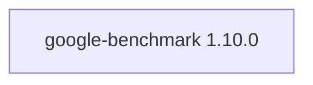

## Aktualisierter BuildEngine-Vertrag (10. November 2026)

**Deklarierte Konfiguration, nicht neuer Test-PASS.**

### Vollständige transitive Abhängigkeiten

Direkt: keine

### Aktuelle Konfiguration

- `-DCMAKE_TOOLCHAIN_FILE:FILEPATH={BuildFileDir}\cmake\toolchains\bcc64x-buildengine-cxx.cmake`
- `-DCMAKE_MAKE_PROGRAM:FILEPATH={Tool:ninja}`
- `-DCMAKE_INSTALL_PREFIX:PATH={InstallRoot}\packages\{LibraryId}\{LibraryVersion}`
- `-DCMAKE_INSTALL_INCLUDEDIR:STRING=include`
- `-DCMAKE_CXX_STANDARD:STRING=17`
- `-DCMAKE_CXX_SCAN_FOR_MODULES:BOOL=OFF`
- `-DBUILD_SHARED_LIBS:BOOL=ON`
- `-DBENCHMARK_ENABLE_TESTING:BOOL=ON`
- `-DBENCHMARK_ENABLE_GTEST_TESTS:BOOL=OFF`
- `-DBENCHMARK_USE_BUNDLED_GTEST:BOOL=OFF`
- `-DBENCHMARK_DOWNLOAD_DEPENDENCIES:BOOL=OFF`
- `-DBENCHMARK_ENABLE_INSTALL:BOOL=ON`
- `-DBENCHMARK_ENABLE_WERROR:BOOL=OFF`
- `-DBENCHMARK_INSTALL_DOCS:BOOL=OFF`
- `-DBENCHMARK_INSTALL_TOOLS:BOOL=OFF`
- `-DCMAKE_BUILD_TYPE:STRING=Release`
- `-DCMAKE_CXX_FLAGS_RELEASE:STRING=-O2 -DNDEBUG`
- `-DCMAKE_DEBUG_POSTFIX:STRING=`
- `-DCMAKE_INSTALL_LIBDIR:STRING=lib/win64/Release`
- `-DCMAKE_INSTALL_BINDIR:STRING=bin/win64/Release`
- `-DCMAKE_BUILD_TYPE:STRING=Debug`
- `-DCMAKE_CXX_FLAGS_DEBUG:STRING=-O0`
- `-DCMAKE_DEBUG_POSTFIX:STRING=d`
- `-DCMAKE_INSTALL_LIBDIR:STRING=lib/win64/Debug`
- `-DCMAKE_INSTALL_BINDIR:STRING=bin/win64/Debug`
- `-Dbenchmark_DIR:PATH={InstallRoot}\packages\{LibraryId}\{LibraryVersion}\lib\win64\Release\cmake\benchmark`

---

## Historische Integrationsnotizen

# Google Benchmark 1.10.0

[TOC|Content]

## Aktueller BuildEngine-Vertrag (10. November 2026)

**Vertragsdaten, keine bestätigte Build-Ausführung.** Ergebnisse aus früheren Tests sind versions- und buildgebunden; neue Ausführungen bleiben **[nicht verifiziert]**.

C++ microbenchmark framework for reproducible performance measurements and JSON reports in BuildEngine-Tests.

**Koordinate:** `google-benchmark@1.10.0` · **Kategorie:** `testing` · **Lizenzampel:** `green`

### Deklarierte Abhängigkeiten (vollständig transitiv)

Die Diagrammkanten stammen aus den exakt gepinnten XML-Abhängigkeiten. Gestrichelte Kanten kennzeichnen Erweiterungen, durchgezogene Kanten Paketabhängigkeiten. Upstream-intern gebündelte Komponenten sind keine zusätzlichen BuildEngine-Koordinaten.

**Direkte Abhängigkeiten:** Keine deklariert.

### Konfiguration und Besonderheiten

**CMake-Argumente:**

- `-DCMAKE_TOOLCHAIN_FILE:FILEPATH={BuildFileDir}\cmake\toolchains\bcc64x-buildengine-cxx.cmake`
- `-DCMAKE_MAKE_PROGRAM:FILEPATH={Tool:ninja}`
- `-DCMAKE_INSTALL_PREFIX:PATH={InstallRoot}\packages\{LibraryId}\{LibraryVersion}`
- `-DCMAKE_INSTALL_INCLUDEDIR:STRING=include`
- `-DCMAKE_CXX_STANDARD:STRING=17`
- `-DCMAKE_CXX_SCAN_FOR_MODULES:BOOL=OFF`
- `-DBUILD_SHARED_LIBS:BOOL=ON`
- `-DBENCHMARK_ENABLE_TESTING:BOOL=ON`
- `-DBENCHMARK_ENABLE_GTEST_TESTS:BOOL=OFF`
- `-DBENCHMARK_USE_BUNDLED_GTEST:BOOL=OFF`
- `-DBENCHMARK_DOWNLOAD_DEPENDENCIES:BOOL=OFF`
- `-DBENCHMARK_ENABLE_INSTALL:BOOL=ON`
- `-DBENCHMARK_ENABLE_WERROR:BOOL=OFF`
- `-DBENCHMARK_INSTALL_DOCS:BOOL=OFF`
- `-DBENCHMARK_INSTALL_TOOLS:BOOL=OFF`
- `-DCMAKE_BUILD_TYPE:STRING=Release`
- `-DCMAKE_CXX_FLAGS_RELEASE:STRING=-O2 -DNDEBUG`
- `-DCMAKE_DEBUG_POSTFIX:STRING=`
- `-DCMAKE_INSTALL_LIBDIR:STRING=lib/win64/Release`
- `-DCMAKE_INSTALL_BINDIR:STRING=bin/win64/Release`
- `-DCMAKE_BUILD_TYPE:STRING=Debug`
- `-DCMAKE_CXX_FLAGS_DEBUG:STRING=-O0`
- `-DCMAKE_DEBUG_POSTFIX:STRING=d`
- `-DCMAKE_INSTALL_LIBDIR:STRING=lib/win64/Debug`
- `-DCMAKE_INSTALL_BINDIR:STRING=bin/win64/Debug`

**Build-Umgebung:**

- `CB_BCC64X={Tool:bcc64x}`
- `CB_BDS={BDS}`
- `CTEST_PARALLEL_LEVEL={TestJobs}`
- `PATH={BuildRoot}\packages\{LibraryId}\{LibraryVersion}\{Configuration}\src;{BuildRoot}\packages\{LibraryId}\{LibraryVersion}\{Configuration};{ENV:PATH}`

**Source-Downloads:**

- `https://github.com/google/benchmark/archive/a6b4a9f00b36c19af9997d68a1cf6e0b5b3d032c.zip`

**Deklarierte Smoke-Tests:**

- `consumer` / `Release` / `package` / `smokes\google-benchmark\consumer`

**Explizit geforderte Installationsartefakte:**

- `{InstallRoot}\packages\{LibraryId}\{LibraryVersion}\bin\win64\{Configuration}\{SharedName}.dll`
- `{InstallRoot}\packages\{LibraryId}\{LibraryVersion}\lib\win64\{Configuration}\{SharedName}.lib`
- `{InstallRoot}\packages\{LibraryId}\{LibraryVersion}\lib\win64\{Configuration}\cmake\benchmark\benchmarkConfig.cmake`
- `{InstallRoot}\packages\{LibraryId}\{LibraryVersion}\include\benchmark\benchmark.h`
- `{InstallRoot}\packages\{LibraryId}\{LibraryVersion}\LICENSE`

**Verbindliche Quellen:** `admin/build-libraries.xml` für Konfiguration und Pins; FSM/Buildlogs für tatsächliche Ausführung. [Bibliotheksverzeichnis](/manual/libraries.md).
