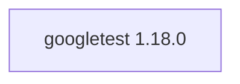

## Updated BuildEngine contract (10 November 2026)

**Declared configuration; no new test PASS.**

### Complete transitive dependencies

Direct: none

### Current configuration

- `-DCMAKE_TOOLCHAIN_FILE:FILEPATH={BuildFileDir}\cmake\toolchains\bcc64x-buildengine-cxx.cmake`
- `-DCMAKE_MAKE_PROGRAM:FILEPATH={Tool:ninja}`
- `-DCMAKE_INSTALL_PREFIX:PATH={InstallRoot}\packages\{LibraryId}\{LibraryVersion}`
- `-DCMAKE_INSTALL_INCLUDEDIR:STRING=include`
- `-DCMAKE_CXX_STANDARD:STRING=17`
- `-DCMAKE_CXX_STANDARD_REQUIRED:BOOL=ON`
- `-DCMAKE_CXX_SCAN_FOR_MODULES:BOOL=OFF`
- `-DCMAKE_PROJECT_INCLUDE:FILEPATH={BuildFileDir}\cmake\googletest\bcc64x-target-fixes.cmake`
- `-DBUILD_SHARED_LIBS:BOOL=OFF`
- `-DBUILD_GMOCK:BOOL=ON`
- `-DINSTALL_GTEST:BOOL=ON`
- `-DCMAKE_BUILD_TYPE:STRING=Release`
- `-DCMAKE_CXX_FLAGS_RELEASE:STRING=-O2 -DNDEBUG`
- `-DCMAKE_INSTALL_LIBDIR:STRING=lib/win64/Release`
- `-DCMAKE_BUILD_TYPE:STRING=Debug`
- `-DCMAKE_CXX_FLAGS_DEBUG:STRING=-O0`
- `-DCMAKE_INSTALL_LIBDIR:STRING=lib/win64/Debug`
- `-DGTest_DIR:PATH={InstallRoot}\packages\{LibraryId}\{LibraryVersion}\lib\win64\Release\cmake\GTest`

---

## Historical integration notes

# GoogleTest 1.18.0

[TOC|Content]

## Current BuildEngine contract (10 November 2026)

**Contract data; no verified build execution.** Earlier results apply only to their exact versions and binaries; new executions remain **[not verified]**.

C++ testing framework providing GoogleTest and GoogleMock for unit tests and mocks.

**Coordinate:** `googletest@1.18.0` · **Category:** `testing` · **License indicator:** `green`

### Declared dependencies (full transitive closure)

Graph edges come from exact XML-pinned dependencies. Dashed edges are extensions; solid edges are package dependencies. Bundled upstream components are not separate BuildEngine packages.

**Direct dependencies:** None declared.

### Configuration and integration notes

**CMake arguments:**

- `-DCMAKE_TOOLCHAIN_FILE:FILEPATH={BuildFileDir}\cmake\toolchains\bcc64x-buildengine-cxx.cmake`
- `-DCMAKE_MAKE_PROGRAM:FILEPATH={Tool:ninja}`
- `-DCMAKE_INSTALL_PREFIX:PATH={InstallRoot}\packages\{LibraryId}\{LibraryVersion}`
- `-DCMAKE_INSTALL_INCLUDEDIR:STRING=include`
- `-DCMAKE_CXX_STANDARD:STRING=17`
- `-DCMAKE_CXX_STANDARD_REQUIRED:BOOL=ON`
- `-DCMAKE_CXX_SCAN_FOR_MODULES:BOOL=OFF`
- `-DCMAKE_PROJECT_INCLUDE:FILEPATH={BuildFileDir}\cmake\googletest\bcc64x-target-fixes.cmake`
- `-DBUILD_SHARED_LIBS:BOOL=OFF`
- `-DBUILD_GMOCK:BOOL=ON`
- `-DINSTALL_GTEST:BOOL=ON`
- `-DCMAKE_BUILD_TYPE:STRING=Release`
- `-DCMAKE_CXX_FLAGS_RELEASE:STRING=-O2 -DNDEBUG`
- `-DCMAKE_INSTALL_LIBDIR:STRING=lib/win64/Release`
- `-DCMAKE_BUILD_TYPE:STRING=Debug`
- `-DCMAKE_CXX_FLAGS_DEBUG:STRING=-O0`
- `-DCMAKE_INSTALL_LIBDIR:STRING=lib/win64/Debug`

**Build-Umgebung:**

- `CB_BCC64X={Tool:bcc64x}`
- `CB_BDS={BDS}`

**Source-Downloads:**

- `https://github.com/google/googletest/archive/063de7e9578f82b369302001269680b4b1553359.zip`

**Deklarierte Smoke-Tests:**

- `consumer` / `Release` / `package` / `smokes\googletest\consumer`

**Explizit geforderte Installationsartefakte:**

- `{InstallRoot}\packages\{LibraryId}\{LibraryVersion}\lib\win64\{Configuration}\gtest.lib`
- `{InstallRoot}\packages\{LibraryId}\{LibraryVersion}\lib\win64\{Configuration}\gtest_main.lib`
- `{InstallRoot}\packages\{LibraryId}\{LibraryVersion}\lib\win64\{Configuration}\gmock.lib`
- `{InstallRoot}\packages\{LibraryId}\{LibraryVersion}\lib\win64\{Configuration}\gmock_main.lib`
- `{InstallRoot}\packages\{LibraryId}\{LibraryVersion}\lib\win64\{Configuration}\cmake\GTest\GTestConfig.cmake`
- `{InstallRoot}\packages\{LibraryId}\{LibraryVersion}\include\gtest\gtest.h`
- `{InstallRoot}\packages\{LibraryId}\{LibraryVersion}\include\gmock\gmock.h`

**Authoritative sources:** `admin/build-libraries.xml` for configuration and pins; FSM/build logs for actual execution. [Library catalog](/manual/libraries.md).
