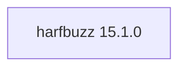

## Updated BuildEngine contract (10 November 2026)

**Declared configuration; no new test PASS.**

### Complete transitive dependencies

Direct: none

### Current configuration

- `-DCMAKE_TOOLCHAIN_FILE:FILEPATH={BuildFileDir}\cmake\toolchains\bcc64x-buildengine-cxx.cmake`
- `-DCMAKE_MAKE_PROGRAM:FILEPATH={Tool:ninja}`
- `-DCMAKE_INSTALL_PREFIX:PATH={InstallRoot}\packages\{LibraryId}\{LibraryVersion}`
- `-DCMAKE_INSTALL_INCLUDEDIR:STRING=include`
- `-DBUILD_SHARED_LIBS:BOOL=ON`
- `-DHB_HAVE_FREETYPE:BOOL=OFF`
- `-DHB_HAVE_CAIRO:BOOL=OFF`
- `-DHB_HAVE_GRAPHITE2:BOOL=OFF`
- `-DHB_HAVE_GLIB:BOOL=OFF`
- `-DHB_HAVE_ICU:BOOL=OFF`
- `-DHB_HAVE_GOBJECT:BOOL=OFF`
- `-DHB_HAVE_INTROSPECTION:BOOL=OFF`
- `-DHB_HAVE_UNISCRIBE:BOOL=OFF`
- `-DHB_HAVE_GDI:BOOL=OFF`
- `-DHB_HAVE_DIRECTWRITE:BOOL=OFF`
- `-DHB_BUILD_SUBSET:BOOL=ON`
- `-DHB_BUILD_RASTER:BOOL=OFF`
- `-DHB_BUILD_VECTOR:BOOL=OFF`
- `-DHB_BUILD_GPU:BOOL=OFF`
- `-DHB_BUILD_GPU_DEMO:STRING=OFF`
- `-DHB_BUILD_UTILS:BOOL=OFF`
- `-DCMAKE_BUILD_TYPE:STRING=Release`
- `-DCMAKE_C_FLAGS_RELEASE:STRING=-O2 -DNDEBUG`
- `-DCMAKE_CXX_FLAGS_RELEASE:STRING=-O2 -DNDEBUG`
- `-DCMAKE_INSTALL_LIBDIR:STRING=lib/win64/Release`
- `-DCMAKE_INSTALL_BINDIR:STRING=bin/win64/Release`
- `-DCMAKE_BUILD_TYPE:STRING=Debug`
- `-DCMAKE_C_FLAGS_DEBUG:STRING=-O0`
- `-DCMAKE_CXX_FLAGS_DEBUG:STRING=-O0`
- `-DCMAKE_DEBUG_POSTFIX:STRING=d`
- `-DCMAKE_INSTALL_LIBDIR:STRING=lib/win64/Debug`
- `-DCMAKE_INSTALL_BINDIR:STRING=bin/win64/Debug`
- `-Dharfbuzz_DIR:PATH={ConsumerRoot}\lib\win64\{Configuration}\cmake\harfbuzz`

---

## Historical integration notes

# harfbuzz 15.1.0 — BCC64X integration

Source pin `3df40d9b98d6b32f0e4288d4ecfbb158ddb3a372`; official release tar.xz SHA-256 `0fc7c565443a5f4be7da65ac5ee5bd737d9b158dc908708b7689a0a5796b0c8d`. Canonical DLL names are patched for upstream CMake. FreeType support remains OFF to avoid a dependency cycle.

The previous library version remains available and is marked `supersededBy` in the BuildEngine XML catalog. The new version has a full producer, installation, publication and consumer contract.

**Verification boundary:** Source and patch compatibility checks do not establish a successful build. Native Windows BCC64X Release/Debug builds, upstream tests, installed consumer smoke, SBOM and Doxygen are **[not verified]** until the complete target-machine FSM has run.
