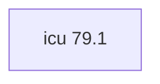

## Updated BuildEngine contract (10 November 2026)

**Declared configuration; no new test PASS.**

### Complete transitive dependencies

Direct: none

### Current configuration

- `-DCMAKE_TOOLCHAIN_FILE:FILEPATH={BuildFileDir}\cmake\toolchains\bcc64x-buildengine-cxx.cmake`
- `-DCMAKE_MAKE_PROGRAM:FILEPATH={Tool:ninja}`
- `-DCMAKE_INSTALL_PREFIX:PATH={BuildRoot}\stage\packages\{LibraryId}\{LibraryVersion}\{Configuration}`
- `-DCMAKE_INSTALL_INCLUDEDIR:STRING=include`
- `-DCMAKE_INSTALL_LIBDIR:STRING=lib`
- `-DCMAKE_INSTALL_BINDIR:STRING=bin`
- `-DCMAKE_C_STANDARD:STRING=11`
- `-DCMAKE_C_STANDARD_REQUIRED:BOOL=ON`
- `-DCMAKE_C_EXTENSIONS:BOOL=OFF`
- `-DCMAKE_CXX_STANDARD:STRING=17`
- `-DCMAKE_CXX_STANDARD_REQUIRED:BOOL=ON`
- `-DCMAKE_CXX_EXTENSIONS:BOOL=OFF`
- `-DCMAKE_CXX_SCAN_FOR_MODULES:BOOL=OFF`
- `-DCMAKE_BUILD_TYPE:STRING=Release`
- `-DCMAKE_C_FLAGS_RELEASE:STRING=-O2 -DNDEBUG`
- `-DCMAKE_CXX_FLAGS_RELEASE:STRING=-O2 -DNDEBUG`
- `-DCMAKE_BUILD_TYPE:STRING=Debug`
- `-DCMAKE_C_FLAGS_DEBUG:STRING=-O0 -D_DEBUG`
- `-DCMAKE_CXX_FLAGS_DEBUG:STRING=-O0 -D_DEBUG`

---

## Historical integration notes

# ICU4C 79.1

[TOC|Content]

## Purpose and integration

Unicode and globalization library providing text, locale, normalization, collation, and conversion services.

**Status:** BuildEngine XML contract from 10 November 2026; native builds and smoke results **[not verified]**.

## Dependencies including transitive levels

**Direct dependencies:** none

## Konfiguration

### CMake

- `-DCMAKE_TOOLCHAIN_FILE:FILEPATH={BuildFileDir}\cmake\toolchains\bcc64x-buildengine-cxx.cmake`
- `-DCMAKE_MAKE_PROGRAM:FILEPATH={Tool:ninja}`
- `-DCMAKE_INSTALL_PREFIX:PATH={BuildRoot}\stage\packages\{LibraryId}\{LibraryVersion}\{Configuration}`
- `-DCMAKE_INSTALL_INCLUDEDIR:STRING=include`
- `-DCMAKE_INSTALL_LIBDIR:STRING=lib`
- `-DCMAKE_INSTALL_BINDIR:STRING=bin`
- `-DCMAKE_C_STANDARD:STRING=11`
- `-DCMAKE_C_STANDARD_REQUIRED:BOOL=ON`
- `-DCMAKE_C_EXTENSIONS:BOOL=OFF`
- `-DCMAKE_CXX_STANDARD:STRING=17`
- `-DCMAKE_CXX_STANDARD_REQUIRED:BOOL=ON`
- `-DCMAKE_CXX_EXTENSIONS:BOOL=OFF`
- `-DCMAKE_CXX_SCAN_FOR_MODULES:BOOL=OFF`
- `-DCMAKE_BUILD_TYPE:STRING=Release`
- `-DCMAKE_C_FLAGS_RELEASE:STRING=-O2 -DNDEBUG`
- `-DCMAKE_CXX_FLAGS_RELEASE:STRING=-O2 -DNDEBUG`
- `-DCMAKE_BUILD_TYPE:STRING=Debug`
- `-DCMAKE_C_FLAGS_DEBUG:STRING=-O0 -D_DEBUG`
- `-DCMAKE_CXX_FLAGS_DEBUG:STRING=-O0 -D_DEBUG`

### Build environment

- `CB_BCC64X={Tool:bcc64x}`
- `CB_BDS={BDS}`
- `CB_WINDOWS_RC={Tool:windows-rc}`
- `CB_LLVM_AR={Tool:llvm-ar}`
- `CB_LLVM_RANLIB={Tool:llvm-ranlib}`

### Sources

- `https://github.com/unicode-org/icu/releases/download/release-{LibraryVersion}/icu4c-{LibraryVersion}-sources.tgz`

### Consumer-Smoke

Nicht deklariert.

## Special considerations

Versioned source/build actions and required BCC64X patches are declared in `admin/build-libraries.xml`. A recorded fix is not a test PASS without FSM evidence.

[Library overview](/manual/libraries.md)
