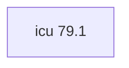

## Aktualisierter BuildEngine-Vertrag (10. November 2026)

**Deklarierte Konfiguration, nicht neuer Test-PASS.**

### Vollständige transitive Abhängigkeiten

Direkt: keine

### Aktuelle Konfiguration

- `-DCMAKE_TOOLCHAIN_FILE:FILEPATH={BuildFileDir}\cmake\toolchains\bcc64x-buildengine-cxx.cmake`
- `-DCMAKE_MAKE_PROGRAM:FILEPATH={Tool:ninja}`
- `-DCMAKE_INSTALL_PREFIX:PATH={BuildRoot}\stage\packages\{LibraryId}\{LibraryVersion}\{Configuration}`
- `-DCMAKE_INSTALL_INCLUDEDIR:STRING=include`
- `-DCMAKE_INSTALL_LIBDIR:STRING=lib`
- `-DCMAKE_INSTALL_BINDIR:STRING=bin`
- `-DCMAKE_C_STANDARD:STRING=11`
- `-DCMAKE_C_STANDARD_REQUIRED:BOOL=ON`
- `-DCMAKE_C_EXTENSIONS:BOOL=OFF`
- `-DCMAKE_CXX_STANDARD:STRING=17`
- `-DCMAKE_CXX_STANDARD_REQUIRED:BOOL=ON`
- `-DCMAKE_CXX_EXTENSIONS:BOOL=OFF`
- `-DCMAKE_CXX_SCAN_FOR_MODULES:BOOL=OFF`
- `-DCMAKE_BUILD_TYPE:STRING=Release`
- `-DCMAKE_C_FLAGS_RELEASE:STRING=-O2 -DNDEBUG`
- `-DCMAKE_CXX_FLAGS_RELEASE:STRING=-O2 -DNDEBUG`
- `-DCMAKE_BUILD_TYPE:STRING=Debug`
- `-DCMAKE_C_FLAGS_DEBUG:STRING=-O0 -D_DEBUG`
- `-DCMAKE_CXX_FLAGS_DEBUG:STRING=-O0 -D_DEBUG`

---

## Historische Integrationsnotizen

# ICU4C 79.1

[TOC|Content]

## Aufgabe und Integration

Unicode and globalization library providing text, locale, normalization, collation, and conversion services.

**Stand:** BuildEngine-XML-Vertrag vom 10. November 2026; native Builds und Smoke-Ergebnisse **[nicht verifiziert]**.

## Abhängigkeiten einschließlich transitiver Stufen

**Direkte Abhängigkeiten:** keine

## Konfiguration

### CMake

- `-DCMAKE_TOOLCHAIN_FILE:FILEPATH={BuildFileDir}\cmake\toolchains\bcc64x-buildengine-cxx.cmake`
- `-DCMAKE_MAKE_PROGRAM:FILEPATH={Tool:ninja}`
- `-DCMAKE_INSTALL_PREFIX:PATH={BuildRoot}\stage\packages\{LibraryId}\{LibraryVersion}\{Configuration}`
- `-DCMAKE_INSTALL_INCLUDEDIR:STRING=include`
- `-DCMAKE_INSTALL_LIBDIR:STRING=lib`
- `-DCMAKE_INSTALL_BINDIR:STRING=bin`
- `-DCMAKE_C_STANDARD:STRING=11`
- `-DCMAKE_C_STANDARD_REQUIRED:BOOL=ON`
- `-DCMAKE_C_EXTENSIONS:BOOL=OFF`
- `-DCMAKE_CXX_STANDARD:STRING=17`
- `-DCMAKE_CXX_STANDARD_REQUIRED:BOOL=ON`
- `-DCMAKE_CXX_EXTENSIONS:BOOL=OFF`
- `-DCMAKE_CXX_SCAN_FOR_MODULES:BOOL=OFF`
- `-DCMAKE_BUILD_TYPE:STRING=Release`
- `-DCMAKE_C_FLAGS_RELEASE:STRING=-O2 -DNDEBUG`
- `-DCMAKE_CXX_FLAGS_RELEASE:STRING=-O2 -DNDEBUG`
- `-DCMAKE_BUILD_TYPE:STRING=Debug`
- `-DCMAKE_C_FLAGS_DEBUG:STRING=-O0 -D_DEBUG`
- `-DCMAKE_CXX_FLAGS_DEBUG:STRING=-O0 -D_DEBUG`

### Build-Umgebung

- `CB_BCC64X={Tool:bcc64x}`
- `CB_BDS={BDS}`
- `CB_WINDOWS_RC={Tool:windows-rc}`
- `CB_LLVM_AR={Tool:llvm-ar}`
- `CB_LLVM_RANLIB={Tool:llvm-ranlib}`

### Quellen

- `https://github.com/unicode-org/icu/releases/download/release-{LibraryVersion}/icu4c-{LibraryVersion}-sources.tgz`

### Consumer-Smoke

Nicht deklariert.

## Besonderheiten

Versionierte Quell- und Build-Aktionen sowie eventuell erforderliche BCC64X-Patches sind im ausführbaren `admin/build-libraries.xml` dokumentiert. Eingetragene Fixes sind ohne FSM-Nachweis kein Test-PASS.

[Bibliotheksübersicht](/manual/libraries.md)
