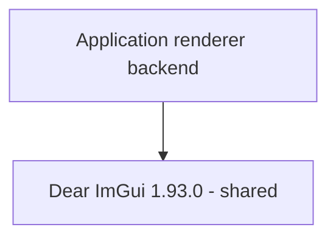

# Dear ImGui 1.93.0 — BCC64X Integration and Migration

## Purpose

Standalone immediate-mode C++ GUI with window, keyboard, mouse and widgets. The platform/renderer backend is a separately selected integration detail.

## Package contract

| Property | Value |
| --- | --- |
| Coordinate | `imgui@1.93.0` |
| Artifact type | **Shared Library (planned)** |
| Language | C++ |
| License | MIT |
| Upstream | [Project repository](https://github.com/ocornut/imgui) |
| Native validation | **Not verified** |

## Dependency and extension decisions

No mandatory link-time SDL2 dependency in the core; the application selects a backend such as Win32 + DirectX or SDL2 + OpenGL. The BCC64X adapter path has not been approved for writing; no DLL build can be claimed.

No extension relationship.

## BCC64X policy

All native C/C++ code must be consumed by the BCC64X Clang toolchain, not an MSVC or MinGW binary. Interface libraries install headers without DLL/ILIB checks. Shared libraries require matching Debug and Release DLL/import-library artifacts, complete exported API coverage, license/SBOM and a linked consumer smoke.

## Smoke-test contract

The repository includes `admin/smokes/imgui/consumer`, where a C++23 consumer verifies a real library operation. A committed test definition is not evidence of a successful test. Rendering, SDL2/OpenGL or VCL integration remain separate functional demonstration gates.

## Status and follow-up

**Not verified:** source acquisition, native BCC64X build, installation, linked smoke, runtime graphics backend and package distribution. No successful build, installed artifact or package export is asserted.
