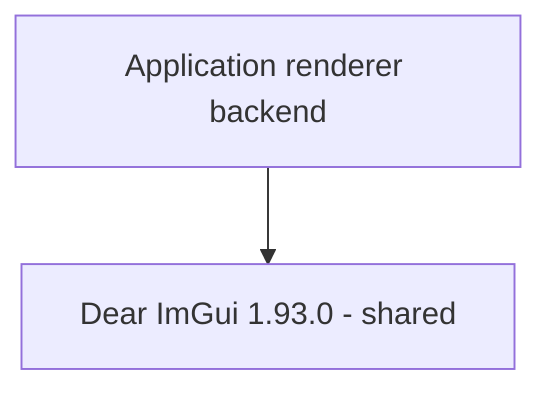

# Dear ImGui 1.93.0 — BCC64X Integration and Migration

## Purpose

Standalone immediate-mode C++ GUI with window, keyboard, mouse and widgets. The platform/renderer backend is a separately selected integration detail.

## Package contract

| Property | Value |
| --- | --- |
| Coordinate | `imgui@1.93.0` |
| Artifact type | **Shared DLL and import library** |
| Language | C++ |
| License | MIT |
| Upstream | [Project repository](https://github.com/ocornut/imgui) |
| Native validation | **Native FSM completed (user-confirmed)** |

## Dependency and extension decisions

No mandatory link-time SDL2 dependency in the core; the application selects a backend such as Win32 + DirectX or SDL2 + OpenGL. The native BCC64X adapter, Debug/Release artifacts and DLL smoke have been user-confirmed successful.

No extension relationship.

## BCC64X policy

All native C/C++ code must be consumed by the BCC64X Clang toolchain, not an MSVC or MinGW binary. Interface libraries install headers without DLL/ILIB checks. Shared libraries require matching Debug and Release DLL/import-library artifacts, complete exported API coverage, license/SBOM and a linked consumer smoke.

## Smoke-test contract

The repository includes `admin/smokes/imgui/consumer`, where a C++23 consumer verifies a real library operation. A committed test definition is not evidence of a successful test. Rendering, SDL2/OpenGL or VCL integration remain separate functional demonstration gates.

## Final native status and visual demonstration boundary

The operator confirmed completion of the 120-version BuildEngine FSM on 2026-11-18, including the BCC64X shared-library consumer smoke for this package. The separate BuildEngine-Tests graphics demonstration is newly authored and **[not verified]** until independently built and executed on Windows.

Presentation sources, build commands, declared CycloneDX SBOM and licensing: https://github.com/adeccscholar/BuildEngine-Tests/tree/main/graphics

## Official SDL2 + OpenGL3 backend extension (20 November 2026)

The producer's existing Dear ImGui 1.93.0 core DLL remains separate. Its upstream `backends/imgui_impl_sdl2.cpp` and `backends/imgui_impl_opengl3.cpp` are now built into a second, managed, variant-specific `imgui_sdl2_opengl3` shared library. The backend links the installed ImGui core, SDL2 2.32.10, Mesa OpenGL 26.2.1 and GLEW 2.3.1. It does not duplicate ImGui's core code or use a handwritten per-showcase renderer. `IMGUI_IMPL_OPENGL_LOADER_CUSTOM` selects the installed GLEW loader rather than the bundled loader implementation.

The catalog declares the three dependency identities and exact installed paths. Both DLL and import library are mandatory in each configuration; the installed upstream backend headers are checked as required evidence. The existing core smoke remains intact, while the Navigation Reactor supplies an additional GPU integration and runtime smoke.

**[not verified]** The producer extension must be compiled under BCC64X for both Debug and Release; the current XML registration is not itself passing test evidence. This addition intentionally increases backend functionality instead of disabling it to avoid dependencies.
