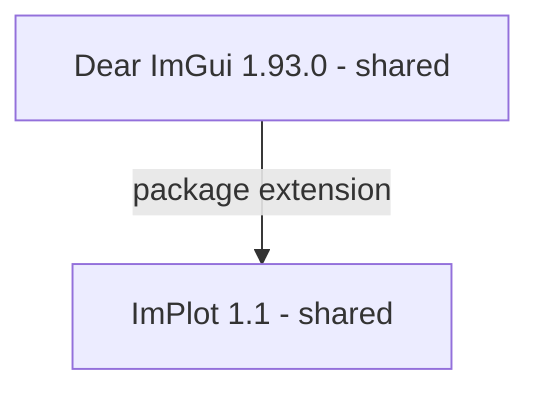

# ImPlot 1.1 — BCC64X Integration and Migration

## Purpose

Native 2D plotting extension for Dear ImGui: interactive lines, histograms, heatmaps and axes.

## Package contract

| Property | Value |
| --- | --- |
| Coordinate | `implot@1.1` |
| Artifact type | **Shared DLL and import library** |
| Language | C++ |
| License | MIT |
| Upstream | [Project repository](https://github.com/epezent/implot) |
| Native validation | **Native FSM completed (user-confirmed)** |

## Dependency and extension decisions

Package extension of imgui@1.93.0; uses the same Dear ImGui context and an import library with matching configuration. This release pair was compiled and consumer smoke-tested with BCC64X as confirmed by the operator.

The normative XML extension is `&lt;extension type="package" library="imgui" version="1.93.0"/&gt;`.

## BCC64X policy

All native C/C++ code must be consumed by the BCC64X Clang toolchain, not an MSVC or MinGW binary. Interface libraries install headers without DLL/ILIB checks. Shared libraries require matching Debug and Release DLL/import-library artifacts, complete exported API coverage, license/SBOM and a linked consumer smoke.

## Smoke-test contract

The repository includes `admin/smokes/implot/consumer`, where a C++23 consumer verifies a real library operation. A committed test definition is not evidence of a successful test. Rendering, SDL2/OpenGL or VCL integration remain separate functional demonstration gates.

## Final native status and visual demonstration boundary

The operator confirmed completion of the 120-version BuildEngine FSM on 2026-11-18, including the BCC64X shared-library consumer smoke for this package. The separate BuildEngine-Tests graphics demonstration is newly authored and **[not verified]** until independently built and executed on Windows.

Presentation sources, build commands, declared CycloneDX SBOM and licensing: https://github.com/adeccscholar/BuildEngine-Tests/tree/main/graphics
