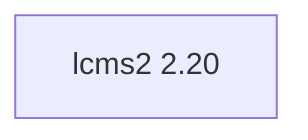

## Updated BuildEngine contract (10 November 2026)

**Declared configuration; no new test PASS.**

### Complete transitive dependencies

Direct: none

### Current configuration

- `-DCMAKE_TOOLCHAIN_FILE:FILEPATH={BuildFileDir}\cmake\toolchains\bcc64x-buildengine-cxx.cmake`
- `-DCMAKE_MAKE_PROGRAM:FILEPATH={Tool:ninja}`
- `-DCMAKE_INSTALL_PREFIX:PATH={InstallRoot}\packages\{LibraryId}\{LibraryVersion}`
- `-DCMAKE_INSTALL_INCLUDEDIR:STRING=include`
- `-DLCMS2_BUILD_SHARED:BOOL=ON`
- `-DLCMS2_BUILD_STATIC:BOOL=OFF`
- `-DLCMS2_BUILD_TOOLS:BOOL=OFF`
- `-DLCMS2_BUILD_TESTS:BOOL=OFF`
- `-DLCMS2_WITH_FASTFLOAT:BOOL=OFF`
- `-DLCMS2_WITH_THREADED_PLUGIN:BOOL=OFF`
- `-DCMAKE_BUILD_TYPE:STRING=Release`
- `-DCMAKE_INSTALL_LIBDIR:STRING=lib/win64/Release`
- `-DCMAKE_INSTALL_BINDIR:STRING=bin/win64/Release`
- `-DCMAKE_BUILD_TYPE:STRING=Debug`
- `-DCMAKE_INSTALL_LIBDIR:STRING=lib/win64/Debug`
- `-DCMAKE_INSTALL_BINDIR:STRING=bin/win64/Debug`
- `-Dlcms2_DIR:PATH={InstallRoot}\packages\{LibraryId}\{LibraryVersion}\lib\win64\Release\cmake\lcms2`

---

## Historical integration notes

# lcms2 2.20 — BCC64X integration

Upstream tag `lcms2.20`, pin `7717fce0d85447ef3b2df0cca2e99207c15eeecd`. The BCC64X inline patch is retained against the actual 2.20 header. GPL plugin features remain explicitly OFF.

The previous library version remains available and is marked `supersededBy` in the BuildEngine XML catalog. The new version has a full producer, installation, publication and consumer contract.

**Verification boundary:** Source and patch compatibility checks do not establish a successful build. Native Windows BCC64X Release/Debug builds, upstream tests, installed consumer smoke, SBOM and Doxygen are **[not verified]** until the complete target-machine FSM has run.
