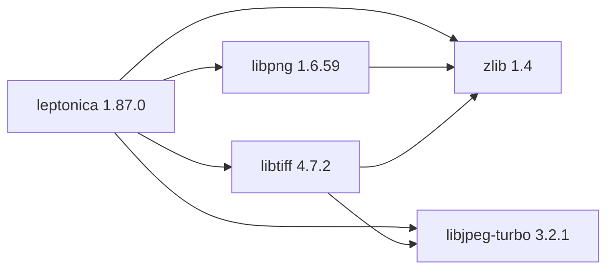

# Leptonica 1.87.0

[TOC|Content]

## Aktueller BuildEngine-Vertrag (10. November 2026)

**Vertragsdaten, keine bestätigte Build-Ausführung.** Ergebnisse aus früheren Tests sind versions- und buildgebunden; neue Ausführungen bleiben **[nicht verifiziert]**.

Image normalization, binarization, morphology and OCR preprocessing for Tesseract.

**Koordinate:** `leptonica@1.87.0` · **Kategorie:** `image` · **Lizenzampel:** `yellow`

### Deklarierte Abhängigkeiten (vollständig transitiv)

Die Diagrammkanten stammen aus den exakt gepinnten XML-Abhängigkeiten. Gestrichelte Kanten kennzeichnen Erweiterungen, durchgezogene Kanten Paketabhängigkeiten. Upstream-intern gebündelte Komponenten sind keine zusätzlichen BuildEngine-Koordinaten.

**Direkte Abhängigkeiten:** `zlib@1.4`, `libpng@1.6.59`, `libjpeg-turbo@3.2.1`, `libtiff@4.7.2`

### Konfiguration und Besonderheiten

**CMake-Argumente:**

- `-DCMAKE_TOOLCHAIN_FILE:FILEPATH={BuildFileDir}\cmake\toolchains\bcc64x-buildengine-cxx.cmake`
- `-DCMAKE_MAKE_PROGRAM:FILEPATH={Tool:ninja}`
- `-DCMAKE_INSTALL_PREFIX:PATH={InstallRoot}\packages\{LibraryId}\{LibraryVersion}`
- `-DBUILD_SHARED_LIBS:BOOL=ON`
- `-DBUILD_PROG:BOOL=OFF`
- `-DSW_BUILD:BOOL=OFF`
- `-DENABLE_ZLIB:BOOL=ON`
- `-DENABLE_PNG:BOOL=ON`
- `-DENABLE_JPEG:BOOL=ON`
- `-DENABLE_TIFF:BOOL=ON`
- `-DENABLE_GIF:BOOL=OFF`
- `-DENABLE_WEBP:BOOL=OFF`
- `-DENABLE_OPENJPEG:BOOL=OFF`
- `-DCMAKE_PREFIX_PATH:PATH={DependencyRoot:zlib};{DependencyRoot:libpng};{DependencyRoot:libjpeg-turbo};{DependencyRoot:libtiff}`
- `-DCMAKE_BUILD_TYPE:STRING=Release`
- `-DCMAKE_C_FLAGS_RELEASE:STRING=-O2 -DNDEBUG`
- `-DCMAKE_INSTALL_LIBDIR:STRING=lib/win64/Release`
- `-DCMAKE_INSTALL_BINDIR:STRING=bin/win64/Release`
- `-DCMAKE_BUILD_TYPE:STRING=Debug`
- `-DCMAKE_C_FLAGS_DEBUG:STRING=-O0`
- `-DCMAKE_DEBUG_POSTFIX:STRING=d`
- `-DCMAKE_INSTALL_LIBDIR:STRING=lib/win64/Debug`
- `-DCMAKE_INSTALL_BINDIR:STRING=bin/win64/Debug`

**Build-Umgebung:**

- `CB_BCC64X={Tool:bcc64x}`
- `CB_BDS={BDS}`

**Source-Downloads:**

- `https://github.com/DanBloomberg/leptonica/releases/download/{LibraryVersion}/leptonica-{LibraryVersion}.tar.gz` (SHA-256: `c73363397f96eb1295602bf44d708a994ad42046c791bf03ea0505d829bdb6a7`)

**Deklarierte Smoke-Tests:**

- `consumer` / `Release` / `package` / `smokes\leptonica\consumer`

**Explizit geforderte Installationsartefakte:**

- `{InstallRoot}\packages\{LibraryId}\{LibraryVersion}\lib\win64\{Configuration}`
- `{InstallRoot}\packages\{LibraryId}\{LibraryVersion}\bin\win64\{Configuration}`
- `{InstallRoot}\packages\{LibraryId}\{LibraryVersion}\lib\win64\{Configuration}\cmake\leptonica\LeptonicaConfig.cmake`
- `{InstallRoot}\packages\{LibraryId}\{LibraryVersion}\include\leptonica\allheaders.h`
- `{InstallRoot}\packages\{LibraryId}\{LibraryVersion}\LICENSE`
- `{InstallRoot}\packages\{LibraryId}\{LibraryVersion}\leptonica-license.txt`

**Verbindliche Quellen:** `admin/build-libraries.xml` für Konfiguration und Pins; FSM/Buildlogs für tatsächliche Ausführung. [Bibliotheksverzeichnis](/manual/libraries.md).
