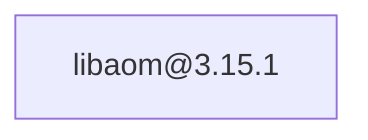

# libaom 3.15.1: BuildEngine integration

[TOC|Content]

## Purpose and integration

AV1 encoder and decoder, retained as the superseded version preceding 3.15.3.

The BuildEngine operator confirmed successful completion of the **109/109 versioned library FSM** on 15 November 2026. The current XML and installed SBOM remain authoritative for artifact coordinates and test evidence.

## Direct and transitive dependencies

No direct external BuildEngine dependency is declared.



## Configuration

Build system: CMake/Ninja with the registered BCC64X Win64 toolchain. All package and tool locations are resolved by BuildEngine variables.

```text
-DAOM_TARGET_CPU:STRING=x86_64
-DENABLE_NASM:BOOL=ON
-DCONFIG_AV1_DECODER:STRING=1
-DCONFIG_AV1_ENCODER:STRING=1
-DCONFIG_MULTITHREAD:STRING=1
-DCONFIG_LIBYUV:STRING=0
-DENABLE_TESTS:BOOL=OFF
-DENABLE_EXAMPLES:BOOL=OFF
-DENABLE_DOCS:BOOL=OFF
-DENABLE_TOOLS:BOOL=OFF
-DBUILD_SHARED_LIBS:BOOL=ON
```

Debug and Release are separate configuration-specific installations.

## Source patches and special considerations

- `patches/libaom/3.15.1/bcc64x-native-win32-threads.patch`
- Historical package version; current libavif 1.4.2 directly consumes libaom 3.15.3. No change to the historical dependency contract.

## Verification

The aggregate library FSM was reported successful. This document does not infer independently verified downstream application-level behavior from the aggregate run.

[Library overview](/manual/libraries.md)
