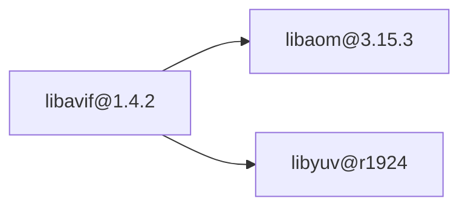

# libavif 1.4.2: BuildEngine integration

[TOC|Content]

## Purpose and current integration

AVIF image encoder and decoder using externally managed libaom and optional libyuv

**BuildEngine package:** `libavif@1.4.2`  
**Upstream source reference:** `v1.4.2`  
**Status:** Successful completion of the 109/109 BuildEngine integration run was confirmed on 15 November 2026. This is not a claim that Skia's separately bundled upstream copies have been replaced by the corresponding external packages.

## Direct and transitive dependencies

- `libaom@3.15.3`
- `libyuv@r1924`



The graph follows the version-specific BuildEngine XML dependency declarations. Shared dependencies are shown once. It does not infer binary linkage from the presence of a package in the overall closure.

## Build configuration

**Toolchain:** Windows x64, RAD Studio C++Builder BCC64X, CMake/Ninja where configured. BuildEngine injects the paths and versions from its dependency and tool registries; no machine-specific absolute path is part of this guide.

```text
-DCMAKE_TOOLCHAIN_FILE:FILEPATH={BuildFileDir}\cmake\toolchains\bcc64x-buildengine-cxx.cmake
-DCMAKE_MAKE_PROGRAM:FILEPATH={Tool:ninja}
-DCMAKE_INSTALL_PREFIX:PATH={InstallRoot}\packages\{LibraryId}\{LibraryVersion}
-DCMAKE_INSTALL_INCLUDEDIR:STRING=include
-DCMAKE_INSTALL_LIBDIR:STRING=lib/win64/{Configuration}
-DCMAKE_INSTALL_BINDIR:STRING=bin/win64/{Configuration}
-DCMAKE_PREFIX_PATH:PATH={DependencyRoot:libaom};{DependencyRoot:libyuv}
-DAOM_LIBRARY:FILEPATH={DependencyRoot:libaom}\lib\win64\{Configuration}\libaom_dll.lib
-DBUILD_SHARED_LIBS:BOOL=ON
-DAVIF_CODEC_AOM:STRING=SYSTEM
-DAVIF_CODEC_DAV1D:STRING=OFF
-DAVIF_CODEC_RAV1E:STRING=OFF
-DAVIF_CODEC_SVT:STRING=OFF
-DAVIF_LIBYUV:STRING=SYSTEM
-DAVIF_JPEG:STRING=OFF
-DAVIF_ZLIBPNG:STRING=OFF
-DAVIF_BUILD_APPS:BOOL=OFF
-DAVIF_BUILD_TESTS:BOOL=OFF
-DAVIF_BUILD_EXAMPLES:BOOL=OFF
-DAVIF_ENABLE_WERROR:BOOL=OFF
-DCMAKE_BUILD_TYPE:STRING=Release
-DCMAKE_BUILD_TYPE:STRING=Debug
```

## Integration patches and special considerations

No version-specific source patch is declared in the source workflow.


AV1/AOM and libyuv are configured as system packages; no bundled codec switch is required.


## Verification and maintenance

The overall BuildEngine run was reported successful for 109 versioned library integrations. Check each package's installed artifacts and its package-specific logs for per-configuration and consumer-test evidence. The authoritative configuration is `admin/build-libraries.xml`; do not duplicate dependency paths or names as fixed values outside its variables.

[Library overview](/manual/libraries.md)
