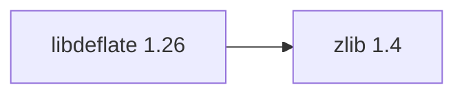

## Updated BuildEngine contract (10 November 2026)

**Aktuelle Deklaration; keine neue PASS-Aussage.** Historische Befunde folgen unverändert unterhalb dieses Abschnitts.

### Complete transitive dependency graph

**Direkte Versionen:** `zlib@1.4`

### Configuration and integration notes

- `-DCMAKE_TOOLCHAIN_FILE:FILEPATH={BuildFileDir}\cmake\toolchains\bcc64x-buildengine-cxx.cmake`
- `-DCMAKE_MAKE_PROGRAM:FILEPATH={Tool:ninja}`
- `-DCMAKE_INSTALL_PREFIX:PATH={InstallRoot}\packages\{LibraryId}\{LibraryVersion}`
- `-DCMAKE_INSTALL_INCLUDEDIR:STRING=include`
- `-DZLIB_INCLUDE_DIR:PATH={DependencyRoot:zlib}\include`
- `-DZLIB_LIBRARY:FILEPATH={DependencyRoot:zlib}\lib\win64\{Configuration}\{ZlibImportLibrary}`
- `-DLIBDEFLATE_BUILD_STATIC_LIB:BOOL=OFF`
- `-DLIBDEFLATE_BUILD_SHARED_LIB:BOOL=ON`
- `-DLIBDEFLATE_COMPRESSION_SUPPORT:BOOL=ON`
- `-DLIBDEFLATE_DECOMPRESSION_SUPPORT:BOOL=ON`
- `-DLIBDEFLATE_ZLIB_SUPPORT:BOOL=ON`
- `-DLIBDEFLATE_GZIP_SUPPORT:BOOL=ON`
- `-DLIBDEFLATE_BUILD_GZIP:BOOL=OFF`
- `-DLIBDEFLATE_BUILD_TESTS:BOOL=ON`
- `-DLIBDEFLATE_USE_SHARED_LIB:BOOL=ON`
- `-DLIBDEFLATE_INSTALL:BOOL=ON`
- `-DCMAKE_BUILD_TYPE:STRING=Release`
- `-DCMAKE_C_FLAGS_RELEASE:STRING=-O2 -DNDEBUG`
- `-DCMAKE_DEBUG_POSTFIX:STRING=`
- `-DCMAKE_INSTALL_LIBDIR:STRING=lib/win64/Release`
- `-DCMAKE_INSTALL_BINDIR:STRING=bin/win64/Release`
- `-DCMAKE_BUILD_TYPE:STRING=Debug`
- `-DCMAKE_C_FLAGS_DEBUG:STRING=-O0`
- `-DCMAKE_DEBUG_POSTFIX:STRING=d`
- `-DCMAKE_INSTALL_LIBDIR:STRING=lib/win64/Debug`
- `-DCMAKE_INSTALL_BINDIR:STRING=bin/win64/Debug`
- `-Dlibdeflate_DIR:PATH={InstallRoot}\packages\{LibraryId}\{LibraryVersion}\lib\win64\Release\cmake\libdeflate`
- Patch: `{Workspace}\.buildengine\patches\{LibraryVersion}\bcc64x-wmain-tests.patch`

---

## Bisherige Migrations- und Integrationsnotizen

# libdeflate 1.26

[TOC|Content]

## Current BuildEngine contract (10 November 2026)

**Contract data; no verified build execution.** Earlier test results apply only to their exact versions and binaries; new runs remain **[not verified]**.

Fast native DEFLATE, zlib and gzip compression/decompression; distinct from zlib streaming interfaces.

**Coordinate:** `libdeflate@1.26` · **Category:** `compression` · **License indicator:** `green`

### Declared dependencies (full transitive closure)

Graph edges reflect exact XML pins. Dashed edges represent extensions; solid edges represent package dependencies. Bundled upstream components are not additional BuildEngine packages.

**Direct dependencies:** `zlib@1.4`

### Configuration and integration notes

**CMake arguments:**

- `-DCMAKE_TOOLCHAIN_FILE:FILEPATH={BuildFileDir}\cmake\toolchains\bcc64x-buildengine-cxx.cmake`
- `-DCMAKE_MAKE_PROGRAM:FILEPATH={Tool:ninja}`
- `-DCMAKE_INSTALL_PREFIX:PATH={InstallRoot}\packages\{LibraryId}\{LibraryVersion}`
- `-DCMAKE_INSTALL_INCLUDEDIR:STRING=include`
- `-DZLIB_INCLUDE_DIR:PATH={DependencyRoot:zlib}\include`
- `-DZLIB_LIBRARY:FILEPATH={DependencyRoot:zlib}\lib\win64\{Configuration}\{ZlibImportLibrary}`
- `-DLIBDEFLATE_BUILD_STATIC_LIB:BOOL=OFF`
- `-DLIBDEFLATE_BUILD_SHARED_LIB:BOOL=ON`
- `-DLIBDEFLATE_COMPRESSION_SUPPORT:BOOL=ON`
- `-DLIBDEFLATE_DECOMPRESSION_SUPPORT:BOOL=ON`
- `-DLIBDEFLATE_ZLIB_SUPPORT:BOOL=ON`
- `-DLIBDEFLATE_GZIP_SUPPORT:BOOL=ON`
- `-DLIBDEFLATE_BUILD_GZIP:BOOL=OFF`
- `-DLIBDEFLATE_BUILD_TESTS:BOOL=ON`
- `-DLIBDEFLATE_USE_SHARED_LIB:BOOL=ON`
- `-DLIBDEFLATE_INSTALL:BOOL=ON`
- `-DCMAKE_BUILD_TYPE:STRING=Release`
- `-DCMAKE_C_FLAGS_RELEASE:STRING=-O2 -DNDEBUG`
- `-DCMAKE_DEBUG_POSTFIX:STRING=`
- `-DCMAKE_INSTALL_LIBDIR:STRING=lib/win64/Release`
- `-DCMAKE_INSTALL_BINDIR:STRING=bin/win64/Release`
- `-DCMAKE_BUILD_TYPE:STRING=Debug`
- `-DCMAKE_C_FLAGS_DEBUG:STRING=-O0`
- `-DCMAKE_DEBUG_POSTFIX:STRING=d`
- `-DCMAKE_INSTALL_LIBDIR:STRING=lib/win64/Debug`
- `-DCMAKE_INSTALL_BINDIR:STRING=bin/win64/Debug`

**Build environment:**

- `CB_BCC64X={Tool:bcc64x}`
- `CB_BDS={BDS}`
- `CTEST_PARALLEL_LEVEL={TestJobs}`
- `PATH={BuildRoot}\packages\{LibraryId}\{LibraryVersion}\{Configuration};{ENV:PATH}`

**Versionsgebundene Patches:**

- `{Workspace}\.buildengine\patches\{LibraryVersion}\bcc64x-wmain-tests.patch`
- `{BuildFileDir}\patches\libdeflate\1.26\bcc64x-wmain-tests.patch`

**Source-Downloads:**

- `https://github.com/ebiggers/libdeflate/releases/download/v{LibraryVersion}/libdeflate-{LibraryVersion}.tar.gz` (SHA-256: `125856d4656e0feab660f94842f835923410c9281fedbcee64598c918da42b5a`)

**Deklarierte Smoke-Tests:**

- `consumer` / `Release` / `package` / `smokes\libdeflate\consumer`

**Explizit geforderte Installationsartefakte:**

- `{InstallRoot}\packages\{LibraryId}\{LibraryVersion}\bin\win64\{Configuration}\{SharedName}.dll`
- `{InstallRoot}\packages\{LibraryId}\{LibraryVersion}\lib\win64\{Configuration}\{SharedName}.lib`
- `{InstallRoot}\packages\{LibraryId}\{LibraryVersion}\lib\win64\{Configuration}\cmake\libdeflate\libdeflate-config.cmake`
- `{InstallRoot}\packages\{LibraryId}\{LibraryVersion}\lib\win64\{Configuration}\cmake\libdeflate\libdeflate-targets.cmake`
- `{InstallRoot}\packages\{LibraryId}\{LibraryVersion}\include\libdeflate.h`
- `{InstallRoot}\packages\{LibraryId}\{LibraryVersion}\COPYING`

**Verbindliche Sources:** `admin/build-libraries.xml` for configuration and pins; FSM/build logs for actual execution. [Library catalog](/manual/libraries.md).
