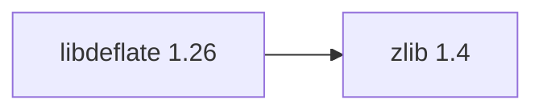

# libdeflate 1.26

[TOC|Content]

## Aktueller BuildEngine-Vertrag (10. November 2026)

**Vertragsdaten, keine bestätigte Build-Ausführung.** Ergebnisse aus früheren Tests sind versions- und buildgebunden; neue Ausführungen bleiben **[nicht verifiziert]**.

Fast native DEFLATE, zlib and gzip compression/decompression; distinct from zlib streaming interfaces.

**Koordinate:** `libdeflate@1.26` · **Kategorie:** `compression` · **Lizenzampel:** `green`

### Deklarierte Abhängigkeiten (vollständig transitiv)

Die Diagrammkanten stammen aus den exakt gepinnten XML-Abhängigkeiten. Gestrichelte Kanten kennzeichnen Erweiterungen, durchgezogene Kanten Paketabhängigkeiten. Upstream-intern gebündelte Komponenten sind keine zusätzlichen BuildEngine-Koordinaten.

**Direkte Abhängigkeiten:** `zlib@1.4`

### Konfiguration und Besonderheiten

**CMake-Argumente:**

- `-DCMAKE_TOOLCHAIN_FILE:FILEPATH={BuildFileDir}\cmake\toolchains\bcc64x-buildengine-cxx.cmake`
- `-DCMAKE_MAKE_PROGRAM:FILEPATH={Tool:ninja}`
- `-DCMAKE_INSTALL_PREFIX:PATH={InstallRoot}\packages\{LibraryId}\{LibraryVersion}`
- `-DCMAKE_INSTALL_INCLUDEDIR:STRING=include`
- `-DZLIB_INCLUDE_DIR:PATH={DependencyRoot:zlib}\include`
- `-DZLIB_LIBRARY:FILEPATH={DependencyRoot:zlib}\lib\win64\{Configuration}\{ZlibImportLibrary}`
- `-DLIBDEFLATE_BUILD_STATIC_LIB:BOOL=OFF`
- `-DLIBDEFLATE_BUILD_SHARED_LIB:BOOL=ON`
- `-DLIBDEFLATE_COMPRESSION_SUPPORT:BOOL=ON`
- `-DLIBDEFLATE_DECOMPRESSION_SUPPORT:BOOL=ON`
- `-DLIBDEFLATE_ZLIB_SUPPORT:BOOL=ON`
- `-DLIBDEFLATE_GZIP_SUPPORT:BOOL=ON`
- `-DLIBDEFLATE_BUILD_GZIP:BOOL=OFF`
- `-DLIBDEFLATE_BUILD_TESTS:BOOL=ON`
- `-DLIBDEFLATE_USE_SHARED_LIB:BOOL=ON`
- `-DLIBDEFLATE_INSTALL:BOOL=ON`
- `-DCMAKE_BUILD_TYPE:STRING=Release`
- `-DCMAKE_C_FLAGS_RELEASE:STRING=-O2 -DNDEBUG`
- `-DCMAKE_DEBUG_POSTFIX:STRING=`
- `-DCMAKE_INSTALL_LIBDIR:STRING=lib/win64/Release`
- `-DCMAKE_INSTALL_BINDIR:STRING=bin/win64/Release`
- `-DCMAKE_BUILD_TYPE:STRING=Debug`
- `-DCMAKE_C_FLAGS_DEBUG:STRING=-O0`
- `-DCMAKE_DEBUG_POSTFIX:STRING=d`
- `-DCMAKE_INSTALL_LIBDIR:STRING=lib/win64/Debug`
- `-DCMAKE_INSTALL_BINDIR:STRING=bin/win64/Debug`

**Build-Umgebung:**

- `CB_BCC64X={Tool:bcc64x}`
- `CB_BDS={BDS}`
- `CTEST_PARALLEL_LEVEL={TestJobs}`
- `PATH={BuildRoot}\packages\{LibraryId}\{LibraryVersion}\{Configuration};{ENV:PATH}`

**Versionsgebundene Patches:**

- `{Workspace}\.buildengine\patches\{LibraryVersion}\bcc64x-wmain-tests.patch`
- `{BuildFileDir}\patches\libdeflate\1.26\bcc64x-wmain-tests.patch`

**Source-Downloads:**

- `https://github.com/ebiggers/libdeflate/releases/download/v{LibraryVersion}/libdeflate-{LibraryVersion}.tar.gz` (SHA-256: `125856d4656e0feab660f94842f835923410c9281fedbcee64598c918da42b5a`)

**Deklarierte Smoke-Tests:**

- `consumer` / `Release` / `package` / `smokes\libdeflate\consumer`

**Explizit geforderte Installationsartefakte:**

- `{InstallRoot}\packages\{LibraryId}\{LibraryVersion}\bin\win64\{Configuration}\{SharedName}.dll`
- `{InstallRoot}\packages\{LibraryId}\{LibraryVersion}\lib\win64\{Configuration}\{SharedName}.lib`
- `{InstallRoot}\packages\{LibraryId}\{LibraryVersion}\lib\win64\{Configuration}\cmake\libdeflate\libdeflate-config.cmake`
- `{InstallRoot}\packages\{LibraryId}\{LibraryVersion}\lib\win64\{Configuration}\cmake\libdeflate\libdeflate-targets.cmake`
- `{InstallRoot}\packages\{LibraryId}\{LibraryVersion}\include\libdeflate.h`
- `{InstallRoot}\packages\{LibraryId}\{LibraryVersion}\COPYING`

**Verbindliche Quellen:** `admin/build-libraries.xml` für Konfiguration und Pins; FSM/Buildlogs für tatsächliche Ausführung. [Bibliotheksverzeichnis](/manual/libraries.md).
