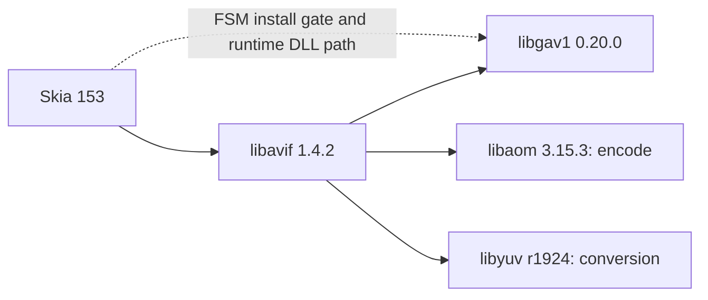

# libgav1 0.20.0: Native BuildEngine decoder package

[TOC|Content]

## Purpose and ownership

`libgav1@0.20.0` is an independently managed AV1 decoder package. The intended consumer chain is `skia@153 -> libavif@1.4.2 -> libgav1@0.20.0`. Skia also declares libgav1 directly as an FSM install dependency and for its variant-specific DLL runtime environment; it does not build its own libgav1 source.

This guide describes the **declared schema-17 contract**, not an independently verified build result. The earlier operator-confirmed 109/109 FSM result predates this codec integration.

## Source and version identity

- Upstream version: `v0.20.0`
- Source archive: `https://github.com/chromium-full-mirror/codecs_libgav1/archive/refs/tags/v0.20.0.tar.gz`
- Source root: `codecs_libgav1-0.20.0`
- Security source reference: `https://chromium.googlesource.com/codecs/libgav1/`, commit `c05bf9be660cf170d7c26bd06bb42b3322180e58`
- License contract: Apache-2.0; installed original `licenses/libgav1/LICENSE`

The source phase requires the upstream CMake project, install script, decoder header and license. Both patches are version-bound, checked with `git apply --check`, applied, and verified with `git apply --reverse --check`.

## Native Windows build and installation

The library is configured with BuildEngine's `bcc64x-buildengine-cxx.cmake` toolchain, managed Ninja and CMake, and the variant-specific package directories. The declared settings are:

```text
-DBUILD_SHARED_LIBS:BOOL=ON
-DLIBGAV1_THREADPOOL_USE_STD_MUTEX:STRING=1
-DLIBGAV1_ENABLE_EXAMPLES:BOOL=OFF
-DLIBGAV1_ENABLE_TESTS:BOOL=OFF
-DCMAKE_INSTALL_INCLUDEDIR:STRING=include
-DCMAKE_INSTALL_LIBDIR:STRING=lib/win64/{Configuration}
-DCMAKE_INSTALL_BINDIR:STRING=bin/win64/{Configuration}
```

The two source patches are:

- `admin/patches/libgav1/0.20.0/bcc64x-winthreads.patch`: select the Windows worker-thread implementation under BCC64X/Win64.
- `admin/patches/libgav1/0.20.0/bcc64x-install-layout.patch`: install the shared library with separate `RUNTIME`, `LIBRARY`, and `ARCHIVE` destinations.

Required installed artifacts for both Release and Debug:

```text
include/gav1/decoder.h
lib/win64/{Configuration}/libgav1_shared.lib
bin/win64/{Configuration}/libgav1_shared.dll
licenses/libgav1/LICENSE
```

These are declared exact-path install gates, not observed target-machine artifacts. The package publishes headers, the import library, and the runtime DLL to the standard shared consumer tree.

## Consumer relationship and dependency diagram



libavif declares `AVIF_CODEC_LIBGAV1=SYSTEM`, `AVIF_CODEC_AOM_DECODE=OFF`, `AVIF_CODEC_AOM_ENCODE=ON`, and `AVIF_LIBYUV=SYSTEM`. Its import path is resolved from `{DependencyRoot:libgav1}` with the current `{Configuration}`.

## Verification boundary

**[not verified]** A matching BCC64X Release and Debug run, import-library and DLL outputs, libavif's effective decoder target resolution, PE import tables, Windows loader closure, and an AVIF decoding consumer smoke still require machine evidence. A valid XML/SBOM dependency declaration alone does not prove an external DLL import.

No library-specific alternate compiler, hidden bundled fallback, or source rewriting during Build is part of this contract. Update this guide only from the current XML and concrete build evidence.

[Skia 153](/package/skia/153/migration) · [libavif 1.4.2](/package/libavif/1.4.2/migration) · [Library catalog](/manual/libraries.md)
