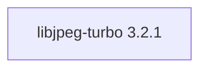

## Updated BuildEngine contract (10 November 2026)

**Declared configuration; no new test PASS.**

### Complete transitive dependencies

Direct: none

### Current configuration

- `-DCMAKE_TOOLCHAIN_FILE:FILEPATH={BuildFileDir}\cmake\toolchains\bcc64x-buildengine-cxx.cmake`
- `-DCMAKE_MAKE_PROGRAM:FILEPATH={Tool:ninja}`
- `-DCMAKE_INSTALL_PREFIX:PATH={InstallRoot}\packages\{LibraryId}\{LibraryVersion}`
- `-DCMAKE_INSTALL_INCLUDEDIR:STRING=include`
- `-DENABLE_SHARED:BOOL=ON`
- `-DENABLE_STATIC:BOOL=OFF`
- `-DWITH_SIMD:BOOL=OFF`
- `-DWITH_TURBOJPEG:BOOL=ON`
- `-DWITH_TOOLS:BOOL={TestsEnabled}`
- `-DWITH_TESTS:BOOL={TestsEnabled}`
- `-DCMAKE_BUILD_TYPE:STRING=Release`
- `-DCMAKE_C_FLAGS_RELEASE:STRING=-O2 -DNDEBUG`
- `-DCMAKE_INSTALL_LIBDIR:STRING=lib/win64/Release`
- `-DCMAKE_INSTALL_BINDIR:STRING=bin/win64/Release`
- `-DCMAKE_BUILD_TYPE:STRING=Debug`
- `-DCMAKE_C_FLAGS_DEBUG:STRING=-O0`
- `-DCMAKE_DEBUG_POSTFIX:STRING=d`
- `-DCMAKE_INSTALL_LIBDIR:STRING=lib/win64/Debug`
- `-DCMAKE_INSTALL_BINDIR:STRING=bin/win64/Debug`

---

## Historical integration notes

# libjpeg-turbo 3.2.1

[TOC|Content]

## Current BuildEngine contract (10 November 2026)

**Contract data; no verified build execution.** Earlier test results apply only to their exact versions and binaries; new runs remain **[not verified]**.

High-performance JPEG codec using SIMD acceleration while remaining API-compatible with libjpeg.

**Coordinate:** `libjpeg-turbo@3.2.1` · **Category:** `image` · **License indicator:** `yellow`

### Declared dependencies (full transitive closure)

Graph edges reflect exact XML pins. Dashed edges represent extensions; solid edges represent package dependencies. Bundled upstream components are not additional BuildEngine packages.

**Direct dependencies:** None declared.

### Configuration and integration notes

**CMake arguments:**

- `-DCMAKE_TOOLCHAIN_FILE:FILEPATH={BuildFileDir}\cmake\toolchains\bcc64x-buildengine-cxx.cmake`
- `-DCMAKE_MAKE_PROGRAM:FILEPATH={Tool:ninja}`
- `-DCMAKE_INSTALL_PREFIX:PATH={InstallRoot}\packages\{LibraryId}\{LibraryVersion}`
- `-DCMAKE_INSTALL_INCLUDEDIR:STRING=include`
- `-DENABLE_SHARED:BOOL=ON`
- `-DENABLE_STATIC:BOOL=OFF`
- `-DWITH_SIMD:BOOL=OFF`
- `-DWITH_TURBOJPEG:BOOL=ON`
- `-DWITH_TOOLS:BOOL={TestsEnabled}`
- `-DWITH_TESTS:BOOL={TestsEnabled}`
- `-DCMAKE_BUILD_TYPE:STRING=Release`
- `-DCMAKE_C_FLAGS_RELEASE:STRING=-O2 -DNDEBUG`
- `-DCMAKE_INSTALL_LIBDIR:STRING=lib/win64/Release`
- `-DCMAKE_INSTALL_BINDIR:STRING=bin/win64/Release`
- `-DCMAKE_BUILD_TYPE:STRING=Debug`
- `-DCMAKE_C_FLAGS_DEBUG:STRING=-O0`
- `-DCMAKE_DEBUG_POSTFIX:STRING=d`
- `-DCMAKE_INSTALL_LIBDIR:STRING=lib/win64/Debug`
- `-DCMAKE_INSTALL_BINDIR:STRING=bin/win64/Debug`

**Build environment:**

- `CB_BCC64X={Tool:bcc64x}`
- `CB_BDS={BDS}`
- `CTEST_PARALLEL_LEVEL={TestJobs}`

**Versionsgebundene Patches:**

- `{Workspace}\.buildengine\patches\{LibraryVersion}\bcc64x-skip-unsupported-installer.patch`
- `{BuildFileDir}\patches\libjpeg-turbo\3.2.1\bcc64x-skip-unsupported-installer.patch`

**Source-Downloads:**

- `https://github.com/libjpeg-turbo/libjpeg-turbo/releases/download/{LibraryVersion}/libjpeg-turbo-{LibraryVersion}.tar.gz` (SHA-256: `c27ad72a68da151177929aa969ae773a2da5ac2af9ce946079314fdac8cece7f`)

**Deklarierte Smoke-Tests:**

- `consumer` / `Release` / `published` / `smokes\libjpeg-turbo\consumer`

**Explizit geforderte Installationsartefakte:**

- `{InstallRoot}\packages\{LibraryId}\{LibraryVersion}\lib\win64\{Configuration}`
- `{InstallRoot}\packages\{LibraryId}\{LibraryVersion}\bin\win64\{Configuration}`
- `{InstallRoot}\packages\{LibraryId}\{LibraryVersion}\include\jpeglib.h`
- `{InstallRoot}\packages\{LibraryId}\{LibraryVersion}\include\turbojpeg.h`
- `{InstallRoot}\packages\{LibraryId}\{LibraryVersion}\LICENSE.md`

**Verbindliche Sources:** `admin/build-libraries.xml` for configuration and pins; FSM/build logs for actual execution. [Library catalog](/manual/libraries.md).
