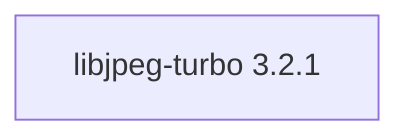

## Aktualisierter BuildEngine-Vertrag (10. November 2026)

**Deklarierte Konfiguration, nicht neuer Test-PASS.**

### Vollständige transitive Abhängigkeiten

Direkt: keine

### Aktuelle Konfiguration

- `-DCMAKE_TOOLCHAIN_FILE:FILEPATH={BuildFileDir}\cmake\toolchains\bcc64x-buildengine-cxx.cmake`
- `-DCMAKE_MAKE_PROGRAM:FILEPATH={Tool:ninja}`
- `-DCMAKE_INSTALL_PREFIX:PATH={InstallRoot}\packages\{LibraryId}\{LibraryVersion}`
- `-DCMAKE_INSTALL_INCLUDEDIR:STRING=include`
- `-DENABLE_SHARED:BOOL=ON`
- `-DENABLE_STATIC:BOOL=OFF`
- `-DWITH_SIMD:BOOL=OFF`
- `-DWITH_TURBOJPEG:BOOL=ON`
- `-DWITH_TOOLS:BOOL={TestsEnabled}`
- `-DWITH_TESTS:BOOL={TestsEnabled}`
- `-DCMAKE_BUILD_TYPE:STRING=Release`
- `-DCMAKE_C_FLAGS_RELEASE:STRING=-O2 -DNDEBUG`
- `-DCMAKE_INSTALL_LIBDIR:STRING=lib/win64/Release`
- `-DCMAKE_INSTALL_BINDIR:STRING=bin/win64/Release`
- `-DCMAKE_BUILD_TYPE:STRING=Debug`
- `-DCMAKE_C_FLAGS_DEBUG:STRING=-O0`
- `-DCMAKE_DEBUG_POSTFIX:STRING=d`
- `-DCMAKE_INSTALL_LIBDIR:STRING=lib/win64/Debug`
- `-DCMAKE_INSTALL_BINDIR:STRING=bin/win64/Debug`

---

## Historische Integrationsnotizen

# libjpeg-turbo 3.2.1

[TOC|Content]

## Aktueller BuildEngine-Vertrag (10. November 2026)

**Vertragsdaten, keine bestätigte Build-Ausführung.** Ergebnisse aus früheren Tests sind versions- und buildgebunden; neue Ausführungen bleiben **[nicht verifiziert]**.

High-performance JPEG codec using SIMD acceleration while remaining API-compatible with libjpeg.

**Koordinate:** `libjpeg-turbo@3.2.1` · **Kategorie:** `image` · **Lizenzampel:** `yellow`

### Deklarierte Abhängigkeiten (vollständig transitiv)

Die Diagrammkanten stammen aus den exakt gepinnten XML-Abhängigkeiten. Gestrichelte Kanten kennzeichnen Erweiterungen, durchgezogene Kanten Paketabhängigkeiten. Upstream-intern gebündelte Komponenten sind keine zusätzlichen BuildEngine-Koordinaten.

**Direkte Abhängigkeiten:** Keine deklariert.

### Konfiguration und Besonderheiten

**CMake-Argumente:**

- `-DCMAKE_TOOLCHAIN_FILE:FILEPATH={BuildFileDir}\cmake\toolchains\bcc64x-buildengine-cxx.cmake`
- `-DCMAKE_MAKE_PROGRAM:FILEPATH={Tool:ninja}`
- `-DCMAKE_INSTALL_PREFIX:PATH={InstallRoot}\packages\{LibraryId}\{LibraryVersion}`
- `-DCMAKE_INSTALL_INCLUDEDIR:STRING=include`
- `-DENABLE_SHARED:BOOL=ON`
- `-DENABLE_STATIC:BOOL=OFF`
- `-DWITH_SIMD:BOOL=OFF`
- `-DWITH_TURBOJPEG:BOOL=ON`
- `-DWITH_TOOLS:BOOL={TestsEnabled}`
- `-DWITH_TESTS:BOOL={TestsEnabled}`
- `-DCMAKE_BUILD_TYPE:STRING=Release`
- `-DCMAKE_C_FLAGS_RELEASE:STRING=-O2 -DNDEBUG`
- `-DCMAKE_INSTALL_LIBDIR:STRING=lib/win64/Release`
- `-DCMAKE_INSTALL_BINDIR:STRING=bin/win64/Release`
- `-DCMAKE_BUILD_TYPE:STRING=Debug`
- `-DCMAKE_C_FLAGS_DEBUG:STRING=-O0`
- `-DCMAKE_DEBUG_POSTFIX:STRING=d`
- `-DCMAKE_INSTALL_LIBDIR:STRING=lib/win64/Debug`
- `-DCMAKE_INSTALL_BINDIR:STRING=bin/win64/Debug`

**Build-Umgebung:**

- `CB_BCC64X={Tool:bcc64x}`
- `CB_BDS={BDS}`
- `CTEST_PARALLEL_LEVEL={TestJobs}`

**Versionsgebundene Patches:**

- `{Workspace}\.buildengine\patches\{LibraryVersion}\bcc64x-skip-unsupported-installer.patch`
- `{BuildFileDir}\patches\libjpeg-turbo\3.2.1\bcc64x-skip-unsupported-installer.patch`

**Source-Downloads:**

- `https://github.com/libjpeg-turbo/libjpeg-turbo/releases/download/{LibraryVersion}/libjpeg-turbo-{LibraryVersion}.tar.gz` (SHA-256: `c27ad72a68da151177929aa969ae773a2da5ac2af9ce946079314fdac8cece7f`)

**Deklarierte Smoke-Tests:**

- `consumer` / `Release` / `published` / `smokes\libjpeg-turbo\consumer`

**Explizit geforderte Installationsartefakte:**

- `{InstallRoot}\packages\{LibraryId}\{LibraryVersion}\lib\win64\{Configuration}`
- `{InstallRoot}\packages\{LibraryId}\{LibraryVersion}\bin\win64\{Configuration}`
- `{InstallRoot}\packages\{LibraryId}\{LibraryVersion}\include\jpeglib.h`
- `{InstallRoot}\packages\{LibraryId}\{LibraryVersion}\include\turbojpeg.h`
- `{InstallRoot}\packages\{LibraryId}\{LibraryVersion}\LICENSE.md`

**Verbindliche Quellen:** `admin/build-libraries.xml` für Konfiguration und Pins; FSM/Buildlogs für tatsächliche Ausführung. [Bibliotheksverzeichnis](/manual/libraries.md).
