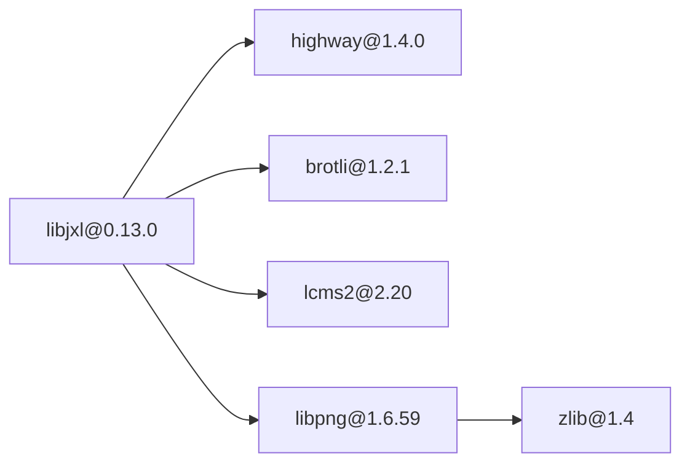

# libjxl 0.13.0: BuildEngine integration

[TOC|Content]

## Purpose and current integration

JPEG XL image encoder and decoder with managed Highway, Brotli and LCMS2 dependencies

**BuildEngine package:** `libjxl@0.13.0`  
**Upstream source reference:** `v0.13.0`  
**Status:** Successful completion of the 109/109 BuildEngine integration run was confirmed on 15 November 2026. This is not a claim that Skia's separately bundled upstream copies have been replaced by the corresponding external packages.

## Direct and transitive dependencies

- `highway@1.4.0`
- `brotli@1.2.1`
- `lcms2@2.20`
- `libpng@1.6.59`



The graph follows the version-specific BuildEngine XML dependency declarations. Shared dependencies are shown once. It does not infer binary linkage from the presence of a package in the overall closure.

## Build configuration

**Toolchain:** Windows x64, RAD Studio C++Builder BCC64X, CMake/Ninja where configured. BuildEngine injects the paths and versions from its dependency and tool registries; no machine-specific absolute path is part of this guide.

```text
-DCMAKE_TOOLCHAIN_FILE:FILEPATH={BuildFileDir}\cmake\toolchains\bcc64x-buildengine-cxx.cmake
-DCMAKE_MAKE_PROGRAM:FILEPATH={Tool:ninja}
-DCMAKE_INSTALL_PREFIX:PATH={InstallRoot}\packages\{LibraryId}\{LibraryVersion}
-DCMAKE_INSTALL_INCLUDEDIR:STRING=include
-DCMAKE_INSTALL_LIBDIR:STRING=lib/win64/{Configuration}
-DCMAKE_INSTALL_BINDIR:STRING=bin/win64/{Configuration}
-DCMAKE_PREFIX_PATH:PATH={DependencyRoot:highway};{DependencyRoot:brotli};{DependencyRoot:lcms2};{DependencyRoot:libpng}
-DBUILD_SHARED_LIBS:BOOL=ON
-DBUILD_TESTING:BOOL=OFF
-DJPEGXL_ENABLE_TOOLS:BOOL=OFF
-DJPEGXL_ENABLE_BENCHMARK:BOOL=OFF
-DJPEGXL_ENABLE_EXAMPLES:BOOL=OFF
-DJPEGXL_ENABLE_JNI:BOOL=OFF
-DJPEGXL_ENABLE_OPENEXR:BOOL=OFF
-DJPEGXL_ENABLE_SJPEG:BOOL=OFF
-DJPEGXL_ENABLE_MANPAGES:BOOL=OFF
-DJPEGXL_ENABLE_DOXYGEN:BOOL=OFF
-DJPEGXL_ENABLE_VIEWERS:BOOL=OFF
-DJPEGXL_ENABLE_SKCMS:BOOL=OFF
-DJPEGXL_FORCE_SYSTEM_BROTLI:BOOL=ON
-DJPEGXL_FORCE_SYSTEM_HWY:BOOL=ON
-DJPEGXL_FORCE_SYSTEM_LCMS2:BOOL=ON
-DJPEGXL_BUNDLE_LIBPNG:BOOL=OFF
-DCMAKE_BUILD_TYPE:STRING=Release
-DCMAKE_BUILD_TYPE:STRING=Debug
```

## Integration patches and special considerations

No version-specific source patch is declared in the source workflow.


JPEG XL is configured to consume external Highway, Brotli and LCMS2, with bundled libpng disabled.


## Verification and maintenance

The overall BuildEngine run was reported successful for 109 versioned library integrations. Check each package's installed artifacts and its package-specific logs for per-configuration and consumer-test evidence. The authoritative configuration is `admin/build-libraries.xml`; do not duplicate dependency paths or names as fixed values outside its variables.

[Library overview](/manual/libraries.md)
