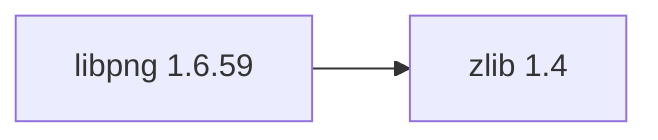

## Updated BuildEngine contract (10 November 2026)

**Declared configuration; no new test PASS.**

### Complete transitive dependencies

Direkt: `zlib@1.4`

### Current configuration

- `-DCMAKE_TOOLCHAIN_FILE:FILEPATH={BuildFileDir}\cmake\toolchains\bcc64x-buildengine-cxx.cmake`
- `-DCMAKE_MAKE_PROGRAM:FILEPATH={Tool:ninja}`
- `-DCMAKE_INSTALL_PREFIX:PATH={InstallRoot}\packages\{LibraryId}\{LibraryVersion}`
- `-DCMAKE_INSTALL_INCLUDEDIR:STRING=include`
- `-DCMAKE_PREFIX_PATH:PATH={DependencyRoot:zlib}`
- `-DPNG_SHARED:BOOL=ON`
- `-DPNG_STATIC:BOOL=OFF`
- `-DPNG_TESTS:BOOL=OFF`
- `-DCMAKE_BUILD_TYPE:STRING=Release`
- `-DCMAKE_C_FLAGS_RELEASE:STRING=-O2 -DNDEBUG`
- `-DCMAKE_INSTALL_LIBDIR:STRING=lib/win64/Release`
- `-DCMAKE_INSTALL_BINDIR:STRING=bin/win64/Release`
- `-DCMAKE_BUILD_TYPE:STRING=Debug`
- `-DCMAKE_C_FLAGS_DEBUG:STRING=-O0`
- `-DCMAKE_DEBUG_POSTFIX:STRING=d`
- `-DCMAKE_INSTALL_LIBDIR:STRING=lib/win64/Debug`
- `-DCMAKE_INSTALL_BINDIR:STRING=bin/win64/Debug`

---

## Historical integration notes

# libpng 1.6.59

[TOC|Content]

## Current BuildEngine contract (10 November 2026)

**Contract data; no verified build execution.** Earlier test results apply only to their exact versions and binaries; new runs remain **[not verified]**.

Reference PNG library for reading, writing, and manipulating Portable Network Graphics images.

**Coordinate:** `libpng@1.6.59` · **Category:** `image` · **License indicator:** `green`

### Declared dependencies (full transitive closure)

Graph edges reflect exact XML pins. Dashed edges represent extensions; solid edges represent package dependencies. Bundled upstream components are not additional BuildEngine packages.

**Direct dependencies:** `zlib@1.4`

### Configuration and integration notes

**CMake arguments:**

- `-DCMAKE_TOOLCHAIN_FILE:FILEPATH={BuildFileDir}\cmake\toolchains\bcc64x-buildengine-cxx.cmake`
- `-DCMAKE_MAKE_PROGRAM:FILEPATH={Tool:ninja}`
- `-DCMAKE_INSTALL_PREFIX:PATH={InstallRoot}\packages\{LibraryId}\{LibraryVersion}`
- `-DCMAKE_INSTALL_INCLUDEDIR:STRING=include`
- `-DCMAKE_PREFIX_PATH:PATH={DependencyRoot:zlib}`
- `-DPNG_SHARED:BOOL=ON`
- `-DPNG_STATIC:BOOL=OFF`
- `-DPNG_TESTS:BOOL=OFF`
- `-DCMAKE_BUILD_TYPE:STRING=Release`
- `-DCMAKE_C_FLAGS_RELEASE:STRING=-O2 -DNDEBUG`
- `-DCMAKE_INSTALL_LIBDIR:STRING=lib/win64/Release`
- `-DCMAKE_INSTALL_BINDIR:STRING=bin/win64/Release`
- `-DCMAKE_BUILD_TYPE:STRING=Debug`
- `-DCMAKE_C_FLAGS_DEBUG:STRING=-O0`
- `-DCMAKE_DEBUG_POSTFIX:STRING=d`
- `-DCMAKE_INSTALL_LIBDIR:STRING=lib/win64/Debug`
- `-DCMAKE_INSTALL_BINDIR:STRING=bin/win64/Debug`

**Build environment:**

- `CB_BCC64X={Tool:bcc64x}`
- `CB_BDS={BDS}`

**Source-Downloads:**

- `https://download.sourceforge.net/libpng/libpng-{LibraryVersion}.tar.xz` (SHA-256: `d80dd2a38a37f803cb9b6ac7b14bd6e74ddc3b654780a8380bdf93523fdb4389`)

**Deklarierte Smoke-Tests:**

- `consumer` / `Release` / `published` / `smokes\libpng\consumer`

**Explizit geforderte Installationsartefakte:**

- `{InstallRoot}\packages\{LibraryId}\{LibraryVersion}\lib\win64\{Configuration}`
- `{InstallRoot}\packages\{LibraryId}\{LibraryVersion}\bin\win64\{Configuration}`
- `{InstallRoot}\packages\{LibraryId}\{LibraryVersion}\include\png.h`
- `{InstallRoot}\packages\{LibraryId}\{LibraryVersion}\include\pngconf.h`
- `{InstallRoot}\packages\{LibraryId}\{LibraryVersion}\LICENSE`

**Verbindliche Sources:** `admin/build-libraries.xml` for configuration and pins; FSM/build logs for actual execution. [Library catalog](/manual/libraries.md).
