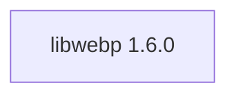

# libwebp 1.6.0: BuildEngine integration

[TOC|Content]

## Purpose and status

WebP image decoding, encoding, and container muxing via the upstream WebM Project. **Registered in the BuildEngine Admin XML on 15 November 2026; Debug/Release BCC64X build, installed DLL import, and consumer smoke are not yet verified.** Do not interpret registration as a successful FSM run.

**Coordinate:** `libwebp@1.6.0`  
**Upstream:** `https://github.com/webmproject/libwebp.git`, tag `v1.6.0`  
**Compiler:** BCC64X, Windows x64; CMake with managed Ninja.

## Dependency graph

The initial library XML declares no direct external package dependencies. Skia 153 now declares this coordinate as a direct dependency. The GN external linkage is configured, but the installed import names and DLL/consumer runtime are not yet verified.



## Build settings

The BuildEngine XML remains the authoritative source of tool and package roots; no absolute machine path or independent version constant belongs in the integration.

```text
-DCMAKE_TOOLCHAIN_FILE:FILEPATH={BuildFileDir}\cmake\toolchains\bcc64x-buildengine-cxx.cmake
-DCMAKE_MAKE_PROGRAM:FILEPATH={Tool:ninja}
-DCMAKE_INSTALL_PREFIX:PATH={InstallRoot}\packages\{LibraryId}\{LibraryVersion}
-DCMAKE_INSTALL_INCLUDEDIR:STRING=include
-DCMAKE_INSTALL_LIBDIR:STRING=lib/win64/{Configuration}
-DCMAKE_INSTALL_BINDIR:STRING=bin/win64/{Configuration}
-DBUILD_SHARED_LIBS:BOOL=ON
-DWEBP_LINK_STATIC:BOOL=OFF
-DWEBP_BUILD_LIBWEBPMUX:BOOL=ON
-DWEBP_ENABLE_SIMD:BOOL=ON
-DWEBP_BUILD_CWEBP:BOOL=OFF
-DWEBP_BUILD_DWEBP:BOOL=OFF
-DWEBP_BUILD_GIF2WEBP:BOOL=OFF
-DWEBP_BUILD_IMG2WEBP:BOOL=OFF
-DWEBP_BUILD_VWEBP:BOOL=OFF
-DWEBP_BUILD_WEBPINFO:BOOL=OFF
-DWEBP_BUILD_WEBPMUX:BOOL=OFF
-DWEBP_BUILD_ANIM_UTILS:BOOL=OFF
-DWEBP_BUILD_EXTRAS:BOOL=OFF
-DCMAKE_BUILD_TYPE:STRING=Release|Debug
```

**BCC64X build correction (15 November 2026):** The attached Release build log showed repeated `E714: SSE2 register return with SSE2 disabled` and X86 FP Stackifier crashes. Upstream `cmake/cpu.cmake` adds `-mno-sse2` to the global C flags when `WEBP_ENABLE_SIMD=OFF`. On x64 that also disables the floating-point ABI required by the compiler. The BuildEngine configuration now sets `WEBP_ENABLE_SIMD=ON` so the upstream feature detection preserves baseline SSE2. Debug and Release retests are still required. This must not be fixed by changing individual floating-point functions or the shared BCC64X toolchain.

## Install and metadata

Headers are required under `include/webp`; import libraries under `lib/win64/{Configuration}`. The upstream `COPYING` is copied to `licenses/libwebp/COPYING` and is the metadata license path. Installed DLLs are published from configuration-specific `bin` when present. The install output and actual import library names must be inspected before consuming the package from Skia.

## Skia externalization

Skia 153 now declares `libwebp@1.6.0` directly and selects `skia_use_system_libwebp = true` for both encoding and decoding. Its versioned GN patch replaces the upstream system target's bare library names with BuildEngine-managed include paths and per-configuration import archives for `webp`, `webpdemux` and `webpmux`. The old bundled source archive/extraction is no longer in the Skia source workflow. **This is declared integration, not a proven BCC64X link:** rebuild libwebp, inspect the actual installed import names and DLLs, then run Skia Debug/Release GN, build, loader smoke and SBOM checks. Do not claim a successful consumer before this evidence exists.

[Skia externalization](/manual/skia-externalization.md) · [Libraries](/manual/libraries.md) · [News](/news/)
