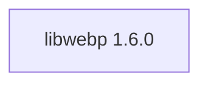

# libwebp 1.6.0: BuildEngine integration

[TOC|Content]

## Purpose and status

WebP image decoding, encoding, and container muxing via the upstream WebM Project. **Registered in the BuildEngine Admin XML on 15 November 2026; Debug/Release BCC64X build, installed DLL import, and consumer smoke are not yet verified.** Do not interpret registration as a successful FSM run.

**Coordinate:** `libwebp@1.6.0`  
**Upstream:** `https://github.com/webmproject/libwebp.git`, tag `v1.6.0`  
**Compiler:** BCC64X, Windows x64; CMake with managed Ninja.

## Dependency graph

The initial library XML declares no direct external package dependencies. An external Skia link must be added only once a matching installed import library and the GN wiring have been verified.



## Build settings

The BuildEngine XML remains the authoritative source of tool and package roots; no absolute machine path or independent version constant belongs in the integration.

```text
-DCMAKE_TOOLCHAIN_FILE:FILEPATH={BuildFileDir}\cmake\toolchains\bcc64x-buildengine-cxx.cmake
-DCMAKE_MAKE_PROGRAM:FILEPATH={Tool:ninja}
-DCMAKE_INSTALL_PREFIX:PATH={InstallRoot}\packages\{LibraryId}\{LibraryVersion}
-DCMAKE_INSTALL_INCLUDEDIR:STRING=include
-DCMAKE_INSTALL_LIBDIR:STRING=lib/win64/{Configuration}
-DCMAKE_INSTALL_BINDIR:STRING=bin/win64/{Configuration}
-DBUILD_SHARED_LIBS:BOOL=ON
-DWEBP_LINK_STATIC:BOOL=OFF
-DWEBP_BUILD_LIBWEBPMUX:BOOL=ON
-DWEBP_ENABLE_SIMD:BOOL=OFF
-DWEBP_BUILD_CWEBP:BOOL=OFF
-DWEBP_BUILD_DWEBP:BOOL=OFF
-DWEBP_BUILD_GIF2WEBP:BOOL=OFF
-DWEBP_BUILD_IMG2WEBP:BOOL=OFF
-DWEBP_BUILD_VWEBP:BOOL=OFF
-DWEBP_BUILD_WEBPINFO:BOOL=OFF
-DWEBP_BUILD_WEBPMUX:BOOL=OFF
-DWEBP_BUILD_ANIM_UTILS:BOOL=OFF
-DWEBP_BUILD_EXTRAS:BOOL=OFF
-DCMAKE_BUILD_TYPE:STRING=Release|Debug
```

SIMD is initially disabled for a conservative first BCC64X port; enabling upstream SIMD optimizations is a separate measured follow-up, not an assumed optimization.

## Install and metadata

Headers are required under `include/webp`; import libraries under `lib/win64/{Configuration}`. The upstream `COPYING` is copied to `licenses/libwebp/COPYING` and is the metadata license path. Installed DLLs are published from configuration-specific `bin` when present. The install output and actual import library names must be inspected before consuming the package from Skia.

## Skia externalization

Skia 153 currently enables WebP encoding and decoding but still uses `skia_use_system_libwebp = false`. Its pinned bundled WebP source must remain available until the Skia GN target has been adapted to consume installed headers and DLL import libraries, with both configurations and consumer linkage verified. **The independent libwebp registration alone does not make Skia external.**

[Skia externalization](/manual/skia-externalization.md) · [Libraries](/manual/libraries.md) · [News](/news/)
