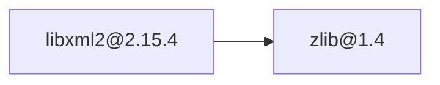

# libxml2 2.15.4: BuildEngine integration

[TOC|Content]

## Purpose and integration

C XML toolkit: XML parsing, XPath, XML Schema, Relax NG, XInclude and serialization.

The BuildEngine operator confirmed successful completion of the **109/109 versioned library FSM** on 15 November 2026. The current XML and installed SBOM remain authoritative for artifact coordinates and test evidence.

## Direct and transitive dependencies

- `zlib@1.4`



## Configuration

Build system: CMake/Ninja with the registered BCC64X Win64 toolchain. All package and tool locations are resolved by BuildEngine variables.

```text
-DBUILD_SHARED_LIBS:BOOL=ON
-DLIBXML2_WITH_DOCS:BOOL=OFF
-DLIBXML2_WITH_PROGRAMS:BOOL=ON
-DLIBXML2_WITH_PYTHON:BOOL=OFF
-DLIBXML2_WITH_TESTS:BOOL={TestsEnabled}
-DLIBXML2_WITH_ICONV:BOOL=OFF
-DLIBXML2_WITH_ICU:BOOL=OFF
-DLIBXML2_WITH_MODULES:BOOL=OFF
-DLIBXML2_WITH_ZLIB:BOOL=ON
-DLIBXML2_WITH_SCHEMAS:BOOL=ON
-DLIBXML2_WITH_RELAXNG:BOOL=ON
-DLIBXML2_WITH_XPATH:BOOL=ON
-DLIBXML2_WITH_XINCLUDE:BOOL=ON
-DLIBXML2_WITH_XPTR:BOOL=ON
-DLIBXML2_WITH_OUTPUT:BOOL=ON
-DCMAKE_PREFIX_PATH:PATH={DependencyRoot:zlib}
```

Debug and Release are separate configuration-specific installations.

## Source patches and special considerations

- `patches/libxml2/2.15.4/release-test-helpers.patch`
- Debug builds set CMAKE_DEBUG_POSTFIX=d. The version-specific patch adjusts native Release test helpers. libxml2 2.15.3 remains a retained historical version.

## Verification

The aggregate library FSM was reported successful. This document does not infer independently verified downstream application-level behavior from the aggregate run.

[Library overview](/manual/libraries.md)
