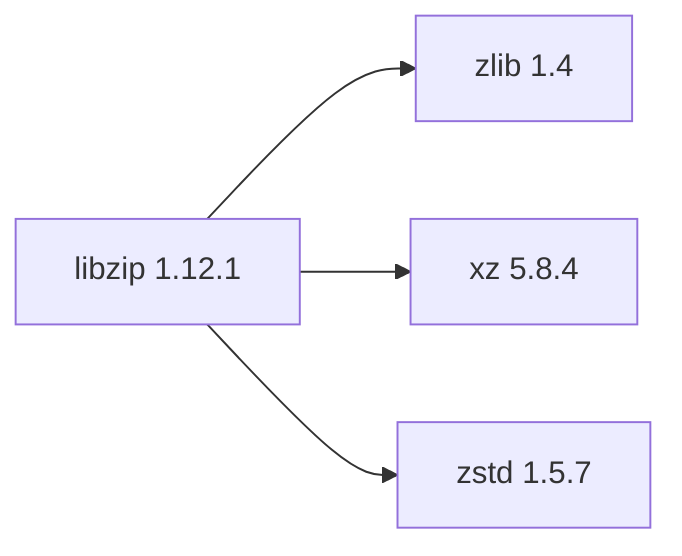

## Aktualisierter BuildEngine-Vertrag (10. November 2026)

**Aktueller XML-Vertrag; kein neuer PASS-Nachweis.** Die historischen Migrationsnotizen folgen unverändert.

### Vollständiger transitiver Abhängigkeitsgraph

**Direkte Abhängigkeiten:** `zlib@1.4`, `xz@5.8.4`, `zstd@1.5.7`

### Konfiguration und Patches

- `-DCMAKE_TOOLCHAIN_FILE:FILEPATH={BuildFileDir}\cmake\toolchains\bcc64x-buildengine-cxx.cmake`
- `-DCMAKE_MAKE_PROGRAM:FILEPATH={Tool:ninja}`
- `-DCMAKE_INSTALL_PREFIX:PATH={InstallRoot}\packages\{LibraryId}\{LibraryVersion}`
- `-DCMAKE_INSTALL_INCLUDEDIR:STRING=include`
- `-DBUILD_SHARED_LIBS:BOOL=ON`
- `-DLIBZIP_DO_INSTALL:BOOL=ON`
- `-DSHARED_LIB_VERSIONNING:BOOL=ON`
- `-DZLIB_INCLUDE_DIR:PATH={DependencyRoot:zlib}\include`
- `-DZLIB_LIBRARY:FILEPATH={DependencyRoot:zlib}\lib\win64\{Configuration}\{ZlibImportLibrary}`
- `-DENABLE_BZIP2:BOOL=OFF`
- `-DENABLE_LZMA:BOOL=ON`
- `-DLIBLZMA_INCLUDE_DIR:PATH={DependencyRoot:xz}\include`
- `-DLIBLZMA_LIBRARY:FILEPATH={DependencyRoot:xz}\lib\win64\{Configuration}\liblzma.lib`
- `-DENABLE_ZSTD:BOOL=ON`
- `-Dzstd_DIR:PATH={DependencyRoot:zstd}\lib\win64\{Configuration}\cmake\zstd`
- `-DENABLE_WINDOWS_CRYPTO:BOOL=ON`
- `-DENABLE_COMMONCRYPTO:BOOL=OFF`
- `-DENABLE_OPENSSL:BOOL=OFF`
- `-DENABLE_GNUTLS:BOOL=OFF`
- `-DENABLE_MBEDTLS:BOOL=OFF`
- `-DENABLE_FDOPEN:BOOL=ON`
- `-DBUILD_TOOLS:BOOL=ON`
- `-DBUILD_REGRESS:BOOL=OFF`
- `-DBUILD_OSSFUZZ:BOOL=OFF`
- `-DBUILD_EXAMPLES:BOOL=ON`
- `-DBUILD_DOC:BOOL=OFF`
- `-DCMAKE_BUILD_TYPE:STRING=Release`
- `-DCMAKE_C_FLAGS_RELEASE:STRING=-O2 -DNDEBUG`
- `-DCMAKE_INSTALL_LIBDIR:STRING=lib/win64/Release`
- `-DCMAKE_INSTALL_BINDIR:STRING=bin/win64/Release`
- `-DCMAKE_BUILD_TYPE:STRING=Debug`
- `-DCMAKE_C_FLAGS_DEBUG:STRING=-O0`
- `-DCMAKE_INSTALL_LIBDIR:STRING=lib/win64/Debug`
- `-DCMAKE_INSTALL_BINDIR:STRING=bin/win64/Debug`

---

## Bisherige Migrationsnotizen

# libzip 1.12.1

[TOC|Content]

## Aktueller BuildEngine-Vertrag (10. November 2026)

**Vertragsdaten, keine bestätigte Build-Ausführung.** Ergebnisse aus früheren Tests sind versions- und buildgebunden; neue Ausführungen bleiben **[nicht verifiziert]**.

C library for reading, creating, and modifying ZIP archives.

**Koordinate:** `libzip@1.12.1` · **Kategorie:** `archive` · **Lizenzampel:** `green`

### Deklarierte Abhängigkeiten (vollständig transitiv)

Die Diagrammkanten stammen aus den exakt gepinnten XML-Abhängigkeiten. Gestrichelte Kanten kennzeichnen Erweiterungen, durchgezogene Kanten Paketabhängigkeiten. Upstream-intern gebündelte Komponenten sind keine zusätzlichen BuildEngine-Koordinaten.

**Direkte Abhängigkeiten:** `zlib@1.4`, `xz@5.8.4`, `zstd@1.5.7`

### Konfiguration und Besonderheiten

**CMake-Argumente:**

- `-DCMAKE_TOOLCHAIN_FILE:FILEPATH={BuildFileDir}\cmake\toolchains\bcc64x-buildengine-cxx.cmake`
- `-DCMAKE_MAKE_PROGRAM:FILEPATH={Tool:ninja}`
- `-DCMAKE_INSTALL_PREFIX:PATH={InstallRoot}\packages\{LibraryId}\{LibraryVersion}`
- `-DCMAKE_INSTALL_INCLUDEDIR:STRING=include`
- `-DBUILD_SHARED_LIBS:BOOL=ON`
- `-DLIBZIP_DO_INSTALL:BOOL=ON`
- `-DSHARED_LIB_VERSIONNING:BOOL=ON`
- `-DZLIB_INCLUDE_DIR:PATH={DependencyRoot:zlib}\include`
- `-DZLIB_LIBRARY:FILEPATH={DependencyRoot:zlib}\lib\win64\{Configuration}\{ZlibImportLibrary}`
- `-DENABLE_BZIP2:BOOL=OFF`
- `-DENABLE_LZMA:BOOL=ON`
- `-DLIBLZMA_INCLUDE_DIR:PATH={DependencyRoot:xz}\include`
- `-DLIBLZMA_LIBRARY:FILEPATH={DependencyRoot:xz}\lib\win64\{Configuration}\liblzma.lib`
- `-DENABLE_ZSTD:BOOL=ON`
- `-Dzstd_DIR:PATH={DependencyRoot:zstd}\lib\win64\{Configuration}\cmake\zstd`
- `-DENABLE_WINDOWS_CRYPTO:BOOL=ON`
- `-DENABLE_COMMONCRYPTO:BOOL=OFF`
- `-DENABLE_OPENSSL:BOOL=OFF`
- `-DENABLE_GNUTLS:BOOL=OFF`
- `-DENABLE_MBEDTLS:BOOL=OFF`
- `-DENABLE_FDOPEN:BOOL=ON`
- `-DBUILD_TOOLS:BOOL=ON`
- `-DBUILD_REGRESS:BOOL=OFF`
- `-DBUILD_OSSFUZZ:BOOL=OFF`
- `-DBUILD_EXAMPLES:BOOL=ON`
- `-DBUILD_DOC:BOOL=OFF`
- `-DCMAKE_BUILD_TYPE:STRING=Release`
- `-DCMAKE_C_FLAGS_RELEASE:STRING=-O2 -DNDEBUG`
- `-DCMAKE_INSTALL_LIBDIR:STRING=lib/win64/Release`
- `-DCMAKE_INSTALL_BINDIR:STRING=bin/win64/Release`
- `-DCMAKE_BUILD_TYPE:STRING=Debug`
- `-DCMAKE_C_FLAGS_DEBUG:STRING=-O0`
- `-DCMAKE_INSTALL_LIBDIR:STRING=lib/win64/Debug`
- `-DCMAKE_INSTALL_BINDIR:STRING=bin/win64/Debug`

**Build-Umgebung:**

- `CB_BCC64X={Tool:bcc64x}`
- `CB_BDS={BDS}`
- `CB_LLVM_AR={Tool:llvm-ar}`
- `CB_LLVM_RANLIB={Tool:llvm-ranlib}`

**Source-Downloads:**

- `https://github.com/nih-at/libzip/releases/download/v{LibraryVersion}/libzip-{LibraryVersion}.tar.gz` (SHA-256: `3b66fe92cbc768d8d4d16e1427bfb7399e15d9c2795c2fc482e7b30a6332a422`)

**Deklarierte Smoke-Tests:**

- `consumer` / `Release` / `published` / `smokes\libzip\consumer`

**Explizit geforderte Installationsartefakte:**

- `{InstallRoot}\packages\{LibraryId}\{LibraryVersion}\bin\win64\{Configuration}\libzip.dll`
- `{InstallRoot}\packages\{LibraryId}\{LibraryVersion}\bin\win64\{Configuration}\zipcmp.exe`
- `{InstallRoot}\packages\{LibraryId}\{LibraryVersion}\bin\win64\{Configuration}\zipmerge.exe`
- `{InstallRoot}\packages\{LibraryId}\{LibraryVersion}\bin\win64\{Configuration}\ziptool.exe`
- `{InstallRoot}\packages\{LibraryId}\{LibraryVersion}\lib\win64\{Configuration}\libzip.lib`
- `{InstallRoot}\packages\{LibraryId}\{LibraryVersion}\lib\win64\{Configuration}\cmake\libzip\libzip-config.cmake`
- `{InstallRoot}\packages\{LibraryId}\{LibraryVersion}\lib\win64\{Configuration}\cmake\libzip\libzip-config-version.cmake`
- `{InstallRoot}\packages\{LibraryId}\{LibraryVersion}\lib\win64\{Configuration}\cmake\libzip\libzip-targets.cmake`
- `{InstallRoot}\packages\{LibraryId}\{LibraryVersion}\lib\win64\{Configuration}\cmake\libzip\libzip-targets-{CMakeExportConfiguration}.cmake`
- `{InstallRoot}\packages\{LibraryId}\{LibraryVersion}\lib\win64\{Configuration}\cmake\libzip\libzip-bin-targets.cmake`
- `{InstallRoot}\packages\{LibraryId}\{LibraryVersion}\lib\win64\{Configuration}\cmake\libzip\libzip-bin-targets-{CMakeExportConfiguration}.cmake`
- `{InstallRoot}\packages\{LibraryId}\{LibraryVersion}\lib\win64\{Configuration}\pkgconfig\libzip.pc`
- `{InstallRoot}\packages\{LibraryId}\{LibraryVersion}\include\zip.h`
- `{InstallRoot}\packages\{LibraryId}\{LibraryVersion}\include\zipconf.h`
- `{InstallRoot}\packages\{LibraryId}\{LibraryVersion}\LICENSE`

**Verbindliche Quellen:** `admin/build-libraries.xml` für Konfiguration und Pins; FSM/Buildlogs für tatsächliche Ausführung. [Bibliotheksverzeichnis](/manual/libraries.md).
