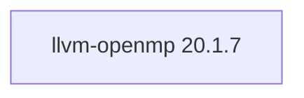

## Updated BuildEngine contract (10 November 2026)

**Declared configuration; no new test PASS.**

### Complete transitive dependencies

Direct: none

### Current configuration

- `-DCMAKE_MODULE_PATH:PATH={BuildFileDir}\patches\llvm-openmp\20.1.7`
- `-DPython3_EXECUTABLE:FILEPATH={Tool:python}`
- `-DCMAKE_ASM_MASM_COMPILER:FILEPATH={Tool:llvm-ml}`
- `-DCMAKE_ASM_MASM_FLAGS:STRING=-m64`
- `-DCMAKE_TOOLCHAIN_FILE:FILEPATH={BuildFileDir}\cmake\toolchains\bcc64x-buildengine-cxx.cmake`
- `-DCMAKE_MAKE_PROGRAM:FILEPATH={Tool:ninja}`
- `-DCMAKE_INSTALL_PREFIX:PATH={InstallRoot}\packages\{LibraryId}\{LibraryVersion}`
- `-DCMAKE_INSTALL_INCLUDEDIR:STRING=include`
- `-DOPENMP_INSTALL_LIBDIR:STRING=lib/win64/{Configuration}`
- `-DCMAKE_INSTALL_BINDIR:STRING=bin/win64/{Configuration}`
- `-DLIBOMP_LIB_TYPE:STRING=normal`
- `-DLIBOMP_ARCH:STRING=x86_64`
- `-DLIBOMP_COPY_EXPORTS:BOOL=OFF`
- `-DLIBOMP_FORTRAN_MODULES:BOOL=OFF`
- `-DLIBOMP_USE_HWLOC:BOOL=OFF`
- `-DOPENMP_ENABLE_LIBOMPTARGET:BOOL=OFF`
- `-DOPENMP_ENABLE_OMPT_TOOLS:BOOL=OFF`
- `-DOPENMP_ENABLE_WERROR:BOOL=OFF`
- `-DCMAKE_CXX_SCAN_FOR_MODULES:BOOL=OFF`
- `-DCMAKE_BUILD_TYPE:STRING=Release`
- `-DCMAKE_BUILD_TYPE:STRING=Debug`
- `-DOPENMP_PACKAGE_ROOT:PATH={InstallRoot}\packages\{LibraryId}\{LibraryVersion}`
- `-DOPENMP_CONFIGURATION:STRING=Release`
- `-DOPENMP_PACKAGE_ROOT:PATH={InstallRoot}\packages\{LibraryId}\{LibraryVersion}`
- `-DOPENMP_CONFIGURATION:STRING=Debug`

---

## Historical integration notes

# LLVM OpenMP Runtime 20.1.7

[TOC|Content]

## Purpose and integration

Self-built dynamic LLVM libomp runtime, BCC64X compiler consumer validation.

**Status:** BuildEngine XML contract dated 10 November 2026; native builds and smoke results **[not verified]**.

## Dependencies including transitive levels

**Direct dependencies:** none

## Konfiguration

### CMake

- `-DCMAKE_MODULE_PATH:PATH={BuildFileDir}\patches\llvm-openmp\20.1.7`
- `-DPython3_EXECUTABLE:FILEPATH={Tool:python}`
- `-DCMAKE_ASM_MASM_COMPILER:FILEPATH={Tool:llvm-ml}`
- `-DCMAKE_ASM_MASM_FLAGS:STRING=-m64`
- `-DCMAKE_TOOLCHAIN_FILE:FILEPATH={BuildFileDir}\cmake\toolchains\bcc64x-buildengine-cxx.cmake`
- `-DCMAKE_MAKE_PROGRAM:FILEPATH={Tool:ninja}`
- `-DCMAKE_INSTALL_PREFIX:PATH={InstallRoot}\packages\{LibraryId}\{LibraryVersion}`
- `-DCMAKE_INSTALL_INCLUDEDIR:STRING=include`
- `-DOPENMP_INSTALL_LIBDIR:STRING=lib/win64/{Configuration}`
- `-DCMAKE_INSTALL_BINDIR:STRING=bin/win64/{Configuration}`
- `-DLIBOMP_LIB_TYPE:STRING=normal`
- `-DLIBOMP_ARCH:STRING=x86_64`
- `-DLIBOMP_COPY_EXPORTS:BOOL=OFF`
- `-DLIBOMP_FORTRAN_MODULES:BOOL=OFF`
- `-DLIBOMP_USE_HWLOC:BOOL=OFF`
- `-DOPENMP_ENABLE_LIBOMPTARGET:BOOL=OFF`
- `-DOPENMP_ENABLE_OMPT_TOOLS:BOOL=OFF`
- `-DOPENMP_ENABLE_WERROR:BOOL=OFF`
- `-DCMAKE_CXX_SCAN_FOR_MODULES:BOOL=OFF`
- `-DCMAKE_BUILD_TYPE:STRING=Release`
- `-DCMAKE_BUILD_TYPE:STRING=Debug`
- `-DOPENMP_PACKAGE_ROOT:PATH={InstallRoot}\packages\{LibraryId}\{LibraryVersion}`
- `-DOPENMP_CONFIGURATION:STRING=Release`
- `-DOPENMP_PACKAGE_ROOT:PATH={InstallRoot}\packages\{LibraryId}\{LibraryVersion}`
- `-DOPENMP_CONFIGURATION:STRING=Debug`

### Build environment

- `CB_BCC64X={Tool:bcc64x}`
- `CB_BDS={BDS}`
- `CB_WINDOWS_RC={Tool:windows-rc}`
- `CB_BCC64X={Tool:bcc64x}`
- `CB_BDS={BDS}`
- `PATH={InstallRoot}\packages\{LibraryId}\{LibraryVersion}\bin\win64\Release;{ENV:PATH}`
- `OPENMP_PACKAGE_RUNTIME_DLL={InstallRoot}\packages\{LibraryId}\{LibraryVersion}\bin\win64\Release\libomp.dll`
- `CB_BCC64X={Tool:bcc64x}`
- `CB_BDS={BDS}`
- `PATH={InstallRoot}\packages\{LibraryId}\{LibraryVersion}\bin\win64\Debug;{ENV:PATH}`
- `OPENMP_PACKAGE_RUNTIME_DLL={InstallRoot}\packages\{LibraryId}\{LibraryVersion}\bin\win64\Debug\libomp.dll`

### Sources

- `https://github.com/llvm/llvm-project/releases/download/llvmorg-20.1.7/openmp-20.1.7.src.tar.xz`

### Consumer-Smoke

- `consumer / Release / package`
- `consumer / Debug / package`

## Special considerations

Versioned source/build actions and necessary BCC64X patches are defined in `admin/build-libraries.xml`. A recorded fix is not a test PASS without FSM evidence.

[Library overview](/manual/libraries.md)
