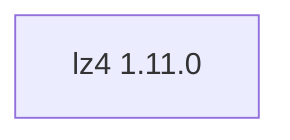

## Aktualisierter BuildEngine-Vertrag (10. November 2026)

**Aktuelle Deklaration; keine neue PASS-Aussage.** Historische Befunde folgen unverändert unterhalb dieses Abschnitts.

### Vollständiger transitiver Abhängigkeitsgraph

**Direkte Versionen:** keine

### Konfiguration und Besonderheiten

- `-DCMAKE_TOOLCHAIN_FILE:FILEPATH={BuildFileDir}\cmake\toolchains\bcc64x-buildengine-cxx.cmake`
- `-DCMAKE_MAKE_PROGRAM:FILEPATH={Tool:ninja}`
- `-DCMAKE_PROJECT_INCLUDE:FILEPATH={BuildFileDir}\cmake\packages\lz4-bcc64x.cmake`
- `-DCMAKE_INSTALL_PREFIX:PATH={InstallRoot}\packages\{LibraryId}\{LibraryVersion}`
- `-DCMAKE_INSTALL_INCLUDEDIR:STRING=include`
- `-DBUILD_SHARED_LIBS:BOOL=ON`
- `-DBUILD_STATIC_LIBS:BOOL=OFF`
- `-DLZ4_BUILD_CLI:BOOL=OFF`
- `-DLZ4_BUNDLED_MODE:BOOL=OFF`
- `-DCMAKE_BUILD_TYPE:STRING=Release`
- `-DCMAKE_C_FLAGS_RELEASE:STRING=-O2 -DNDEBUG`
- `-DCMAKE_INSTALL_LIBDIR:STRING=lib/win64/Release`
- `-DCMAKE_INSTALL_BINDIR:STRING=bin/win64/Release`
- `-DCMAKE_BUILD_TYPE:STRING=Debug`
- `-DCMAKE_C_FLAGS_DEBUG:STRING=-O0`
- `-DCMAKE_INSTALL_LIBDIR:STRING=lib/win64/Debug`
- `-DCMAKE_INSTALL_BINDIR:STRING=bin/win64/Debug`

---

## Bisherige Migrations- und Integrationsnotizen

# lz4 1.11.0

[TOC|Content]

## Aktueller BuildEngine-Vertrag (10. November 2026)

**Vertragsdaten, keine bestätigte Build-Ausführung.** Ergebnisse aus früheren Tests sind versions- und buildgebunden; neue Ausführungen bleiben **[nicht verifiziert]**.

Fast lossless LZ4 block and frame compression with BCC64X shared DLL.

**Koordinate:** `lz4@1.11.0` · **Kategorie:** `compression` · **Lizenzampel:** `green`

### Deklarierte Abhängigkeiten (vollständig transitiv)

Die Diagrammkanten stammen aus den exakt gepinnten XML-Abhängigkeiten. Gestrichelte Kanten kennzeichnen Erweiterungen, durchgezogene Kanten Paketabhängigkeiten. Upstream-intern gebündelte Komponenten sind keine zusätzlichen BuildEngine-Koordinaten.

**Direkte Abhängigkeiten:** Keine deklariert.

### Konfiguration und Besonderheiten

**CMake-Argumente:**

- `-DCMAKE_TOOLCHAIN_FILE:FILEPATH={BuildFileDir}\cmake\toolchains\bcc64x-buildengine-cxx.cmake`
- `-DCMAKE_MAKE_PROGRAM:FILEPATH={Tool:ninja}`
- `-DCMAKE_PROJECT_INCLUDE:FILEPATH={BuildFileDir}\cmake\packages\lz4-bcc64x.cmake`
- `-DCMAKE_INSTALL_PREFIX:PATH={InstallRoot}\packages\{LibraryId}\{LibraryVersion}`
- `-DCMAKE_INSTALL_INCLUDEDIR:STRING=include`
- `-DBUILD_SHARED_LIBS:BOOL=ON`
- `-DBUILD_STATIC_LIBS:BOOL=OFF`
- `-DLZ4_BUILD_CLI:BOOL=OFF`
- `-DLZ4_BUNDLED_MODE:BOOL=OFF`
- `-DCMAKE_BUILD_TYPE:STRING=Release`
- `-DCMAKE_C_FLAGS_RELEASE:STRING=-O2 -DNDEBUG`
- `-DCMAKE_INSTALL_LIBDIR:STRING=lib/win64/Release`
- `-DCMAKE_INSTALL_BINDIR:STRING=bin/win64/Release`
- `-DCMAKE_BUILD_TYPE:STRING=Debug`
- `-DCMAKE_C_FLAGS_DEBUG:STRING=-O0`
- `-DCMAKE_INSTALL_LIBDIR:STRING=lib/win64/Debug`
- `-DCMAKE_INSTALL_BINDIR:STRING=bin/win64/Debug`

**Build-Umgebung:**

- `CB_BCC64X={Tool:bcc64x}`
- `CB_BDS={BDS}`

**Source-Downloads:**

- `https://github.com/lz4/lz4/releases/download/v{LibraryVersion}/lz4-{LibraryVersion}.tar.gz` (SHA-256: `247e5fa64da5f7b75ee3dd3bed484076396c9ebe8254d9ccf693eb62800c5e26`)

**Deklarierte Smoke-Tests:**

- `consumer` / `Release` / `published` / `smokes\lz4\consumer`

**Explizit geforderte Installationsartefakte:**

- `{InstallRoot}\packages\{LibraryId}\{LibraryVersion}\bin\win64\{Configuration}\{BinaryName}.dll`
- `{InstallRoot}\packages\{LibraryId}\{LibraryVersion}\lib\win64\{Configuration}\{BinaryName}.lib`
- `{InstallRoot}\packages\{LibraryId}\{LibraryVersion}\lib\win64\{Configuration}\cmake\lz4\lz4Config.cmake`
- `{InstallRoot}\packages\{LibraryId}\{LibraryVersion}\lib\win64\{Configuration}\cmake\lz4\lz4ConfigVersion.cmake`
- `{InstallRoot}\packages\{LibraryId}\{LibraryVersion}\lib\win64\{Configuration}\cmake\lz4\lz4Targets.cmake`
- `{InstallRoot}\packages\{LibraryId}\{LibraryVersion}\lib\win64\{Configuration}\cmake\lz4\lz4Targets-{CMakeExportConfiguration}.cmake`
- `{InstallRoot}\packages\{LibraryId}\{LibraryVersion}\lib\win64\{Configuration}\pkgconfig\liblz4.pc`
- `{InstallRoot}\packages\{LibraryId}\{LibraryVersion}\include\lz4.h`
- `{InstallRoot}\packages\{LibraryId}\{LibraryVersion}\include\lz4hc.h`
- `{InstallRoot}\packages\{LibraryId}\{LibraryVersion}\include\lz4frame.h`
- `{InstallRoot}\packages\{LibraryId}\{LibraryVersion}\include\lz4file.h`
- `{InstallRoot}\packages\{LibraryId}\{LibraryVersion}\LICENSE`

**Verbindliche Quellen:** `admin/build-libraries.xml` für Konfiguration und Pins; FSM/Buildlogs für tatsächliche Ausführung. [Bibliotheksverzeichnis](/manual/libraries.md).
