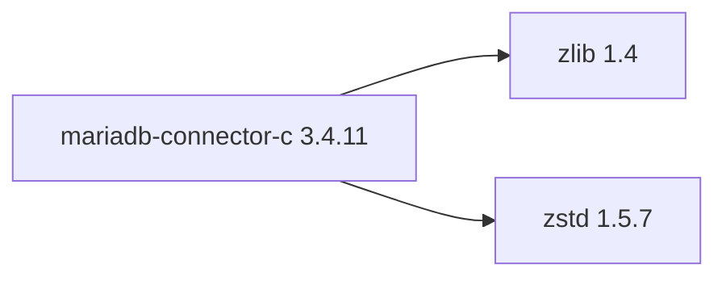

## Aktualisierter BuildEngine-Vertrag (10. November 2026)

**Deklarierte Konfiguration, nicht neuer Test-PASS.**

### Vollständige transitive Abhängigkeiten

Direkt: `zlib@1.4`, `zstd@1.5.7`

### Aktuelle Konfiguration

- `-DCMAKE_TOOLCHAIN_FILE:FILEPATH={BuildFileDir}\cmake\toolchains\bcc64x-buildengine-cxx.cmake`
- `-DCMAKE_MAKE_PROGRAM:FILEPATH={Tool:ninja}`
- `-DCMAKE_INSTALL_PREFIX:PATH={InstallRoot}\packages\{LibraryId}\{LibraryVersion}`
- `-DWITH_UNIT_TESTS:BOOL=OFF`
- `-DWITH_TOOLS:BOOL=OFF`
- `-DWITH_CURL:BOOL=OFF`
- `-DREMOTEIO_PLUGIN_TYPE:STRING=OFF`
- `-DWITH_BOOST_CONTEXT:BOOL=OFF`
- `-DWITH_EXTERNAL_ZLIB:BOOL=ON`
- `-DWITH_SSL:STRING=SCHANNEL`
- `-DDEFAULT_SSL_VERIFY_SERVER_CERT:BOOL=ON`
- `-DENABLED_LOCAL_INFILE:STRING=OFF`
- `-DZLIB_INCLUDE_DIR:PATH={DependencyRoot:zlib}\include`
- `-DZLIB_LIBRARY:FILEPATH={DependencyRoot:zlib}\lib\win64\{Configuration}\{ZlibImport}`
- `-DZSTD_INCLUDE_DIR:PATH={DependencyRoot:zstd}\include`
- `-DZSTD_LIBRARY:FILEPATH={DependencyRoot:zstd}\lib\win64\{Configuration}\libzstd.lib`
- `-DINSTALL_LAYOUT:STRING=DEFAULT`
- `-DINSTALL_INCLUDEDIR:STRING=include`
- `-DINSTALL_PLUGINDIR:STRING=lib/win64/{Configuration}/plugin`
- `-DCMAKE_BUILD_TYPE:STRING=Release`
- `-DCMAKE_C_FLAGS_RELEASE:STRING=-O2 -DNDEBUG`
- `-DINSTALL_LIBDIR:STRING=lib/win64/Release`
- `-DINSTALL_BINDIR:STRING=bin/win64/Release`
- `-DCMAKE_BUILD_TYPE:STRING=Debug`
- `-DCMAKE_C_FLAGS_DEBUG:STRING=-O0`
- `-DINSTALL_LIBDIR:STRING=lib/win64/Debug`
- `-DINSTALL_BINDIR:STRING=bin/win64/Debug`
- `-DMARIADB_INCLUDE_DIR:PATH={ConsumerRoot}\include`
- `-DMARIADB_LIBRARY:FILEPATH={ConsumerRoot}\lib\libmariadb.lib`

---

## Historische Integrationsnotizen

# MariaDB Connector/C 3.4.11

[TOC|Content]

## Aufgabe und Integration

MariaDB native C client as a BCC64X-built shared DLL.

**Stand:** BuildEngine-XML-Vertrag vom 10. November 2026; native Builds und Smoke-Ergebnisse **[nicht verifiziert]**.

## Abhängigkeiten einschließlich transitiver Stufen

**Direkte Abhängigkeiten:** `zlib@1.4`, `zstd@1.5.7`

## Konfiguration

### CMake

- `-DCMAKE_TOOLCHAIN_FILE:FILEPATH={BuildFileDir}\cmake\toolchains\bcc64x-buildengine-cxx.cmake`
- `-DCMAKE_MAKE_PROGRAM:FILEPATH={Tool:ninja}`
- `-DCMAKE_INSTALL_PREFIX:PATH={InstallRoot}\packages\{LibraryId}\{LibraryVersion}`
- `-DWITH_UNIT_TESTS:BOOL=OFF`
- `-DWITH_TOOLS:BOOL=OFF`
- `-DWITH_CURL:BOOL=OFF`
- `-DREMOTEIO_PLUGIN_TYPE:STRING=OFF`
- `-DWITH_BOOST_CONTEXT:BOOL=OFF`
- `-DWITH_EXTERNAL_ZLIB:BOOL=ON`
- `-DWITH_SSL:STRING=SCHANNEL`
- `-DDEFAULT_SSL_VERIFY_SERVER_CERT:BOOL=ON`
- `-DENABLED_LOCAL_INFILE:STRING=OFF`
- `-DZLIB_INCLUDE_DIR:PATH={DependencyRoot:zlib}\include`
- `-DZLIB_LIBRARY:FILEPATH={DependencyRoot:zlib}\lib\win64\{Configuration}\{ZlibImport}`
- `-DZSTD_INCLUDE_DIR:PATH={DependencyRoot:zstd}\include`
- `-DZSTD_LIBRARY:FILEPATH={DependencyRoot:zstd}\lib\win64\{Configuration}\libzstd.lib`
- `-DINSTALL_LAYOUT:STRING=DEFAULT`
- `-DINSTALL_INCLUDEDIR:STRING=include`
- `-DINSTALL_PLUGINDIR:STRING=lib/win64/{Configuration}/plugin`
- `-DCMAKE_BUILD_TYPE:STRING=Release`
- `-DCMAKE_C_FLAGS_RELEASE:STRING=-O2 -DNDEBUG`
- `-DINSTALL_LIBDIR:STRING=lib/win64/Release`
- `-DINSTALL_BINDIR:STRING=bin/win64/Release`
- `-DCMAKE_BUILD_TYPE:STRING=Debug`
- `-DCMAKE_C_FLAGS_DEBUG:STRING=-O0`
- `-DINSTALL_LIBDIR:STRING=lib/win64/Debug`
- `-DINSTALL_BINDIR:STRING=bin/win64/Debug`
- `-DMARIADB_INCLUDE_DIR:PATH={ConsumerRoot}\include`
- `-DMARIADB_LIBRARY:FILEPATH={ConsumerRoot}\lib\libmariadb.lib`

### Build-Umgebung

- `CB_BCC64X={Tool:bcc64x}`
- `CB_BDS={BDS}`
- `CB_WINDOWS_RC={Tool:windows-rc}`
- `CB_BCC64X={Tool:bcc64x}`
- `CB_BDS={BDS}`
- `CB_WINDOWS_RC={Tool:windows-rc}`

### Quellen

- `https://github.com/mariadb-corporation/mariadb-connector-c/archive/refs/tags/v{LibraryVersion}.tar.gz`

### Consumer-Smoke

- `consumer / Release / published`

## Besonderheiten

Versionierte Quell- und Build-Aktionen sowie eventuell erforderliche BCC64X-Patches sind im ausführbaren `admin/build-libraries.xml` dokumentiert. Eingetragene Fixes sind ohne FSM-Nachweis kein Test-PASS.

[Bibliotheksübersicht](/manual/libraries.md)
