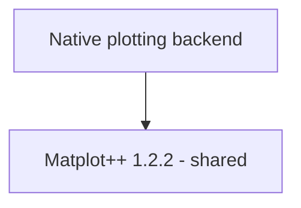

# Matplot++ 1.2.2 — BCC64X Integration and Migration

## Purpose

Native mathematical plotting with 2D/3D figures and graphical output.

## Package contract

| Property | Value |
| --- | --- |
| Coordinate | `matplotplusplus@1.2.2` |
| Artifact type | **Shared DLL and import library** |
| Language | C++ |
| License | MIT |
| Upstream | [Project repository](https://github.com/alandefreitas/matplotplusplus) |
| Native validation | **Native FSM completed (user-confirmed)** |

## Dependency and extension decisions

Independent mathematical plotting library. Requires examination of its plot backend and transitive graph; CMake offers MATPLOTPP_BUILD_SHARED_LIBS and backend-specific options. The final BCC64X build and consumer smoke are user-confirmed successful.

No extension relationship.

## BCC64X policy

All native C/C++ code must be consumed by the BCC64X Clang toolchain, not an MSVC or MinGW binary. Interface libraries install headers without DLL/ILIB checks. Shared libraries require matching Debug and Release DLL/import-library artifacts, complete exported API coverage, license/SBOM and a linked consumer smoke.

## Smoke-test contract

The repository includes `admin/smokes/matplotplusplus/consumer`, where a C++23 consumer verifies a real library operation. A committed test definition is not evidence of a successful test. Rendering, SDL2/OpenGL or VCL integration remain separate functional demonstration gates.

## Final native status and visual demonstration boundary

The operator confirmed completion of the 120-version BuildEngine FSM on 2026-11-18, including the BCC64X shared-library consumer smoke for this package. The separate BuildEngine-Tests graphics demonstration is newly authored and **[not verified]** until independently built and executed on Windows.

Presentation sources, build commands, declared CycloneDX SBOM and licensing: https://github.com/adeccscholar/BuildEngine-Tests/tree/main/graphics
