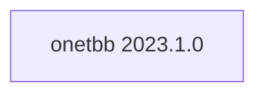

## Updated BuildEngine contract (10 November 2026)

**Declared configuration; no new test PASS.**

### Complete transitive dependencies

Direct: none

### Current configuration

- `-DCMAKE_TOOLCHAIN_FILE:FILEPATH={BuildFileDir}\cmake\toolchains\bcc64x-buildengine-cxx.cmake`
- `-DCMAKE_MAKE_PROGRAM:FILEPATH={Tool:ninja}`
- `-DCMAKE_INSTALL_PREFIX:PATH={InstallRoot}\packages\{LibraryId}\{LibraryVersion}`
- `-DCMAKE_INSTALL_INCLUDEDIR:STRING=include`
- `-DBUILD_SHARED_LIBS:BOOL=ON`
- `-DTBB_BUILD:BOOL=ON`
- `-DTBBMALLOC_BUILD:BOOL=ON`
- `-DTBBMALLOC_PROXY_BUILD:BOOL=OFF`
- `-DTBB_TEST:BOOL=ON`
- `-DTBB_EXAMPLES:BOOL=OFF`
- `-DTBB4PY_BUILD:BOOL=OFF`
- `-DTBB_STRICT:BOOL=OFF`
- `-DTBB_DISABLE_HWLOC_AUTOMATIC_SEARCH:BOOL=ON`
- `-DTBB_ENABLE_IPO:BOOL=OFF`
- `-DTBB_INSTALL:BOOL=ON`
- `-DTBB_FILE_TRIM:BOOL=ON`
- `-DCMAKE_CXX_STANDARD:STRING=23`
- `-DCMAKE_CXX_SCAN_FOR_MODULES:BOOL=OFF`
- `-DCMAKE_BUILD_TYPE:STRING=Release`
- `-DCMAKE_CXX_FLAGS_RELEASE:STRING=-O2 -DNDEBUG`
- `-DCMAKE_INSTALL_LIBDIR:STRING=lib/win64/Release`
- `-DCMAKE_INSTALL_BINDIR:STRING=bin/win64/Release`
- `-DCMAKE_BUILD_TYPE:STRING=Debug`
- `-DCMAKE_CXX_FLAGS_DEBUG:STRING=-O0`
- `-DCMAKE_INSTALL_LIBDIR:STRING=lib/win64/Debug`
- `-DCMAKE_INSTALL_BINDIR:STRING=bin/win64/Debug`
- `-DTBB_DIR:PATH={InstallRoot}\packages\{LibraryId}\{LibraryVersion}\lib\win64\Release\cmake\TBB`
- `-DTBB_DIR:PATH={InstallRoot}\packages\{LibraryId}\{LibraryVersion}\lib\win64\Release\cmake\TBB`

---

## Historical integration notes

# Intel oneTBB 2023.1.0

[TOC|Content]

## Purpose and integration

Task-based C++ parallelism runtime, parallel algorithms and flow graphs.

**Status:** BuildEngine XML contract dated 10 November 2026; native builds and smoke results **[not verified]**.

## Dependencies including transitive levels

**Direct dependencies:** none

## Konfiguration

### CMake

- `-DCMAKE_TOOLCHAIN_FILE:FILEPATH={BuildFileDir}\cmake\toolchains\bcc64x-buildengine-cxx.cmake`
- `-DCMAKE_MAKE_PROGRAM:FILEPATH={Tool:ninja}`
- `-DCMAKE_INSTALL_PREFIX:PATH={InstallRoot}\packages\{LibraryId}\{LibraryVersion}`
- `-DCMAKE_INSTALL_INCLUDEDIR:STRING=include`
- `-DBUILD_SHARED_LIBS:BOOL=ON`
- `-DTBB_BUILD:BOOL=ON`
- `-DTBBMALLOC_BUILD:BOOL=ON`
- `-DTBBMALLOC_PROXY_BUILD:BOOL=OFF`
- `-DTBB_TEST:BOOL=ON`
- `-DTBB_EXAMPLES:BOOL=OFF`
- `-DTBB4PY_BUILD:BOOL=OFF`
- `-DTBB_STRICT:BOOL=OFF`
- `-DTBB_DISABLE_HWLOC_AUTOMATIC_SEARCH:BOOL=ON`
- `-DTBB_ENABLE_IPO:BOOL=OFF`
- `-DTBB_INSTALL:BOOL=ON`
- `-DTBB_FILE_TRIM:BOOL=ON`
- `-DCMAKE_CXX_STANDARD:STRING=23`
- `-DCMAKE_CXX_SCAN_FOR_MODULES:BOOL=OFF`
- `-DCMAKE_BUILD_TYPE:STRING=Release`
- `-DCMAKE_CXX_FLAGS_RELEASE:STRING=-O2 -DNDEBUG`
- `-DCMAKE_INSTALL_LIBDIR:STRING=lib/win64/Release`
- `-DCMAKE_INSTALL_BINDIR:STRING=bin/win64/Release`
- `-DCMAKE_BUILD_TYPE:STRING=Debug`
- `-DCMAKE_CXX_FLAGS_DEBUG:STRING=-O0`
- `-DCMAKE_INSTALL_LIBDIR:STRING=lib/win64/Debug`
- `-DCMAKE_INSTALL_BINDIR:STRING=bin/win64/Debug`
- `-DTBB_DIR:PATH={InstallRoot}\packages\{LibraryId}\{LibraryVersion}\lib\win64\Release\cmake\TBB`
- `-DTBB_DIR:PATH={InstallRoot}\packages\{LibraryId}\{LibraryVersion}\lib\win64\Release\cmake\TBB`

### Build environment

- `CB_BCC64X={Tool:bcc64x}`
- `CB_BDS={BDS}`
- `CB_WINDOWS_RC={Tool:windows-rc}`
- `CTEST_PARALLEL_LEVEL={TestJobs}`
- `CB_BCC64X={Tool:bcc64x}`
- `CB_BDS={BDS}`
- `PATH={InstallRoot}\packages\{LibraryId}\{LibraryVersion}\bin\win64\Release;{ENV:PATH}`
- `CB_BCC64X={Tool:bcc64x}`
- `CB_BDS={BDS}`
- `PATH={InstallRoot}\packages\{LibraryId}\{LibraryVersion}\bin\win64\Release;{ENV:PATH}`

### Sources

- `https://github.com/uxlfoundation/oneTBB/archive/3046c8b0c29df995980003ea24f4d78c80ec0c8d.zip`

### Consumer-Smoke

- `consumer / Release / package`
- `terminate / Release / package`

## Special considerations

Versioned source/build actions and necessary BCC64X patches are defined in `admin/build-libraries.xml`. A recorded fix is not a test PASS without FSM evidence.

[Library overview](/manual/libraries.md)
