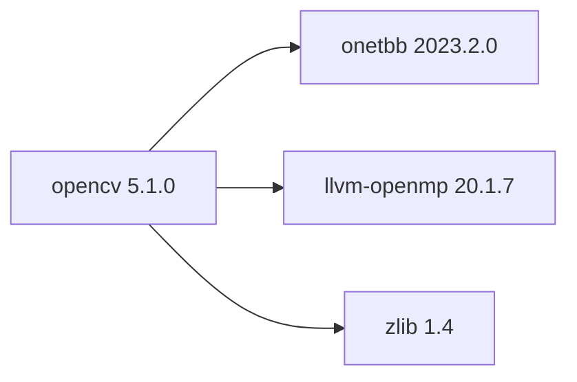

## Aktualisierter BuildEngine-Vertrag (10. November 2026)

**Deklarierte Konfiguration, nicht neuer Test-PASS.**

### Vollständige transitive Abhängigkeiten

Direkt: `onetbb@2023.2.0`, `llvm-openmp@20.1.7`, `zlib@1.4`

### Aktuelle Konfiguration

- `-DCMAKE_TOOLCHAIN_FILE:FILEPATH={BuildFileDir}\cmake\toolchains\bcc64x-buildengine-cxx.cmake`
- `-DCMAKE_MAKE_PROGRAM:FILEPATH={Tool:ninja}`
- `-DCMAKE_INSTALL_PREFIX:PATH={BuildRoot}\stage\packages\{LibraryId}\{LibraryVersion}\{Configuration}`
- `-DOPENCV_INCLUDE_INSTALL_PATH:STRING=include/opencv5`
- `-DOPENCV_LIB_INSTALL_PATH:STRING=lib/win64/{Configuration}`
- `-DOPENCV_BIN_INSTALL_PATH:STRING=bin/win64/{Configuration}`
- `-DOPENCV_CONFIG_INSTALL_PATH:STRING=lib/win64/{Configuration}/cmake/opencv5`
- `-DOPENCV_SKIP_CMAKE_ROOT_CONFIG:BOOL=ON`
- `-DOPENCV_EXTRA_MODULES_PATH:PATH={Workspace}\opencv_contrib-b67a855188a3d683813731010f6d39ac614733a4\modules`
- `-DBUILD_SHARED_LIBS:BOOL=ON`
- `-DBUILD_LIST:STRING=core,imgproc,geometry,flann,features,video,photo,stereo,ptcloud,calib,ml,dnn,objdetect,imgcodecs,videoio,highgui,stitching`
- `-DBUILD_opencv_world:BOOL=OFF`
- `-DBUILD_TESTS:BOOL=OFF`
- `-DBUILD_PERF_TESTS:BOOL=OFF`
- `-DBUILD_EXAMPLES:BOOL=OFF`
- `-DBUILD_DOCS:BOOL=OFF`
- `-DBUILD_opencv_apps:BOOL=OFF`
- `-DBUILD_JAVA:BOOL=OFF`
- `-DBUILD_opencv_python3:BOOL=OFF`
- `-DWITH_IPP:BOOL=OFF`
- `-DOPENCV_DNN_MLAS:BOOL=OFF`
- `-DWITH_ONNXRUNTIME:BOOL=OFF`
- `-DWITH_PROTOBUF:BOOL=ON`
- `-DBUILD_PROTOBUF:BOOL=ON`
- `-DPROTOBUF_UPDATE_FILES:BOOL=OFF`
- `-DOPENCV_DISABLE_THREAD_SUPPORT:BOOL=OFF`
- `-DWITH_OPENCL:BOOL=OFF`
- `-DWITH_CUDA:BOOL=OFF`
- `-DWITH_DIRECTML:BOOL=OFF`
- `-DWITH_TBB:BOOL=ON`
- `-DWITH_OPENMP:BOOL=ON`
- `-DTBB_DIR:PATH={DependencyRoot:onetbb}\lib\win64\{Configuration}\cmake\TBB`
- `-DCMAKE_PREFIX_PATH:PATH={DependencyRoot:onetbb}`
- `-DOpenMP_CXX_FLAGS:STRING=-fopenmp`
- `-DOpenMP_CXX_LIB_NAMES:STRING=omp`
- `-DOpenMP_omp_LIBRARY:FILEPATH={DependencyRoot:llvm-openmp}\lib\win64\{Configuration}\libomp.lib`
- `-DBUILD_TBB:BOOL=OFF`
- `-DWITH_FFMPEG:BOOL=OFF`
- `-DWITH_GSTREAMER:BOOL=OFF`
- `-DWITH_DSHOW:BOOL=ON`
- `-DWITH_MSMF:BOOL=OFF`
- `-DWITH_MSMF_DXVA:BOOL=OFF`
- `-DVIDEOIO_ENABLE_PLUGINS:BOOL=OFF`
- `-DWITH_OBSENSOR:BOOL=OFF`
- `-DWITH_QT:BOOL=OFF`
- `-DWITH_GTK:BOOL=OFF`
- `-DWITH_OPENGL:BOOL=OFF`
- `-DWITH_UNIFONT:BOOL=OFF`
- `-DWITH_JPEG:BOOL=ON`
- `-DBUILD_JPEG:BOOL=ON`
- `-DWITH_PNG:BOOL=ON`
- `-DBUILD_PNG:BOOL=ON`
- `-DWITH_TIFF:BOOL=ON`
- `-DBUILD_TIFF:BOOL=ON`
- `-DWITH_WEBP:BOOL=ON`
- `-DBUILD_WEBP:BOOL=ON`
- `-DWITH_OPENJPEG:BOOL=ON`
- `-DBUILD_OPENJPEG:BOOL=ON`
- `-DBUILD_ZLIB:BOOL=OFF`
- `-DZLIB_INCLUDE_DIR:PATH={DependencyRoot:zlib}\include`
- `-DZLIB_LIBRARY:FILEPATH={DependencyRoot:zlib}\lib\win64\{Configuration}\{ZlibLibrary}`
- `-DCMAKE_BUILD_TYPE:STRING=Release`
- `-DCMAKE_C_FLAGS_RELEASE:STRING=-O2 -DNDEBUG`
- `-DCMAKE_CXX_FLAGS_RELEASE:STRING=-O2 -DNDEBUG`
- `-DCMAKE_BUILD_TYPE:STRING=Debug`
- `-DCMAKE_C_FLAGS_DEBUG:STRING=-O0`
- `-DCMAKE_CXX_FLAGS_DEBUG:STRING=-O0`

---

## Historische Integrationsnotizen

# OpenCV 5.1.0

[TOC|Content]

## Aktueller BuildEngine-Vertrag (10. November 2026)

**Vertragsdaten, keine bestätigte Build-Ausführung.** Ergebnisse aus früheren Tests sind versions- und buildgebunden; neue Ausführungen bleiben **[nicht verifiziert]**.

Computer vision and image-processing library with algorithms for vision, geometry, filtering, and machine learning, Windows DirectShow camera capture (MSMF COM compatibility pending), and image stitching. Native oneTBB 2023.2 parallel backend configured; Release consumer smoke regression pending; LLVM OpenMP 20.1.7 enabled as a build dependency.

**Koordinate:** `opencv@5.1.0` · **Kategorie:** `graphics` · **Lizenzampel:** `yellow`

### Deklarierte Abhängigkeiten (vollständig transitiv)

Die Diagrammkanten stammen aus den exakt gepinnten XML-Abhängigkeiten. Gestrichelte Kanten kennzeichnen Erweiterungen, durchgezogene Kanten Paketabhängigkeiten. Upstream-intern gebündelte Komponenten sind keine zusätzlichen BuildEngine-Koordinaten.

**Direkte Abhängigkeiten:** `onetbb@2023.2.0`, `llvm-openmp@20.1.7`, `zlib@1.4`

### Konfiguration und Besonderheiten

**CMake-Argumente:**

- `-DCMAKE_TOOLCHAIN_FILE:FILEPATH={BuildFileDir}\cmake\toolchains\bcc64x-buildengine-cxx.cmake`
- `-DCMAKE_MAKE_PROGRAM:FILEPATH={Tool:ninja}`
- `-DCMAKE_INSTALL_PREFIX:PATH={BuildRoot}\stage\packages\{LibraryId}\{LibraryVersion}\{Configuration}`
- `-DOPENCV_INCLUDE_INSTALL_PATH:STRING=include/opencv5`
- `-DOPENCV_LIB_INSTALL_PATH:STRING=lib/win64/{Configuration}`
- `-DOPENCV_BIN_INSTALL_PATH:STRING=bin/win64/{Configuration}`
- `-DOPENCV_CONFIG_INSTALL_PATH:STRING=lib/win64/{Configuration}/cmake/opencv5`
- `-DOPENCV_SKIP_CMAKE_ROOT_CONFIG:BOOL=ON`
- `-DOPENCV_EXTRA_MODULES_PATH:PATH={Workspace}\opencv_contrib-b67a855188a3d683813731010f6d39ac614733a4\modules`
- `-DBUILD_SHARED_LIBS:BOOL=ON`
- `-DBUILD_LIST:STRING=core,imgproc,geometry,flann,features,video,photo,stereo,ptcloud,calib,ml,dnn,objdetect,imgcodecs,videoio,highgui,stitching`
- `-DBUILD_opencv_world:BOOL=OFF`
- `-DBUILD_TESTS:BOOL=OFF`
- `-DBUILD_PERF_TESTS:BOOL=OFF`
- `-DBUILD_EXAMPLES:BOOL=OFF`
- `-DBUILD_DOCS:BOOL=OFF`
- `-DBUILD_opencv_apps:BOOL=OFF`
- `-DBUILD_JAVA:BOOL=OFF`
- `-DBUILD_opencv_python3:BOOL=OFF`
- `-DWITH_IPP:BOOL=OFF`
- `-DOPENCV_DNN_MLAS:BOOL=OFF`
- `-DWITH_ONNXRUNTIME:BOOL=OFF`
- `-DWITH_PROTOBUF:BOOL=ON`
- `-DBUILD_PROTOBUF:BOOL=ON`
- `-DPROTOBUF_UPDATE_FILES:BOOL=OFF`
- `-DOPENCV_DISABLE_THREAD_SUPPORT:BOOL=OFF`
- `-DWITH_OPENCL:BOOL=OFF`
- `-DWITH_CUDA:BOOL=OFF`
- `-DWITH_DIRECTML:BOOL=OFF`
- `-DWITH_TBB:BOOL=ON`
- `-DWITH_OPENMP:BOOL=ON`
- `-DTBB_DIR:PATH={DependencyRoot:onetbb}\lib\win64\{Configuration}\cmake\TBB`
- `-DCMAKE_PREFIX_PATH:PATH={DependencyRoot:onetbb}`
- `-DOpenMP_CXX_FLAGS:STRING=-fopenmp`
- `-DOpenMP_CXX_LIB_NAMES:STRING=omp`
- `-DOpenMP_omp_LIBRARY:FILEPATH={DependencyRoot:llvm-openmp}\lib\win64\{Configuration}\libomp.lib`
- `-DBUILD_TBB:BOOL=OFF`
- `-DWITH_FFMPEG:BOOL=OFF`
- `-DWITH_GSTREAMER:BOOL=OFF`
- `-DWITH_DSHOW:BOOL=ON`
- `-DWITH_MSMF:BOOL=OFF`
- `-DWITH_MSMF_DXVA:BOOL=OFF`
- `-DVIDEOIO_ENABLE_PLUGINS:BOOL=OFF`
- `-DWITH_OBSENSOR:BOOL=OFF`
- `-DWITH_QT:BOOL=OFF`
- `-DWITH_GTK:BOOL=OFF`
- `-DWITH_OPENGL:BOOL=OFF`
- `-DWITH_UNIFONT:BOOL=OFF`
- `-DWITH_JPEG:BOOL=ON`
- `-DBUILD_JPEG:BOOL=ON`
- `-DWITH_PNG:BOOL=ON`
- `-DBUILD_PNG:BOOL=ON`
- `-DWITH_TIFF:BOOL=ON`
- `-DBUILD_TIFF:BOOL=ON`
- `-DWITH_WEBP:BOOL=ON`
- `-DBUILD_WEBP:BOOL=ON`
- `-DWITH_OPENJPEG:BOOL=ON`
- `-DBUILD_OPENJPEG:BOOL=ON`
- `-DBUILD_ZLIB:BOOL=OFF`
- `-DZLIB_INCLUDE_DIR:PATH={DependencyRoot:zlib}\include`
- `-DZLIB_LIBRARY:FILEPATH={DependencyRoot:zlib}\lib\win64\{Configuration}\{ZlibLibrary}`
- `-DCMAKE_BUILD_TYPE:STRING=Release`
- `-DCMAKE_C_FLAGS_RELEASE:STRING=-O2 -DNDEBUG`
- `-DCMAKE_CXX_FLAGS_RELEASE:STRING=-O2 -DNDEBUG`
- `-DCMAKE_BUILD_TYPE:STRING=Debug`
- `-DCMAKE_C_FLAGS_DEBUG:STRING=-O0`
- `-DCMAKE_CXX_FLAGS_DEBUG:STRING=-O0`

**Build-Umgebung:**

- `CB_BCC64X={Tool:bcc64x}`
- `CB_BDS={BDS}`
- `CB_WINDOWS_RC={Tool:windows-rc}`
- `CB_LLVM_AR={Tool:llvm-ar}`
- `CB_LLVM_RANLIB={Tool:llvm-ranlib}`

**Versionsgebundene Patches:**

- `{Workspace}\.buildengine\patches\{LibraryVersion}\bcc64x-optional-mlas.patch`
- `{BuildFileDir}\patches\opencv\5.1.0\bcc64x-optional-mlas.patch`

**Source-Downloads:**

- `https://github.com/opencv/opencv/archive/e4f78fbcf1a773fbed69e14500e8b734963eb585.zip`
- `https://github.com/opencv/opencv_contrib/archive/b67a855188a3d683813731010f6d39ac614733a4.zip`

**Deklarierte Smoke-Tests:**

- `consumer` / `Release` / `published` / `smokes\opencv\consumer`

**Explizit geforderte Installationsartefakte:**

- `{InstallRoot}\packages\{LibraryId}\{LibraryVersion}\bin\win64\{Configuration}\libopencv_core510{DebugPostfix}.dll`
- `{InstallRoot}\packages\{LibraryId}\{LibraryVersion}\lib\win64\{Configuration}\libopencv_core510{DebugPostfix}.lib`
- `{InstallRoot}\packages\{LibraryId}\{LibraryVersion}\bin\win64\{Configuration}\libopencv_imgproc510{DebugPostfix}.dll`
- `{InstallRoot}\packages\{LibraryId}\{LibraryVersion}\lib\win64\{Configuration}\libopencv_imgproc510{DebugPostfix}.lib`
- `{InstallRoot}\packages\{LibraryId}\{LibraryVersion}\bin\win64\{Configuration}\libopencv_geometry510{DebugPostfix}.dll`
- `{InstallRoot}\packages\{LibraryId}\{LibraryVersion}\lib\win64\{Configuration}\libopencv_geometry510{DebugPostfix}.lib`
- `{InstallRoot}\packages\{LibraryId}\{LibraryVersion}\bin\win64\{Configuration}\libopencv_flann510{DebugPostfix}.dll`
- `{InstallRoot}\packages\{LibraryId}\{LibraryVersion}\lib\win64\{Configuration}\libopencv_flann510{DebugPostfix}.lib`
- `{InstallRoot}\packages\{LibraryId}\{LibraryVersion}\bin\win64\{Configuration}\libopencv_features510{DebugPostfix}.dll`
- `{InstallRoot}\packages\{LibraryId}\{LibraryVersion}\lib\win64\{Configuration}\libopencv_features510{DebugPostfix}.lib`
- `{InstallRoot}\packages\{LibraryId}\{LibraryVersion}\bin\win64\{Configuration}\libopencv_video510{DebugPostfix}.dll`
- `{InstallRoot}\packages\{LibraryId}\{LibraryVersion}\lib\win64\{Configuration}\libopencv_video510{DebugPostfix}.lib`
- `{InstallRoot}\packages\{LibraryId}\{LibraryVersion}\bin\win64\{Configuration}\libopencv_photo510{DebugPostfix}.dll`
- `{InstallRoot}\packages\{LibraryId}\{LibraryVersion}\lib\win64\{Configuration}\libopencv_photo510{DebugPostfix}.lib`
- `{InstallRoot}\packages\{LibraryId}\{LibraryVersion}\bin\win64\{Configuration}\libopencv_stereo510{DebugPostfix}.dll`
- `{InstallRoot}\packages\{LibraryId}\{LibraryVersion}\lib\win64\{Configuration}\libopencv_stereo510{DebugPostfix}.lib`
- `{InstallRoot}\packages\{LibraryId}\{LibraryVersion}\bin\win64\{Configuration}\libopencv_ptcloud510{DebugPostfix}.dll`
- `{InstallRoot}\packages\{LibraryId}\{LibraryVersion}\lib\win64\{Configuration}\libopencv_ptcloud510{DebugPostfix}.lib`
- `{InstallRoot}\packages\{LibraryId}\{LibraryVersion}\bin\win64\{Configuration}\libopencv_calib510{DebugPostfix}.dll`
- `{InstallRoot}\packages\{LibraryId}\{LibraryVersion}\lib\win64\{Configuration}\libopencv_calib510{DebugPostfix}.lib`
- `{InstallRoot}\packages\{LibraryId}\{LibraryVersion}\bin\win64\{Configuration}\libopencv_ml510{DebugPostfix}.dll`
- `{InstallRoot}\packages\{LibraryId}\{LibraryVersion}\lib\win64\{Configuration}\libopencv_ml510{DebugPostfix}.lib`
- `{InstallRoot}\packages\{LibraryId}\{LibraryVersion}\bin\win64\{Configuration}\libopencv_dnn510{DebugPostfix}.dll`
- `{InstallRoot}\packages\{LibraryId}\{LibraryVersion}\lib\win64\{Configuration}\libopencv_dnn510{DebugPostfix}.lib`
- `{InstallRoot}\packages\{LibraryId}\{LibraryVersion}\bin\win64\{Configuration}\libopencv_objdetect510{DebugPostfix}.dll`
- `{InstallRoot}\packages\{LibraryId}\{LibraryVersion}\lib\win64\{Configuration}\libopencv_objdetect510{DebugPostfix}.lib`
- `{InstallRoot}\packages\{LibraryId}\{LibraryVersion}\bin\win64\{Configuration}\libopencv_imgcodecs510{DebugPostfix}.dll`
- `{InstallRoot}\packages\{LibraryId}\{LibraryVersion}\lib\win64\{Configuration}\libopencv_imgcodecs510{DebugPostfix}.lib`
- `{InstallRoot}\packages\{LibraryId}\{LibraryVersion}\bin\win64\{Configuration}\libopencv_videoio510{DebugPostfix}.dll`
- `{InstallRoot}\packages\{LibraryId}\{LibraryVersion}\lib\win64\{Configuration}\libopencv_videoio510{DebugPostfix}.lib`
- 11 weitere Einträge im XML-Vertrag.

**Verbindliche Quellen:** `admin/build-libraries.xml` für Konfiguration und Pins; FSM/Buildlogs für tatsächliche Ausführung. [Bibliotheksverzeichnis](/manual/libraries.md).
