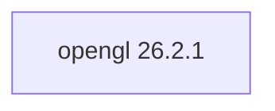
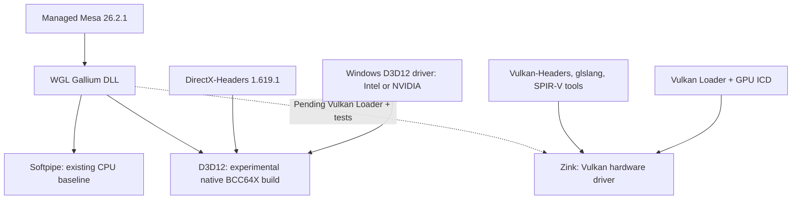

## Updated BuildEngine contract (10 November 2026)

**Declared configuration; no new test PASS.**

### Complete transitive dependencies

Direct: none

### Current configuration

- `-Dplatforms=windows`
- `-Dgallium-drivers=softpipe`
- `-Dgallium-wgl-dll-name=libgallium_wgl`
- `-Dopengl=true`
- `-Dgles1=disabled`
- `-Dgles2=disabled`
- `-Degl=disabled`
- `-Dglx=disabled`
- `-Dgbm=disabled`
- `-Dvulkan-drivers=`
- `-Dvulkan-layers=`
- `-Dllvm=disabled`
- `-Dzlib=disabled`
- `-Dzstd=disabled`
- `-Dxmlconfig=disabled`
- `-Dbuild-tests=true`
- `-Dtools=`
- `-Dgallium-rusticl=false`

---

## Historical integration notes

# opengl 26.2.1: BCC64X migration and integration record

[TOC|Content]

**Contract identity:** `opengl@26.2.1` · **Category:** graphics · **Target:** RAD Studio 13 / native BCC64X / Windows x64.

**Evidence policy:** This document describes the version-specific, declared integration and the documented engineering decisions. A switch being present does not prove the corresponding upstream tests passed. Any result that is not backed by the FSM evidence or a maintained integration report is marked **[not verified]**.

## Purpose and integration strategy

Use Mesa with Meson/Ninja and BCC64X as the actual compiler; produce Windows WGL/desktop OpenGL using Gallium softpipe. Explicitly omit Vulkan/GLES/EGL/GLX/GBM/LLVM infrastructure. Extract the actual DLL exports with tdump and create matching BCC64X import libraries using lld rather than copying foreign compiler artifacts.

**Why this boundary matters:** Each producer is controlled by the Admin XML and consumed via installed or published artifacts. Build variants and dependencies are explicit rather than discovered opportunistically from the developer workstation. Library product form (shared/static/header-only) is separate from the mandatory dynamic BCC64X Windows runtime for executable and DLL consumers (`-tR`).

## Dependency decisions

No direct BuildEngine library dependency is declared for this coordinate. This does **not** mean the generated binary uses no Windows system libraries or that its upstream bundled components are absent.

## Product profile: what is enabled and what is not

The entries below are actual flags in `build-libraries.xml`, not a generic upstream capability list. **Enabled** means the declared setting requests the feature; **disabled** means this integration profile explicitly excludes it. BuildEngine variables such as `{TestsEnabled}` are runtime-resolved and must not be interpreted as unconditional ON/OFF.

### Enabled switches

| Contract switch | Value |
| --- | --- |
| `opengl` | `true` |
| `build-tests` | `true` |

### Deliberately disabled switches

| Contract switch | Value |
| --- | --- |
| `gles1` | `disabled` |
| `gles2` | `disabled` |
| `egl` | `disabled` |
| `glx` | `disabled` |
| `gbm` | `disabled` |
| `llvm` | `disabled` |
| `zlib` | `disabled` |
| `zstd` | `disabled` |
| `xmlconfig` | `disabled` |
| `gallium-rusticl` | `false` |

### Other selected build features and external settings

| Contract switch | Value |
| --- | --- |
| `platforms` | `windows` |
| `gallium-drivers` | `softpipe` |
| `gallium-wgl-dll-name` | `libgallium_wgl` |

## Build architecture, variants and paths

**Selected build flow:** GN/Ninja and explicit native toolchain targets. **Declared variants:** Release, Debug. **State boundary:** Source acquisition and version-bound patches precede the build; install and publication consume completed variant artifacts.

**Representative compiler, installation and workflow arguments:**

- None declared for this category.

**Versioned source locations:**

- `https://archive.mesa3d.org/mesa-{LibraryVersion}.tar.xz`
- `https://files.pythonhosted.org/packages/source/m/meson/meson-1.12.0.tar.gz`
- `https://files.pythonhosted.org/packages/7d/fa/3944b40b07da9ce895c0e6303a5ab7d53da063554f534556b134a54d6093/packaging-26.3.tar.gz`
- `https://files.pythonhosted.org/packages/7e/99/7690b6d4034fffd95959cbe0c02de8deb3098cc577c67bb6a24fe5d7caa7/markupsafe-3.0.3.tar.gz`
- `https://files.pythonhosted.org/packages/2a/12/b5fa2353e2754cd67fb9f83793fa48ff42c213a5da7e719869d2301f6ab8/mako-1.4.1.tar.gz`
- `https://files.pythonhosted.org/packages/05/8e/961c0007c59b8dd7729d542c61a4d537767a59645b82a0b521206e1e25c2/pyyaml-6.0.3.tar.gz`

**Declared extraction profiles:**

- `libarchive / mesa-{LibraryVersion}`
- `libarchive / meson-1.12.0`
- `libarchive / packaging-26.3`
- `libarchive / markupsafe-3.0.3`
- `libarchive / mako-1.4.1`
- `libarchive / pyyaml-6.0.3`

**Package-path convention:** `{InstallRoot}/packages/opengl/26.2.1/`; variant-specific binaries/import libraries generally use `lib/win64/{Configuration}` and `bin/win64/{Configuration}`, unless the actual per-library install contract specifies another layout. The XML is authoritative for each copied file; do not assume every package has all these directories.

## Difficulties, workarounds and unavoidable patches

**No active version-bound `.patch` file is referenced by this library's present XML.** That is a meaningful result: source changes must not be invented merely because porting was difficult. Additional Admin-side adapters, generated configuration or post-install repairs may still be used.

### Engineering constraints recorded in the executable contract

- Official Mesa release archive; checksum is published in the Mesa 26.2.1 release notes.
- Meson is part of the reproducibility contract, not a host prerequisite.
- Mesa mandatory Python configure-time modules. Keep them pinned and source-local so the build does not depend on global pip/site-packages.
- Native BCC64X Mesa build. No MSVC, clang-cl or MinGW fallback is permitted.
- Import libraries are derived only from the BCC64X-built Mesa DLLs.

**Patch criterion:** A source or build-system patch is justified only when the selected upstream revision cannot satisfy this BCC64X contract by configuration or packaging alone. Version-bound patches must be checked against the exact source state and applied in their declared order. Packaging omissions and generic toolchain defects belong to their respective layers instead.

## Installation, publication and consumer responsibilities

**Explicit copy/repair destinations from the contract:**

- `{BuildRoot}\stage\packages\{LibraryId}\{LibraryVersion}\{Configuration}\bin\win64\{Configuration} -> {InstallRoot}\packages\{LibraryId}\{LibraryVersion}\bin\win64\{Configuration}`
- `{BuildFileDir}\cmake\opengl\OpenGLConfig.cmake -> {InstallRoot}\packages\{LibraryId}\{LibraryVersion}\lib\win64\{Configuration}\cmake\OpenGL\OpenGLConfig.cmake`
- `{Workspace}\include\GL -> {InstallRoot}\packages\{LibraryId}\{LibraryVersion}\include\GL`
- `{Workspace}\include\KHR -> {InstallRoot}\packages\{LibraryId}\{LibraryVersion}\include\KHR`
- `{Workspace}\docs\license.rst -> {InstallRoot}\packages\{LibraryId}\{LibraryVersion}\LICENSE-MESA.rst`

**Declared smoke tests:**

- `consumer (Release, scope published; source smokes\opengl\consumer)`

**Selected environment inputs:**

- `CC={Tool:bcc64x}`
- `CXX={Tool:bcc64x}`
- `AR={Tool:llvm-ar}`
- `WINDRES={Tool:bcc64x-windres}`
- `PYTHONPATH={Workspace}\packaging-26.3\src;{Workspace}\markupsafe-3.0.3\src;{Workspace}\mako-1.4.1;{Workspace}\pyyaml-6.0.3\lib`
- `CB_BCC64X={Tool:bcc64x}`
- `CB_BDS={BDS}`

**Consumer rule:** Use the actual package export/target when present and the matching Debug/Release artifact and transitive dependency closure. An installed archive or DLL alone does not prove the installed application links, loads and releases resources correctly.

## Verification and evidence boundaries

The contract includes one or more upstream tests, validation actions or consumer smokes. Their mere declaration does not establish a successful execution; use the FSM state evidence and process logs for the specific version and configuration.

**Gate checklist:** source pin/extract → ordered checked patches → BCC64X compile/link → installed headers and exact artifacts → configured test suite → external installed-package consumer → metadata/SBOM → documentation and ready state. A project-specific stage may be absent from the current contract; report it as a coverage gap rather than synthesizing a PASS.

## Maintenance and authoritative records

1. Confirm this version's active switches, source revisions and patch sequence against `admin/build-libraries.xml` before any upgrade.
2. For a version upgrade, rebase each necessary patch against the correct preceding source state; verify the complete resulting file and rerun the installed consumer.
3. Record any new failure as a specific compiler, test, packaging, ABI or runtime issue. Fix it at the owning layer and update this migration record with cause, decision and evidence.
4. Treat pending or unavailable local logs as **[not verified]**, not as historical success.

**Primary sources:** `admin/build-libraries.xml`; active version-bound patches in `admin/patches/`; `admin/server-docs/libraries.md`; `docs/bcc64x-library-integration-findings.md`. The present contract is the authority if a broad historical overview discusses an older release.

## Gallium hardware-driver expansion — 22 November 2026

The previously validated Mesa package was configured as `gallium-drivers=softpipe` with LLVM disabled. This proves a native BCC64X Mesa software-rasterization baseline, **not** Intel or NVIDIA GPU use.

### Current experimental source change

The current XML attempts `gallium-drivers=softpipe,d3d12` while retaining all upstream Mesa tests and their original build/install/consumer gates. It now declares a direct dependency on the newly pinned `directx-headers 1.619.1` package, which preserves both upstream DirectX-Headers test suites and consumes the already managed GoogleTest 1.18.0 package. DirectX-Headers provides headers, native helper/Guids libraries, CMake exports, and a pkg-config file through its own isolated installed package. The Mesa Meson process resolves the pinned pkg-config path from that dependency, never a system-wide fallback.

### Zink / Vulkan integration gate

Zink is exposed in the Tensor Nebula demonstration's runtime selection for diagnostic testing but is **not** yet enabled in the Mesa XML. The existing Vulkan-Headers 1.4.368, Vulkan Memory Allocator 3.4.0, SPIRV-Headers, SPIRV-Tools, SPIRV-Cross, and glslang packages are relevant and present. A pinned Vulkan Loader 1.4.368 consumer and Vulkan-Headers CMake adapter have been prepared. Vulkan Loader upstream tests, however, explicitly require GoogleTest source and Microsoft Detours source; the latter is not an installed BuildEngine package. These must be managed and tested rather than silently turning off the loader test suite.

### Windows backend selection and acceptance

Gallium WGL uses `GALLIUM_DRIVER=softpipe`, `GALLIUM_DRIVER=d3d12`, and, when compiled into the same DLL, `GALLIUM_DRIVER=zink`. Runtime selection must precede SDL/WGL context creation. Tensor Nebula now provides a requested-backend selector, restart-on-change, D3D12 adapter-name preference, and the actual `GL_VENDOR`, `GL_RENDERER`, and OpenGL version in its UI and optional GPU smoke. A requested GPU path is not reported as successful when the actual renderer identifies known software-rasterizer fallback.

### Verification status

The D3D12 configuration is committed but **[not verified]** by a local BCC64X build. A configure/build failure is expected to identify remaining API, compiler, linker, shader compiler or package-discovery gaps; it must be resolved as a native BCC64X compatibility issue rather than disabling existing tests or adopting MSVC/MinGW libraries. Zink remains **[not verified]** and cannot be presented as installed. The completed historical Softpipe FSM evidence is not evidence of a GPU backend.

## 28 November 2026: GPU-independent package acceptance

The current XML builds Mesa 26.2.1 with Gallium drivers softpipe,d3d12,zink.
Managed vulkan-loader@1.4.368, vulkan-headers@1.4.368 and DirectX packages
are compile/link dependencies, **not** requirements for physical GPUs or
vendor ICDs on the Windows Server 2025 production VM.

The published consumer smoke is now a hardware-neutral artifact/import
check. It verifies that application-local opengl32.dll and libgallium_wgl.dll
are present and load, that the managed consumer links, and that public GL/WGL
exports exist. It does not create WGL contexts or query any Vulkan/DXGI
hardware. Runtime GPU validation belongs to optional, separately supervised
desktop diagnostics in BuildEngine-Tests.

The existing testsAffectBuild flag is deliberately unchanged: in the current
BuildEngine implementation it affects the test runtime PATH and build token,
and is not a general GPU-requirement toggle. Build/install/publish and
hardware-independent smoke errors still matter. Absent GPU capabilities do
not invalidate the package. Native server verification remains [not verified].
