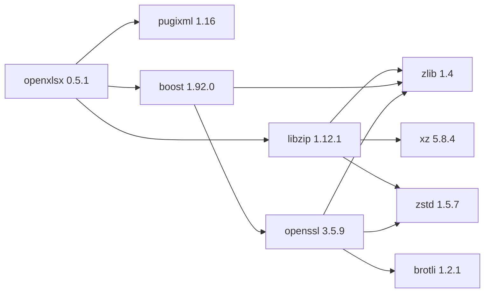

## Aktualisierter BuildEngine-Vertrag (10. November 2026)

**Deklarierte Konfiguration, nicht neuer Test-PASS.**

### Vollständige transitive Abhängigkeiten

Direkt: `pugixml@1.16`, `libzip@1.12.1`, `boost@1.92.0`

### Aktuelle Konfiguration

- `-DCMAKE_TOOLCHAIN_FILE:FILEPATH={BuildFileDir}\cmake\toolchains\bcc64x-buildengine-cxx.cmake`
- `-DCMAKE_MAKE_PROGRAM:FILEPATH={Tool:ninja}`
- `-DCMAKE_INSTALL_PREFIX:PATH={InstallRoot}\packages\{LibraryId}\{LibraryVersion}`
- `-DCMAKE_INSTALL_INCLUDEDIR:STRING=include`
- `-DCMAKE_CXX_STANDARD:STRING=23`
- `-DBUILD_SHARED_LIBS:BOOL=ON`
- `-DOPENXLSX_CREATE_DOCS:BOOL=OFF`
- `-DOPENXLSX_BUILD_SAMPLES:BOOL=OFF`
- `-DOPENXLSX_BUILD_TESTS:BOOL=OFF`
- `-DOPENXLSX_BUILD_BENCHMARKS:BOOL=OFF`
- `-DOPENXLSX_ENABLE_LIBZIP:BOOL=ON`
- `-DOPENXLSX_NOWIDE_STANDALONE:BOOL=OFF`
- `-DOPENXLSX_LOCAL_PACKAGES_ONLY:BOOL=ON`
- `-DUSE_SYSTEM_LIBS:BOOL=ON`
- `-DFETCH_DEPS_AUTO:BOOL=OFF`
- `-DTestPackage_LOG_LEVEL:STRING=DEBUG`
- `-DCMAKE_MESSAGE_LOG_LEVEL:STRING=VERBOSE`
- `-DFORCE_FETCH_ALL:BOOL=OFF`
- `-DCMAKE_PREFIX_PATH:STRING={DependencyRoot:boost}\lib\win64\{Configuration}\cmake\boost_nowide-1.92.0-shared;{DependencyRoot:boost}\lib\win64\{Configuration}\cmake;{DependencyRoot:pugixml}\lib\win64\{Configuration}\cmake;{DependencyRoot:libzip}\lib\win64\{Configuration}\cmake`
- `-Dboost_nowide_DIR:PATH={DependencyRoot:boost}\lib\win64\{Configuration}\cmake\boost_nowide-1.92.0-shared`
- `-DBoost_DIR:PATH={DependencyRoot:boost}\lib\win64\{Configuration}\cmake\Boost-1.92.0`
- `-DLibZip_DIR:PATH={DependencyRoot:libzip}\lib\win64\{Configuration}\cmake\libzip`
- `-Dpugixml_DIR:PATH={DependencyRoot:pugixml}\lib\win64\{Configuration}\cmake\pugixml`
- `-DCMAKE_BUILD_TYPE:STRING=Release`
- `-DCMAKE_CXX_FLAGS_RELEASE:STRING=-O2 -DNDEBUG`
- `-DCMAKE_INSTALL_LIBDIR:STRING=lib/win64/Release`
- `-DCMAKE_INSTALL_BINDIR:STRING=bin/win64/Release`
- `-DCMAKE_BUILD_TYPE:STRING=Debug`
- `-DCMAKE_CXX_FLAGS_DEBUG:STRING=-O0`
- `-DCMAKE_INSTALL_LIBDIR:STRING=lib/win64/Debug`
- `-DCMAKE_INSTALL_BINDIR:STRING=bin/win64/Debug`
- `-DOpenXLSX_DIR:PATH={InstallRoot}\packages\openxlsx\0.5.1\lib\win64\Release\cmake\OpenXLSX`
- `-DBoost_DIR:PATH={DependencyRoot:boost}\lib\win64\Release\cmake\Boost-1.92.0`
- `-DLibZip_DIR:PATH={DependencyRoot:libzip}\lib\win64\Release\cmake\libzip`
- `-Dpugixml_DIR:PATH={DependencyRoot:pugixml}\lib\win64\Release\cmake\pugixml`

---

## Historische Integrationsnotizen

# openxlsx 0.5.1: BCC64X migration and integration record

[TOC|Content]

**Contract identity:** `openxlsx@0.5.1` · **Category:** data · **Target:** RAD Studio 13 / native BCC64X / Windows x64.

**Evidence policy:** This document describes the version-specific, declared integration and the documented engineering decisions. A switch being present does not prove the corresponding upstream tests passed. Any result that is not backed by the FSM evidence or a maintained integration report is marked **[not verified]**.

## Purpose and integration strategy

Build OpenXLSX C++23 as a shared package with pugixml, libzip and Boost resolved exclusively from the managed closure. The upstream CMake forwarding of Boost directories needed a targeted patch after package target/export failures. Samples, docs, benchmarks and upstream tests are not part of this package profile.

**Why this boundary matters:** Each producer is controlled by the Admin XML and consumed via installed or published artifacts. Build variants and dependencies are explicit rather than discovered opportunistically from the developer workstation. Library product form (shared/static/header-only) is separate from the mandatory dynamic BCC64X Windows runtime for executable and DLL consumers (`-tR`).

## Dependency decisions

- `pugixml@1.16`
- `libzip@1.11.4`
- `boost@1.92.0`

These are declared direct dependencies. Transitive runtime DLLs and package CMake imports must be resolved through the BuildEngine dependency graph; they are not evidence for linking arbitrary host copies.

## Product profile: what is enabled and what is not

The entries below are actual flags in `build-libraries.xml`, not a generic upstream capability list. **Enabled** means the declared setting requests the feature; **disabled** means this integration profile explicitly excludes it. BuildEngine variables such as `{TestsEnabled}` are runtime-resolved and must not be interpreted as unconditional ON/OFF.

### Enabled switches

| Contract switch | Value |
| --- | --- |
| `BUILD_SHARED_LIBS` | `ON` |
| `OPENXLSX_ENABLE_LIBZIP` | `ON` |
| `OPENXLSX_LOCAL_PACKAGES_ONLY` | `ON` |
| `USE_SYSTEM_LIBS` | `ON` |

### Deliberately disabled switches

| Contract switch | Value |
| --- | --- |
| `OPENXLSX_CREATE_DOCS` | `OFF` |
| `OPENXLSX_BUILD_SAMPLES` | `OFF` |
| `OPENXLSX_BUILD_TESTS` | `OFF` |
| `OPENXLSX_BUILD_BENCHMARKS` | `OFF` |
| `OPENXLSX_NOWIDE_STANDALONE` | `OFF` |
| `FETCH_DEPS_AUTO` | `OFF` |
| `FORCE_FETCH_ALL` | `OFF` |

### Other selected build features and external settings

| Contract switch | Value |
| --- | --- |
| `TestPackage_LOG_LEVEL` | `DEBUG` |
| `boost_nowide_DIR` | `{InstallRoot}\packages\boost\1.92.0\lib\win64\{Configuration}\cmake\boost_nowide-1.92.0-shared` |
| `Boost_DIR` | `{InstallRoot}\packages\boost\1.92.0\lib\win64\{Configuration}\cmake\Boost-1.92.0` |
| `LibZip_DIR` | `{InstallRoot}\packages\libzip\1.11.4\lib\win64\{Configuration}\cmake\libzip` |
| `pugixml_DIR` | `{InstallRoot}\packages\pugixml\1.16\lib\win64\{Configuration}\cmake\pugixml` |
| `OpenXLSX_DIR` | `{InstallRoot}\packages\openxlsx\0.5.1\lib\win64\Release\cmake\OpenXLSX` |
| `Boost_DIR` | `{InstallRoot}\packages\boost\1.92.0\lib\win64\Release\cmake\Boost-1.92.0` |
| `LibZip_DIR` | `{InstallRoot}\packages\libzip\1.11.4\lib\win64\Release\cmake\libzip` |
| `pugixml_DIR` | `{InstallRoot}\packages\pugixml\1.16\lib\win64\Release\cmake\pugixml` |

## Build architecture, variants and paths

**Selected build flow:** CMake/Ninja using BCC64X. **Declared variants:** Release, Debug. **State boundary:** Source acquisition and version-bound patches precede the build; install and publication consume completed variant artifacts.

**Representative compiler, installation and workflow arguments:**

- `-DCMAKE_TOOLCHAIN_FILE:FILEPATH={BuildFileDir}\cmake\toolchains\bcc64x-buildengine-cxx.cmake`
- `-DCMAKE_MAKE_PROGRAM:FILEPATH={Tool:ninja}`
- `-DCMAKE_INSTALL_PREFIX:PATH={InstallRoot}\packages\{LibraryId}\{LibraryVersion}`
- `-DCMAKE_INSTALL_INCLUDEDIR:STRING=include`
- `-DCMAKE_CXX_STANDARD:STRING=23`
- `-DCMAKE_MESSAGE_LOG_LEVEL:STRING=VERBOSE`
- `-DCMAKE_PREFIX_PATH:STRING={InstallRoot}\packages\boost\1.92.0\lib\win64\{Configuration}\cmake\boost_nowide-1.92.0-shared;{InstallRoot}\packages\boost\1.92.0\lib\win64\{Configuration}\cmake;{InstallRoot}\packages\pugixml\1.16\lib\win64\{Configuration}\cmake;{InstallRoot}\packages\libzip\1.11.4\lib\win64\{Configuration}\cmake`
- `-DCMAKE_BUILD_TYPE:STRING=Release`
- `-DCMAKE_CXX_FLAGS_RELEASE:STRING=-O2`
- `-DCMAKE_INSTALL_LIBDIR:STRING=lib/win64/Release`
- `-DCMAKE_INSTALL_BINDIR:STRING=bin/win64/Release`
- `-DCMAKE_BUILD_TYPE:STRING=Debug`
- `-DCMAKE_CXX_FLAGS_DEBUG:STRING=-O0`
- `-DCMAKE_INSTALL_LIBDIR:STRING=lib/win64/Debug`
- `-DCMAKE_INSTALL_BINDIR:STRING=bin/win64/Debug`

**Versioned source locations:**

- `https://github.com/troldal/OpenXLSX/archive/refs/tags/v{LibraryVersion}.tar.gz`

**Declared extraction profiles:**

- `libarchive / OpenXLSX-{LibraryVersion}`

**Package-path convention:** `{InstallRoot}/packages/openxlsx/0.5.1/`; variant-specific binaries/import libraries generally use `lib/win64/{Configuration}` and `bin/win64/{Configuration}`, unless the actual per-library install contract specifies another layout. The XML is authoritative for each copied file; do not assume every package has all these directories.

## Difficulties, workarounds and unavoidable patches

| Version-bound patch | Problem and justification |
| --- | --- |
| `admin/patches/openxlsx/0.5.1/forward-managed-boost-dirs.patch` | Propagate the managed Boost CMake directories through OpenXLSX's own dependency resolution to avoid stale or missing exported targets. |

### Declarative repairs and preparation actions

- `boost-dirs-patch-check`
- `boost-dirs-patch-apply`

These steps are owned by the XML-driven FSM, not by a separately invoked ad hoc build script. The presence of an action is not a license to run it concurrently from Debug and Release if it changes shared source.
### Engineering constraints recorded in the executable contract

- Immutable upstream release tag; never fetch dependencies from CMake.
- Diagnose the nested CMake package/type probe without fetching dependencies.
- Keep the upstream CMake export relative to its original install prefix.

**Patch criterion:** A source or build-system patch is justified only when the selected upstream revision cannot satisfy this BCC64X contract by configuration or packaging alone. Version-bound patches must be checked against the exact source state and applied in their declared order. Packaging omissions and generic toolchain defects belong to their respective layers instead.

## Installation, publication and consumer responsibilities

**Explicit copy/repair destinations from the contract:**

- `{Workspace}\LICENSE.md -> {InstallRoot}\packages\{LibraryId}\{LibraryVersion}\LICENSE.md`

**Declared smoke tests:**

- `consumer (Release, scope published; source smokes\openxlsx\consumer)`

**Selected environment inputs:**

- `CB_BCC64X={Tool:bcc64x}`
- `CB_BDS={BDS}`

**Consumer rule:** Use the actual package export/target when present and the matching Debug/Release artifact and transitive dependency closure. An installed archive or DLL alone does not prove the installed application links, loads and releases resources correctly.

## Verification and evidence boundaries

The contract includes one or more upstream tests, validation actions or consumer smokes. Their mere declaration does not establish a successful execution; use the FSM state evidence and process logs for the specific version and configuration.

**Gate checklist:** source pin/extract → ordered checked patches → BCC64X compile/link → installed headers and exact artifacts → configured test suite → external installed-package consumer → metadata/SBOM → documentation and ready state. A project-specific stage may be absent from the current contract; report it as a coverage gap rather than synthesizing a PASS.

## Maintenance and authoritative records

1. Confirm this version's active switches, source revisions and patch sequence against `admin/build-libraries.xml` before any upgrade.
2. For a version upgrade, rebase each necessary patch against the correct preceding source state; verify the complete resulting file and rerun the installed consumer.
3. Record any new failure as a specific compiler, test, packaging, ABI or runtime issue. Fix it at the owning layer and update this migration record with cause, decision and evidence.
4. Treat pending or unavailable local logs as **[not verified]**, not as historical success.

**Primary sources:** `admin/build-libraries.xml`; active version-bound patches in `admin/patches/`; `admin/server-docs/libraries.md`; `docs/bcc64x-library-integration-findings.md`. The present contract is the authority if a broad historical overview discusses an older release.
