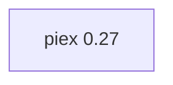

# PIE-X 0.27: BuildEngine integration

[TOC|Content]

## Purpose and provenance

**PIE-X (Preview Image Extractor)** is a Google C++ component for identifying RAW image formats and extracting embedded preview images and metadata without running a full sensor RAW-processing pipeline.

**BuildEngine coordinate:** `piex@0.27`  
**Upstream:** `https://github.com/google/piex.git`, tag `v0.27`  
**License:** Apache-2.0; installed `licenses/piex/LICENSE`  
**Status:** Registered in the Admin XML and adapter only. The BCC64X Debug/Release build, exports, installed consumer and Skia ABI have **not been verified**.

This package uses the public v0.27 tag. The former Skia-bundled Google Gitiles revision `bb217acdca1cc0c16b704669dd6f91a1b509c406` is a **different pinned source**; API and ABI compatibility must not be inferred merely from the PIE-X name.

## Dependency graph

The managed package currently has no declared external BuildEngine dependencies. Its bundled Google subtargets are compiled from seven PIE-X source files in one component DLL.



Skia integration is a separate consumer step, not an already-active dependency edge.

## Source and build settings

The upstream `piex.gyp` lists these compilation units:

```text
src/piex.cc
src/piex_cr3.cc
src/tiff_parser.cc
src/binary_parse/cached_paged_byte_array.cc
src/binary_parse/range_checked_byte_ptr.cc
src/image_type_recognition/image_type_recognition_lite.cc
src/tiff_directory/tiff_directory.cc
```

The BuildEngine-owned `admin/cmake/adapters/piex/CMakeLists.txt` is copied into the extracted source root and builds these sources with the managed BCC64X CMake/Ninja toolchain. It does not invoke GYP or any untracked system compiler.

```text
-G Ninja
-DCMAKE_TOOLCHAIN_FILE:FILEPATH={BuildFileDir}\cmake\toolchains\bcc64x-buildengine-cxx.cmake
-DCMAKE_MAKE_PROGRAM:FILEPATH={Tool:ninja}
-DCMAKE_INSTALL_PREFIX:PATH={InstallRoot}\packages\{LibraryId}\{LibraryVersion}
-DCMAKE_INSTALL_INCLUDEDIR:STRING=include
-DCMAKE_INSTALL_LIBDIR:STRING=lib/win64/{Configuration}
-DCMAKE_INSTALL_BINDIR:STRING=bin/win64/{Configuration}
-DCMAKE_BUILD_TYPE:STRING=Release|Debug
```

The adapter uses CMake's Windows auto-export for its initial DLL attempt. The generated ABI and import-library name require inspection before wiring it into any Skia shared component. The `piex` source includes C++ namespaces, so a plain C ABI is **not** assumed.

## Installation

The public and internal headers are installed with their original paths beneath `include/src` because the original sources refer to `src/piex.h` and related headers. Configuration-specific DLLs and import libraries are packaged separately. The Apache-2.0 license is installed into the package and referenced by BuildEngine metadata. The authoritative installed output is always the XML-defined production package root.

## Open verification gates

1. Validate the source archive extraction layout and BuildEngine XML against schema 17.
2. Run full BCC64X Debug and Release configure, build and install. Check the PIE-X binary symbols and direct consumers.
3. Verify the installed library import and runtime DLL closure with an independent PIE-X RAW-preview smoke (including CR3 and a failure-path case).
4. Compare the PIE-X v0.27 API and ABI to Skia 153's pinned `bb217acd...` revision. Adapt Skia's `third_party/piex/BUILD.gn` to use managed headers and imports only after compatibility is established.
5. Enable `skia_use_piex = true` only for a verified Skia consumer configuration, then check GN output, Debug/Release linker imports, RAW preview behavior and SBOM membership.
6. Only after a verified successful build remove the Skia-bundled PIE-X source closure from the relevant build. Do not add the same component to both bundled and external SBOM sections.

**No PASS has yet been reported for the newly registered PIE-X package.**

[Skia externalization](/manual/skia-externalization.md) · [Skia 153](/package/skia/153/migration) · [Libraries](/manual/libraries.md)
