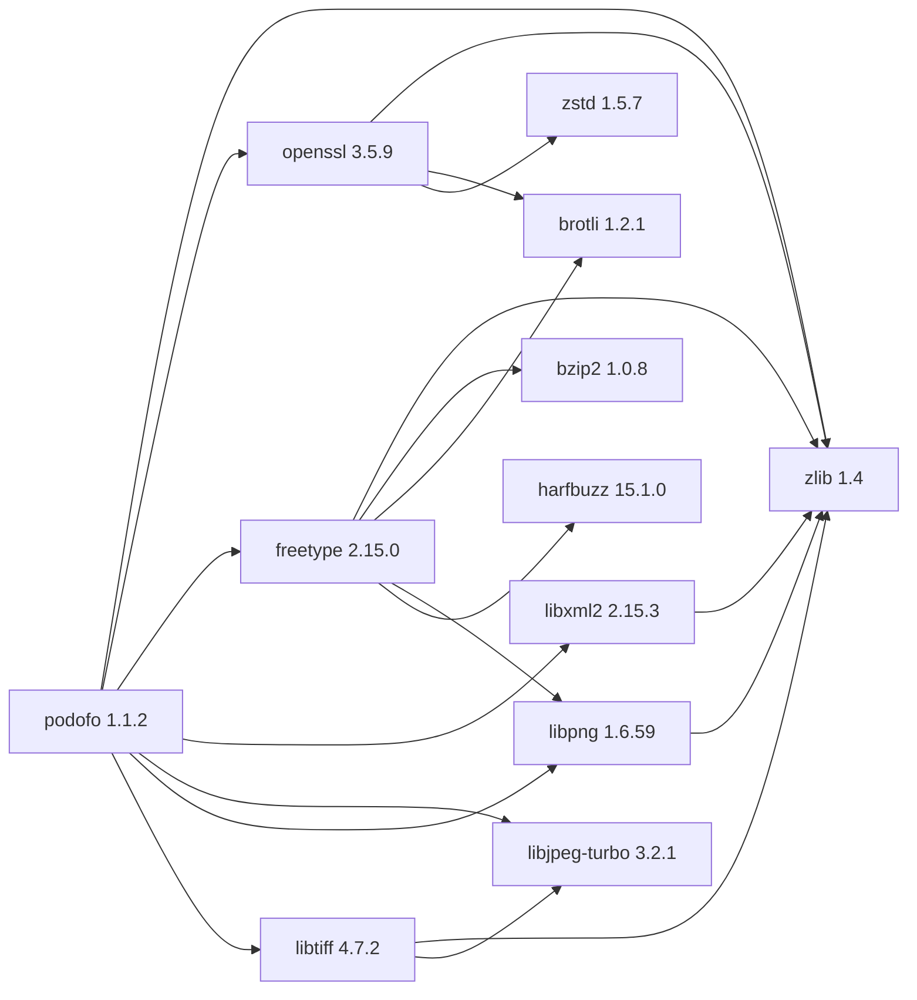

## Updated BuildEngine contract (10 November 2026)

**Declared configuration; no new test PASS.**

### Complete transitive dependencies

Direkt: `zlib@1.4`, `openssl@3.5.9`, `freetype@2.15.0`, `libxml2@2.15.3`, `libjpeg-turbo@3.2.1`, `libpng@1.6.59`, `libtiff@4.7.2`

### Current configuration

- `-DCMAKE_TOOLCHAIN_FILE:FILEPATH={BuildFileDir}\cmake\toolchains\bcc64x-buildengine-cxx.cmake`
- `-DCMAKE_MAKE_PROGRAM:FILEPATH={Tool:ninja}`
- `-DCMAKE_INSTALL_PREFIX:PATH={InstallRoot}\packages\{LibraryId}\{LibraryVersion}`
- `-DCMAKE_INSTALL_INCLUDEDIR:STRING=include`
- `-DCMAKE_CXX_FLAGS:STRING=-fborland-exec-code-page=65001`
- `-DPODOFO_BUILD_STATIC:BOOL=OFF`
- `-DPODOFO_BUILD_TEST:BOOL={TestsEnabled}`
- `-DPODOFO_BUILD_EXAMPLES:BOOL=OFF`
- `-DPODOFO_BUILD_UNSUPPORTED_TOOLS:BOOL=OFF`
- `-DPODOFO_WITH_AFDKO:BOOL=OFF`
- `-DPODOFO_WITH_FONTMANAGER:BOOL=ON`
- `-DPODOFO_WITH_WIN32GDI_FONT_SEARCH:BOOL=ON`
- `-DPODOFO_WITH_LCMS2:BOOL=OFF`
- `-DCMAKE_PREFIX_PATH:PATH={DependencyRoot:zlib};{DependencyRoot:openssl};{DependencyRoot:freetype};{DependencyRoot:libxml2};{DependencyRoot:libjpeg-turbo};{DependencyRoot:libpng};{DependencyRoot:libtiff}`
- `-DPDF_TEST_RESOURCE_PATH:PATH={BuildRoot}\packages\{LibraryId}\{LibraryVersion}\{Configuration}\test\resources`
- `-DPDF_TEST_OUTPUT_PATH:PATH={BuildRoot}\packages\{LibraryId}\{LibraryVersion}\{Configuration}\test\out`
- `-DCMAKE_BUILD_TYPE:STRING=Release`
- `-DLIBXML2_LIBRARY:FILEPATH={DependencyRoot:libxml2}\lib\win64\Release\libxml2.lib`
- `-DCMAKE_CXX_FLAGS_RELEASE:STRING=-O2 -DNDEBUG`
- `-DCMAKE_INSTALL_LIBDIR:STRING=lib/win64/Release`
- `-DCMAKE_INSTALL_BINDIR:STRING=bin/win64/Release`
- `-DCMAKE_BUILD_TYPE:STRING=Debug`
- `-DLIBXML2_LIBRARY:FILEPATH={DependencyRoot:libxml2}\lib\win64\Debug\libxml2d.lib`
- `-DCMAKE_CXX_FLAGS_DEBUG:STRING=-O0`
- `-DCMAKE_DEBUG_POSTFIX:STRING=d`
- `-DCMAKE_INSTALL_LIBDIR:STRING=lib/win64/Debug`
- `-DCMAKE_INSTALL_BINDIR:STRING=bin/win64/Debug`
- `-DPoDoFo_DIR:PATH={ConsumerRoot}\lib\win64\{Configuration}\cmake\podofo`

---

## Historical integration notes

# podofo 1.1.2 — BCC64X integration

Source pin `e91d8b727763724f3efd96c589c8033f4333c68c`. Patch chain has nine rebased BCC64X source patches. `TestUtils` interface differences and DLL-only XMP test helpers have been ported. The `extern/resources` submodule is pinned to `f3e6e289db3cb7fe0a1a21e65430f221fe598882` and FreeType 2.15.0 is a direct dependency.

The previous library version remains available and is marked `supersededBy` in the BuildEngine XML catalog. The new version has a full producer, installation, publication and consumer contract.

**Verification boundary:** Source and patch compatibility checks do not establish a successful build. Native Windows BCC64X Release/Debug builds, upstream tests, installed consumer smoke, SBOM and Doxygen are **[not verified]** until the complete target-machine FSM has run.
