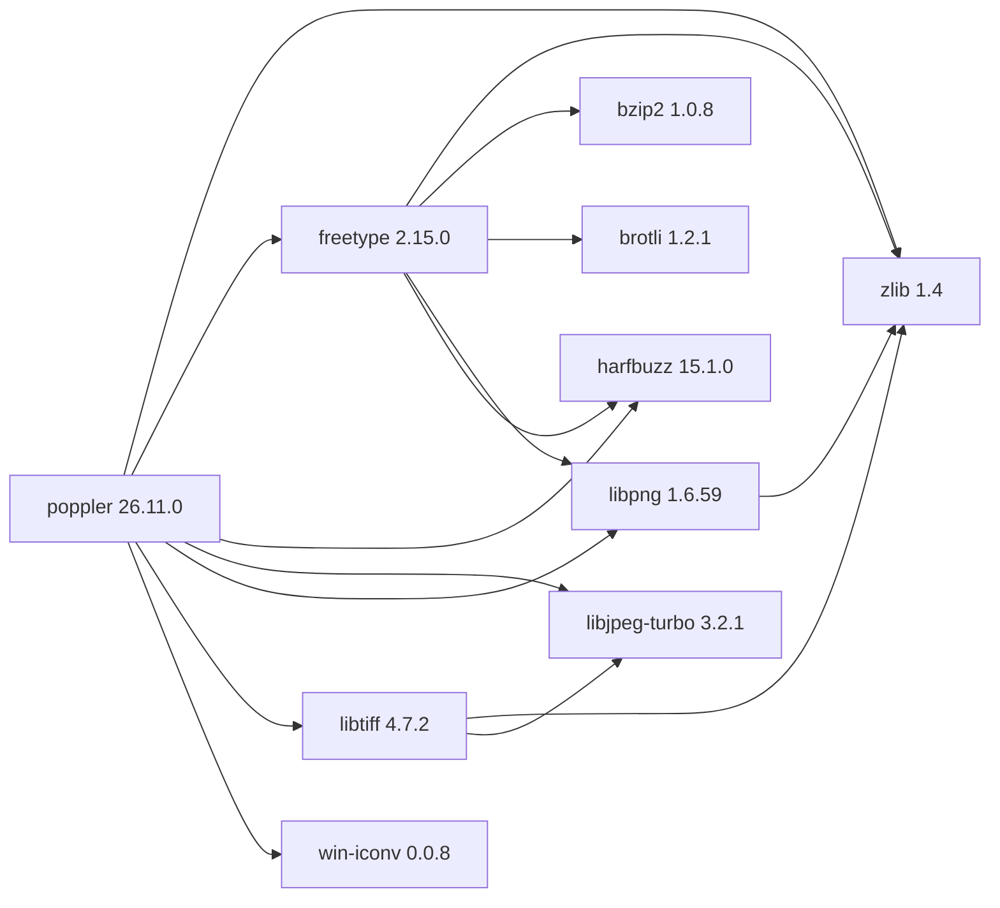

# Poppler 26.11.0

[TOC|Content]

## Aufgabe und Integration

PDF rendering and parsing library derived from Xpdf and used by document-processing toolchains.

**Stand:** BuildEngine-XML-Vertrag vom 10. November 2026; native Builds und Smoke-Ergebnisse **[nicht verifiziert]**.

## Abhängigkeiten einschließlich transitiver Stufen

**Direkte Abhängigkeiten:** `zlib@1.4`, `freetype@2.15.0`, `harfbuzz@15.1.0`, `libjpeg-turbo@3.2.1`, `libpng@1.6.59`, `libtiff@4.7.2`, `win-iconv@0.0.8`

## Konfiguration

### CMake

- `-DCMAKE_TOOLCHAIN_FILE:FILEPATH={BuildFileDir}\cmake\toolchains\bcc64x-buildengine-cxx.cmake`
- `-DCMAKE_MAKE_PROGRAM:FILEPATH={Tool:ninja}`
- `-DCMAKE_INSTALL_PREFIX:PATH={BuildRoot}\stage\packages\{LibraryId}\{LibraryVersion}\{Configuration}`
- `-DCMAKE_INSTALL_INCLUDEDIR:STRING=include`
- `-DCMAKE_INSTALL_LIBDIR:STRING=lib`
- `-DCMAKE_INSTALL_BINDIR:STRING=bin`
- `-DBUILDENGINE_HARFBUZZ_CONFIG_DIR:PATH={DependencyRoot:harfbuzz}\lib\win64\{Configuration}\cmake\harfbuzz`
- `-DBUILDENGINE_HARFBUZZ_INCLUDE_DIR:PATH={DependencyRoot:harfbuzz}\include`
- `-DBUILD_SHARED_LIBS:BOOL=ON`
- `-DCMAKE_CXX_SCAN_FOR_MODULES:BOOL=OFF`
- `-DFONT_CONFIGURATION:STRING=win32`
- `-DENABLE_CPP:BOOL=ON`
- `-DENABLE_UNSTABLE_API_ABI_HEADERS:BOOL=ON`
- `-DENABLE_UTILS:BOOL=OFF`
- `-DENABLE_GLIB:BOOL=OFF`
- `-DENABLE_QT5:BOOL=OFF`
- `-DENABLE_QT6:BOOL=OFF`
- `-DENABLE_BOOST:BOOL=OFF`
- `-DENABLE_BROTLI:BOOL=OFF`
- `-DENABLE_LIBOPENJPEG:BOOL=OFF`
- `-DENABLE_LCMS:BOOL=OFF`
- `-DENABLE_LIBCURL:BOOL=OFF`
- `-DENABLE_NSS3:BOOL=OFF`
- `-DENABLE_GPGME:BOOL=OFF`
- `-DENABLE_LIBJPEG:BOOL=ON`
- `-DENABLE_LIBTIFF:BOOL=ON`
- `-DBUILD_GTK_TESTS:BOOL=OFF`
- `-DBUILD_QT5_TESTS:BOOL=OFF`
- `-DBUILD_QT6_TESTS:BOOL=OFF`
- `-DBUILD_CPP_TESTS:BOOL=OFF`
- `-DBUILD_MANUAL_TESTS:BOOL=OFF`
- `-DRUN_GPERF_IF_PRESENT:BOOL=OFF`
- `-DENABLE_RELOCATABLE:BOOL=ON`
- `-DCMAKE_BUILD_TYPE:STRING=Release`
- `-DIconv_INCLUDE_DIR:PATH={DependencyRoot:win-iconv}\include`
- `-DIconv_LIBRARY:FILEPATH={DependencyRoot:win-iconv}\lib\win64\Release\libiconv.lib`
- `-DCMAKE_C_FLAGS_RELEASE:STRING=-O2 -DNDEBUG`
- `-DCMAKE_CXX_FLAGS_RELEASE:STRING=-O2 -DNDEBUG`
- `-DCMAKE_BUILD_TYPE:STRING=Debug`
- `-DIconv_INCLUDE_DIR:PATH={DependencyRoot:win-iconv}\include`
- `-DIconv_LIBRARY:FILEPATH={DependencyRoot:win-iconv}\lib\win64\Debug\libiconv.lib`
- `-DCMAKE_C_FLAGS_DEBUG:STRING=-O0`
- `-DCMAKE_CXX_FLAGS_DEBUG:STRING=-O0`

### Build-Umgebung

- `CB_BCC64X={Tool:bcc64x}`
- `CB_BDS={BDS}`
- `CB_LLVM_AR={Tool:llvm-ar}`
- `CB_LLVM_RANLIB={Tool:llvm-ranlib}`
- `CXXFLAGS=-D_AMD64_ -DNOMINMAX`

### Quellen

- `https://poppler.freedesktop.org/poppler-{LibraryVersion}.tar.xz`

### Consumer-Smoke

Nicht deklariert.

## Besonderheiten

Versionierte Quell- und Build-Aktionen sowie eventuell erforderliche BCC64X-Patches sind im ausführbaren `admin/build-libraries.xml` dokumentiert. Eingetragene Fixes sind ohne FSM-Nachweis kein Test-PASS.

[Bibliotheksübersicht](/manual/libraries.md)
