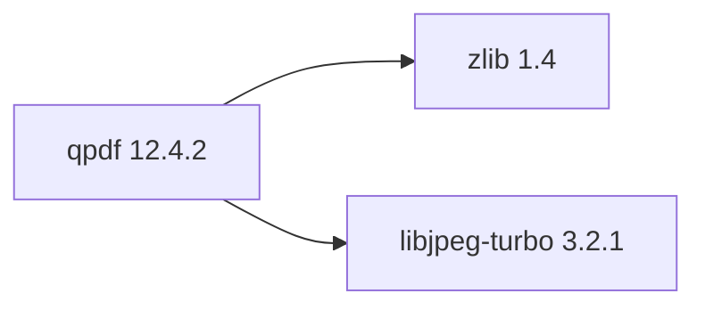

## Aktualisierter BuildEngine-Vertrag (10. November 2026)

**Deklarierte Konfiguration, nicht neuer Test-PASS.**

### Vollständige transitive Abhängigkeiten

Direkt: `zlib@1.4`, `libjpeg-turbo@3.2.1`

### Aktuelle Konfiguration

- `-DCMAKE_TOOLCHAIN_FILE:FILEPATH={BuildFileDir}\cmake\toolchains\bcc64x-buildengine-cxx.cmake`
- `-DCMAKE_MAKE_PROGRAM:FILEPATH={Tool:ninja}`
- `-DCMAKE_INSTALL_PREFIX:PATH={InstallRoot}\packages\{LibraryId}\{LibraryVersion}`
- `-DCMAKE_INSTALL_INCLUDEDIR:STRING=include`
- `-DBUILD_SHARED_LIBS:BOOL=ON`
- `-DBUILD_STATIC_LIBS:BOOL=OFF`
- `-DBUILD_DOC:BOOL=OFF`
- `-DINSTALL_MANUAL:BOOL=OFF`
- `-DINSTALL_EXAMPLES:BOOL=OFF`
- `-DINSTALL_PKGCONFIG:BOOL=ON`
- `-DINSTALL_CMAKE_PACKAGE:BOOL=ON`
- `-DMAINTAINER_MODE:BOOL=OFF`
- `-DCI_MODE:BOOL=OFF`
- `-DWERROR:BOOL=OFF`
- `-DGENERATE_AUTO_JOB:BOOL=OFF`
- `-DENABLE_QTC:BOOL=OFF`
- `-DREQUIRE_SHELLS:BOOL=OFF`
- `-DUSE_IMPLICIT_CRYPTO:BOOL=OFF`
- `-DREQUIRE_CRYPTO_OPENSSL:BOOL=OFF`
- `-DREQUIRE_CRYPTO_GNUTLS:BOOL=OFF`
- `-DREQUIRE_CRYPTO_NATIVE:BOOL=ON`
- `-DUSE_INSECURE_RANDOM:BOOL=OFF`
- `-DSKIP_OS_SECURE_RANDOM:BOOL=OFF`
- `-DCMAKE_PREFIX_PATH:PATH={DependencyRoot:zlib};{DependencyRoot:libjpeg-turbo}`
- `-DCMAKE_BUILD_TYPE:STRING=Release`
- `-DZLIB_H_PATH:PATH={DependencyRoot:zlib}\include`
- `-DZLIB_LIB_PATH:FILEPATH={DependencyRoot:zlib}\lib\win64\Release\libz.lib`
- `-DLIBJPEG_H_PATH:PATH={DependencyRoot:libjpeg-turbo}\include`
- `-DLIBJPEG_LIB_PATH:FILEPATH={DependencyRoot:libjpeg-turbo}\lib\win64\Release\libjpeg.lib`
- `-DCMAKE_C_FLAGS_RELEASE:STRING=-O2 -DNDEBUG`
- `-DCMAKE_CXX_FLAGS_RELEASE:STRING=-O2 -DNDEBUG`
- `-DCMAKE_INSTALL_LIBDIR:STRING=lib/win64/Release`
- `-DCMAKE_INSTALL_BINDIR:STRING=bin/win64/Release`
- `-DCMAKE_BUILD_TYPE:STRING=Debug`
- `-DZLIB_H_PATH:PATH={DependencyRoot:zlib}\include`
- `-DZLIB_LIB_PATH:FILEPATH={DependencyRoot:zlib}\lib\win64\Debug\libzd.lib`
- `-DLIBJPEG_H_PATH:PATH={DependencyRoot:libjpeg-turbo}\include`
- `-DLIBJPEG_LIB_PATH:FILEPATH={DependencyRoot:libjpeg-turbo}\lib\win64\Debug\libjpegd.lib`
- `-DCMAKE_C_FLAGS_DEBUG:STRING=-O0`
- `-DCMAKE_CXX_FLAGS_DEBUG:STRING=-O0`
- `-DCMAKE_DEBUG_POSTFIX:STRING=d`
- `-DCMAKE_INSTALL_LIBDIR:STRING=lib/win64/Debug`
- `-DCMAKE_INSTALL_BINDIR:STRING=bin/win64/Debug`
- `-Dqpdf_DIR:PATH={ConsumerRoot}\lib\win64\{Configuration}\cmake\qpdf`

---

## Historische Integrationsnotizen

# QPDF 12.4.2

[TOC|Content]

## Aufgabe und Integration

PDF structural transformation library and command-line toolkit for inspecting, rewriting, encrypting and validating PDF files.

**Stand:** BuildEngine-XML-Vertrag vom 10. November 2026; native Builds und Smoke-Ergebnisse **[nicht verifiziert]**.

## Abhängigkeiten einschließlich transitiver Stufen

**Direkte Abhängigkeiten:** `zlib@1.4`, `libjpeg-turbo@3.2.1`

## Konfiguration

### CMake

- `-DCMAKE_TOOLCHAIN_FILE:FILEPATH={BuildFileDir}\cmake\toolchains\bcc64x-buildengine-cxx.cmake`
- `-DCMAKE_MAKE_PROGRAM:FILEPATH={Tool:ninja}`
- `-DCMAKE_INSTALL_PREFIX:PATH={InstallRoot}\packages\{LibraryId}\{LibraryVersion}`
- `-DCMAKE_INSTALL_INCLUDEDIR:STRING=include`
- `-DBUILD_SHARED_LIBS:BOOL=ON`
- `-DBUILD_STATIC_LIBS:BOOL=OFF`
- `-DBUILD_DOC:BOOL=OFF`
- `-DINSTALL_MANUAL:BOOL=OFF`
- `-DINSTALL_EXAMPLES:BOOL=OFF`
- `-DINSTALL_PKGCONFIG:BOOL=ON`
- `-DINSTALL_CMAKE_PACKAGE:BOOL=ON`
- `-DMAINTAINER_MODE:BOOL=OFF`
- `-DCI_MODE:BOOL=OFF`
- `-DWERROR:BOOL=OFF`
- `-DGENERATE_AUTO_JOB:BOOL=OFF`
- `-DENABLE_QTC:BOOL=OFF`
- `-DREQUIRE_SHELLS:BOOL=OFF`
- `-DUSE_IMPLICIT_CRYPTO:BOOL=OFF`
- `-DREQUIRE_CRYPTO_OPENSSL:BOOL=OFF`
- `-DREQUIRE_CRYPTO_GNUTLS:BOOL=OFF`
- `-DREQUIRE_CRYPTO_NATIVE:BOOL=ON`
- `-DUSE_INSECURE_RANDOM:BOOL=OFF`
- `-DSKIP_OS_SECURE_RANDOM:BOOL=OFF`
- `-DCMAKE_PREFIX_PATH:PATH={DependencyRoot:zlib};{DependencyRoot:libjpeg-turbo}`
- `-DCMAKE_BUILD_TYPE:STRING=Release`
- `-DZLIB_H_PATH:PATH={DependencyRoot:zlib}\include`
- `-DZLIB_LIB_PATH:FILEPATH={DependencyRoot:zlib}\lib\win64\Release\libz.lib`
- `-DLIBJPEG_H_PATH:PATH={DependencyRoot:libjpeg-turbo}\include`
- `-DLIBJPEG_LIB_PATH:FILEPATH={DependencyRoot:libjpeg-turbo}\lib\win64\Release\libjpeg.lib`
- `-DCMAKE_C_FLAGS_RELEASE:STRING=-O2 -DNDEBUG`
- `-DCMAKE_CXX_FLAGS_RELEASE:STRING=-O2 -DNDEBUG`
- `-DCMAKE_INSTALL_LIBDIR:STRING=lib/win64/Release`
- `-DCMAKE_INSTALL_BINDIR:STRING=bin/win64/Release`
- `-DCMAKE_BUILD_TYPE:STRING=Debug`
- `-DZLIB_H_PATH:PATH={DependencyRoot:zlib}\include`
- `-DZLIB_LIB_PATH:FILEPATH={DependencyRoot:zlib}\lib\win64\Debug\libzd.lib`
- `-DLIBJPEG_H_PATH:PATH={DependencyRoot:libjpeg-turbo}\include`
- `-DLIBJPEG_LIB_PATH:FILEPATH={DependencyRoot:libjpeg-turbo}\lib\win64\Debug\libjpegd.lib`
- `-DCMAKE_C_FLAGS_DEBUG:STRING=-O0`
- `-DCMAKE_CXX_FLAGS_DEBUG:STRING=-O0`
- `-DCMAKE_DEBUG_POSTFIX:STRING=d`
- `-DCMAKE_INSTALL_LIBDIR:STRING=lib/win64/Debug`
- `-DCMAKE_INSTALL_BINDIR:STRING=bin/win64/Debug`
- `-Dqpdf_DIR:PATH={ConsumerRoot}\lib\win64\{Configuration}\cmake\qpdf`

### Build-Umgebung

- `CB_BCC64X={Tool:bcc64x}`
- `CB_BDS={BDS}`
- `CB_LLVM_AR={Tool:llvm-ar}`
- `CB_LLVM_RANLIB={Tool:llvm-ranlib}`
- `QPDF_BCC64X=1`
- `QPDF_PERL={Tool:perl}`
- `CTEST_PARALLEL_LEVEL={TestJobs}`
- `QPDF_NATIVE_WINDOWS_PERL=1`
- `PATH={BuildRoot}\packages\{LibraryId}\{LibraryVersion}\{Configuration}\libqpdf;{BuildRoot}\packages\{LibraryId}\{LibraryVersion}\{Configuration}\qpdf;{BuildRoot}\packages\{LibraryId}\{LibraryVersion}\{Configuration}\compare-for-test;{BuildRoot}\packages\{LibraryId}\{LibraryVersion}\{Configuration}\zlib-flate;{ToolDir:perl};{ToolDir:bash};{ToolDir:bash}\..\usr\bin;{ENV:PATH}`
- `PATH={BuildRoot}\packages\{LibraryId}\{LibraryVersion}\{Configuration}\libqpdf;{ENV:PATH}`
- `PATH={BuildRoot}\packages\{LibraryId}\{LibraryVersion}\{Configuration}\libqpdf;{ENV:PATH}`
- `PATH={BuildRoot}\packages\{LibraryId}\{LibraryVersion}\{Configuration}\libqpdf;{ENV:PATH}`
- `CB_BCC64X={Tool:bcc64x}`
- `CB_BDS={BDS}`
- `PATH={ConsumerRoot}\bin;{DependencyRoot:libjpeg-turbo}\bin\win64\{Configuration};{DependencyRoot:zlib}\bin\win64\{Configuration};{ENV:PATH}`

### Quellen

- `https://github.com/qpdf/qpdf/archive/refs/tags/v{LibraryVersion}.tar.gz`

### Consumer-Smoke

- `consumer / Release / package`

## Besonderheiten

Versionierte Quell- und Build-Aktionen sowie eventuell erforderliche BCC64X-Patches sind im ausführbaren `admin/build-libraries.xml` dokumentiert. Eingetragene Fixes sind ohne FSM-Nachweis kein Test-PASS.

[Bibliotheksübersicht](/manual/libraries.md)
