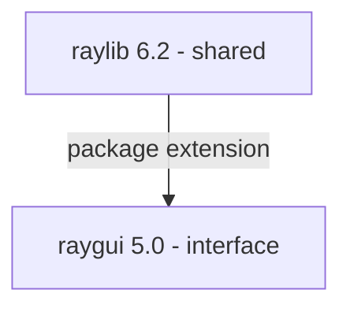

# raygui 5.0 — BCC64X Integration and Migration

## Purpose

Immediate-mode C GUI widgets built on raylib.

## Package contract

| Property | Value |
| --- | --- |
| Coordinate | `raygui@5.0` |
| Artifact type | **Header-only / Interface** |
| Language | C, usable by C++Builder C++23 |
| License | Zlib |
| Upstream | [Project repository](https://github.com/raysan5/raygui) |
| Native validation | **Not verified** |

## Dependency and extension decisions

Package extension of raylib@6.2; installs raygui.h without creating a DLL or .lib. Consumer compiles RAYGUI_IMPLEMENTATION in exactly one translation unit and links with raylib. The BCC64X smoke has not run.

The normative XML extension is `&lt;extension type="package" library="raylib" version="6.2"/&gt;`.

## BCC64X policy

All native C/C++ code must be consumed by the BCC64X Clang toolchain, not an MSVC or MinGW binary. Interface libraries install headers without DLL/ILIB checks. Shared libraries require matching Debug and Release DLL/import-library artifacts, complete exported API coverage, license/SBOM and a linked consumer smoke.

## Smoke-test contract

The repository includes `admin/smokes/raygui/consumer`, where a C++23 consumer verifies a real library operation. A committed test definition is not evidence of a successful test. Rendering, SDL2/OpenGL or VCL integration remain separate functional demonstration gates.

## Status and follow-up

**Not verified:** source acquisition, native BCC64X build, installation, linked smoke, runtime graphics backend and package distribution. No successful build, installed artifact or package export is asserted.
