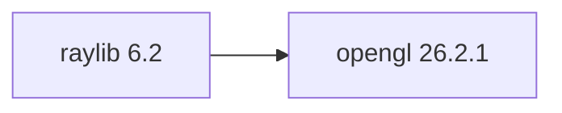

## Aktualisierter BuildEngine-Vertrag (10. November 2026)

**Deklarierte Konfiguration, nicht neuer Test-PASS.**

### Vollständige transitive Abhängigkeiten

Direkt: `opengl@26.2.1`

### Aktuelle Konfiguration

- `-DRAYLIB_SOURCE_DIR:PATH={Workspace}`
- `-DBCC64X_EXECUTABLE:FILEPATH={Tool:bcc64x}`
- `-DOPENGL_LIBRARY:FILEPATH={DependencyRoot:opengl}\lib\win64\{Configuration}\opengl32.lib`
- `-DCMAKE_INSTALL_PREFIX:PATH={BuildRoot}\stage\packages\{LibraryId}\{LibraryVersion}\{Configuration}`
- `-DCMAKE_INSTALL_LIBDIR:STRING=lib\win64\{Configuration}`
- `-DCMAKE_INSTALL_BINDIR:STRING=bin\win64\{Configuration}`
- `-DCMAKE_BUILD_TYPE:STRING=Release`
- `-DCMAKE_BUILD_TYPE:STRING=Debug`

---

## Historische Integrationsnotizen

# raylib 6.2

[TOC|Content]

## Aktueller BuildEngine-Vertrag (10. November 2026)

**Vertragsdaten, keine bestätigte Build-Ausführung.** Ergebnisse aus früheren Tests sind versions- und buildgebunden; neue Ausführungen bleiben **[nicht verifiziert]**.

Simple cross-platform C library for graphics, audio, input, and game and application development.

**Koordinate:** `raylib@6.2` · **Kategorie:** `graphics` · **Lizenzampel:** `green`

### Deklarierte Abhängigkeiten (vollständig transitiv)

Die Diagrammkanten stammen aus den exakt gepinnten XML-Abhängigkeiten. Gestrichelte Kanten kennzeichnen Erweiterungen, durchgezogene Kanten Paketabhängigkeiten. Upstream-intern gebündelte Komponenten sind keine zusätzlichen BuildEngine-Koordinaten.

**Direkte Abhängigkeiten:** `opengl@26.2.1`

### Konfiguration und Besonderheiten

**CMake-Argumente:**

- `-DRAYLIB_SOURCE_DIR:PATH={Workspace}`
- `-DBCC64X_EXECUTABLE:FILEPATH={Tool:bcc64x}`
- `-DOPENGL_LIBRARY:FILEPATH={DependencyRoot:opengl}\lib\win64\{Configuration}\opengl32.lib`
- `-DCMAKE_INSTALL_PREFIX:PATH={BuildRoot}\stage\packages\{LibraryId}\{LibraryVersion}\{Configuration}`
- `-DCMAKE_INSTALL_LIBDIR:STRING=lib\win64\{Configuration}`
- `-DCMAKE_INSTALL_BINDIR:STRING=bin\win64\{Configuration}`
- `-DCMAKE_BUILD_TYPE:STRING=Release`
- `-DCMAKE_BUILD_TYPE:STRING=Debug`

**Versionsgebundene Patches:**

- `{Workspace}\.buildengine\patches\{LibraryVersion}\bcc64x-c-bool.patch`
- `{BuildFileDir}\patches\raylib\6.2\bcc64x-c-bool.patch`

**Source-Downloads:**

- `https://github.com/raysan5/raylib/archive/02566453880e06bec97f5b8160fa6fe1e98397ca.zip`

**Deklarierte Smoke-Tests:**

- `consumer` / `Release` / `published` / `smokes\raylib\consumer`

**Explizit geforderte Installationsartefakte:**

- `{InstallRoot}\packages\{LibraryId}\{LibraryVersion}\bin\win64\{Configuration}\{BaseName}.dll`
- `{InstallRoot}\packages\{LibraryId}\{LibraryVersion}\lib\win64\{Configuration}\{BaseName}.lib`

**Verbindliche Quellen:** `admin/build-libraries.xml` für Konfiguration und Pins; FSM/Buildlogs für tatsächliche Ausführung. [Bibliotheksverzeichnis](/manual/libraries.md).
